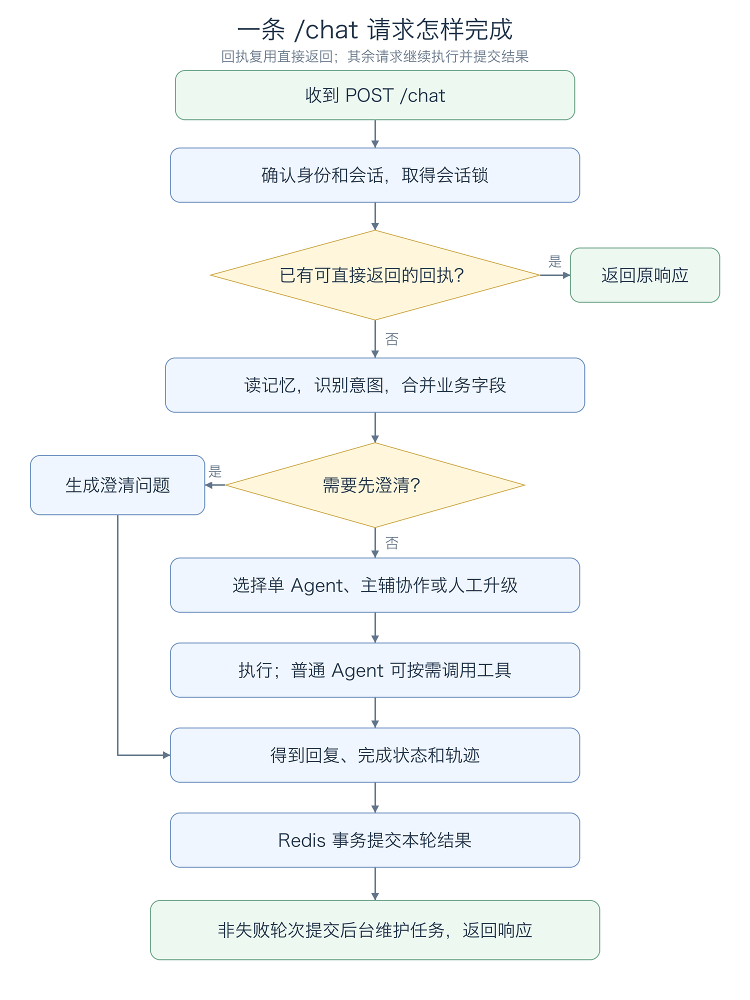
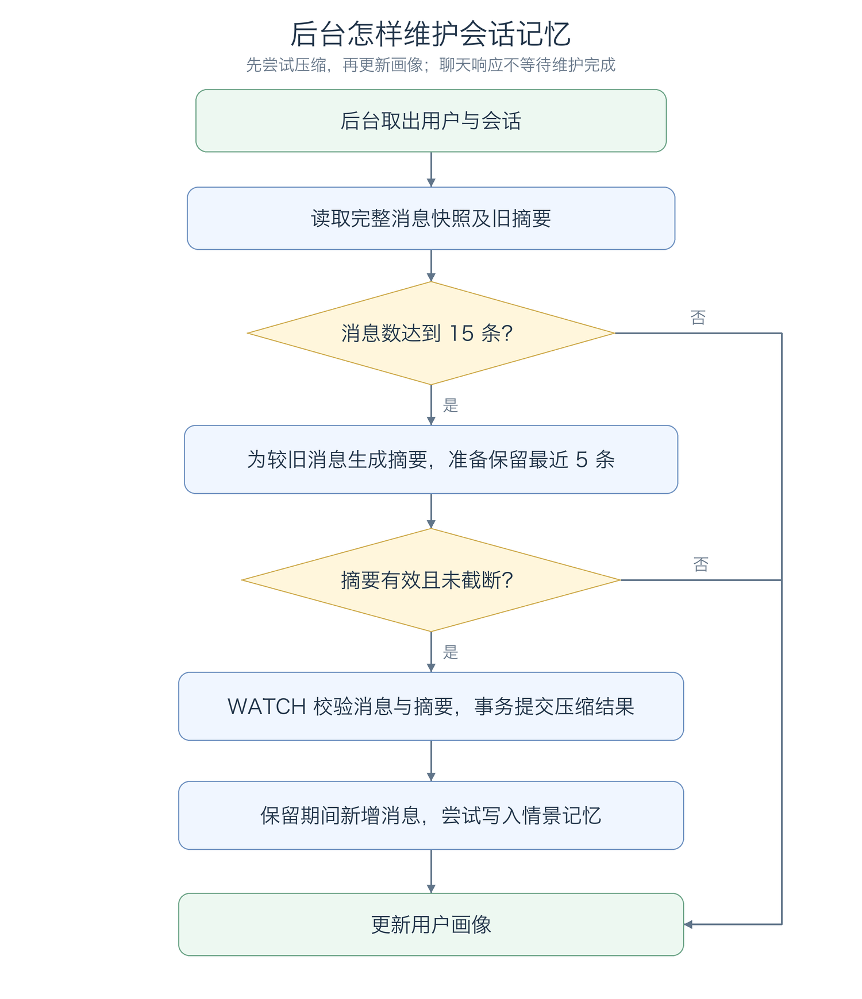

# EchoMind 业务流程说明

> trace 合并版说明：本页保留附件的讲解与示例；当前主链增加 Context Planner、记忆演化、经验记忆、混合检索和 OTel。运行流程、接口变化与迁移以 [合并版本使用指南](合并版本使用指南.md) 为准；文中的历史测试结果不是本次验收。

本文按当前 Python 代码说明一条客服消息怎样处理，以及知识维护、监控和评测怎样运行。

流程图使用 PNG 图片，普通 Markdown 预览器即可显示。移动或分享文档时，请保留相邻的 `assets/flows/` 图片目录。

全文用下面这条退款咨询作例子：

> 订单号 #12345，昨天支付99元，想问退款多久到账？

接下来跟着它看：后端收到什么，怎样认出退款诉求，为什么交给账单客服，工具检查出什么，回复怎样保存。遇到“回执”“事务”“熔断”等术语时，会结合这条流程说明它们的作用。

例子中的意图分数、模型选择和回复是为了讲清代码而设定的条件，不是一次线上调用的实测结果。函数顺序、字段和分支规则以代码为准。

主要入口是 HTTP `POST /chat`。文中涉及的会话锁、请求回执和整轮提交都以这个入口为准，CLI 与评测的区别放在后面。启动与配置方法见 [README](../README.md)，逐步阅读源码可以参考 [教程目录](教程/README.md)。

可以按需要阅读：

- 跟完一条正常消息：[总流程](#flow-overview) → [请求与重试](#request-entry) → [背景、意图和字段](#context-intent) → [角色选择](#routing) → [模型与工具](#agent-tools) → [响应和保存](#response-commit)。
- 看数据后续怎样维护：[后台记忆](#memory-maintenance)、[知识库更新](#knowledge-maintenance)。
- 排查效果或运行问题：[监控与恢复](#monitor-recovery)、[评测与 CLI](#evaluation-cli)、[实际检查步骤](#verification)、[参数速查](#limits)。


<a id="flow-overview"></a>

## 1. 先看一轮对话的顺序

先假设这是一位新用户在新会话中发来的退款咨询。服务取出已有背景，判断这句话主要想解决什么问题，选择账单 Agent。账单 Agent 拿到订单号、金额和日期后，可以检查还缺哪些资料，再决定是否查退款政策。

Agent 在这里指一个有特定职责、提示词和工具集合的处理角色。例如 Billing 负责账单问题，Technical 负责故障排查。它们在同一个 Python 应用中运行，编排器负责决定这一轮由谁处理。

正常走完一轮后，回复和会话记录一起保存。用户下一次追问时，后端就能继续使用这次收集到的信息。



[查看这张图的可编辑源文件](assets/flows/chat-flow-current.mmd)

事务同时保存回执和可用轨迹，非失败轮次还保存消息与业务状态。图中的回执检查会处理消息冲突和可重试失败，具体规则见下一节。未捕获异常、超时或失锁可能提前中断流程，不一定执行到提交步骤。

RAG 在 Agent 执行期间通过工具触发。主流程没有按意图预先检索知识库，也不会每轮聊天都自动运行评测。

### 服务启动时，先准备好哪些东西

`api/main.py` 的 `lifespan()` 在接收聊天之前初始化各模块。可以把这个阶段理解为先准备客服的角色、资料、工具和记录方式。

| 启动时创建的对象 | 负责的事情 | 与一轮聊天的关系 |
| --- | --- | --- |
| `SkillManager` | 从文件读取客服处理规范 | Agent 构造提示词时挑选匹配的规则 |
| `AgentOrchestrator` | 创建角色、识别器和回复汇总器 | 识别诉求、路由、执行和合并回复 |
| `MemoryManager` | 准备 Redis、历史摘要和画像存储 | 读旧信息，保存新对话 |
| `KnowledgeBase`、`MCPToolManager` | 准备知识库和工具管理 | 模型选择工具后，由程序执行 |
| `StandardMCPClient` | 连接配置中的外部工具服务 | 把获准的外部工具提供给相应角色 |
| `PerformanceMonitor` | 启动周期采样 | 发现 Agent 和工具的运行问题 |
| 评测对象、后台维护 worker | 准备评测和记忆维护 | 按需评测，异步压缩和更新画像 |

这些对象会被多轮请求复用，不是每发一句话都重新创建。工具调用记录等属于单次请求的数据另行保存，避免两个用户同时聊天时互相串数据。

`/health` 只检查应用是否已完成相关初始化，不会每次实际请求模型、Redis 和知识库。因此，健康接口正常之后，还应通过一次聊天确认模型配置可用。

### 这条退款消息会经过哪些函数

下面是主流程中几个重要的接力点。表里的“交出去”表示函数返回值或组装出的对象。

| 顺序 | 当前函数 | 接到什么 | 做完后交出去什么 |
| --- | --- | --- | --- |
| 1 | `chat()` | `ChatRequest`，即 HTTP 请求中的字段 | 当前用户、会话和客户端请求 ID |
| 2 | `get_turn_receipt()` | 用户、会话、客户端 ID | 已有回执，或没有回执 |
| 3 | `get_context()` | 用户、会话、当前消息 | `MemoryContext`，包含历史、摘要、画像和业务状态 |
| 4 | `recognize_intent()` | 当前消息和最近历史 | `IntentResult`，包含意图、分数、紧急度和实体 |
| 5 | `run()`、`merge_state()` | 组装好的内部 `Request` | 合并后的字段，以及本轮执行结果 |
| 6 | `_route_decision()`、`_execute()` | 诉求、实体与运行状态 | 角色选择、Agent 回复和工具明细 |
| 7 | `commit_turn()` | 用户消息、响应、业务状态、轨迹 | Redis 中一整轮记录和响应回执 |
| 8 | `ProfileUpdater.submit()` | 用户和会话 | 待后台处理的记忆维护任务 |

API 已经识别过意图时，会把结果填进内部 `Request`。`run()` 看到 `intent` 已有值，就不会再识别一次。CLI 和对话评测可以直接交给 `run()`，由它补做识别。

代码：[api/main.py](../api/main.py) 的 `lifespan()`、`chat()`；[agent_orchestrator.py](../agents/agent_orchestrator.py) 的 `run()`。

<a id="request-entry"></a>

## 2. 请求进入后，先确认“谁、哪段会话、哪条消息”

客户端可以这样提交一条消息：

```json
{
  "message": "订单号 #12345，昨天支付99元，想问退款多久到账？",
  "user_id": "reader_01",
  "conv_id": "demo-refund",
  "client_request_id": "msg-001"
}
```

`message` 长度为 1～12000 字符。`user_id` 默认是 `anonymous`；开启 Token 鉴权后，以 Token 对应用户为准，请求体中的 `user_id` 会被覆盖。开启后，缺少有效身份返回 `401`，普通用户访问管理接口返回 `403`。`production` 模式要求配置有效的访问 Token。

有三个编号需要分清：

| 字段 | 谁提供 | 用来做什么 |
| --- | --- | --- |
| `conv_id` | 客户端提供，或服务端生成 | 标识会话；后续追问沿用同一个值 |
| `client_request_id` | 客户端提供，缺省时服务端生成 | 标识一条逻辑消息；重试保留，新消息更换 |
| `request_id` | 编排请求创建时生成 | 标识一次执行，可查询工具轨迹 |

未传 `conv_id` 时，服务根据用户和客户端请求 ID 生成确定性的 UUID；未传客户端 ID 时先生成随机 ID。因此，调用方要可靠重试，应主动传入 `client_request_id`，并在后续对话中保存返回的 `conv_id`。

例如，本文第一轮使用 `demo-refund / msg-001`：

| 用户接下来的动作 | `conv_id` | `client_request_id` |
| --- | --- | --- |
| 网络断了，重发原来的退款问题 | 仍是 `demo-refund` | 仍是 `msg-001` |
| 继续问“退款是原路退回吗” | 仍是 `demo-refund` | 改为 `msg-002` |
| 开始一段独立的新对话 | 换一个会话 ID | 使用新的消息 ID |

服务端 `request_id` 在下文用 `R1`、`R2` 简写，实际通常是 UUID。拿 `R1` 查的是某次执行过程；拿 `msg-001` 重试的是同一条用户消息，二者不能互换。

### 同一会话的消息怎样排队

从读上下文到提交结果，整轮请求都持有会话锁。同一进程按会话排队，跨进程使用可续租的 Redis 锁；不同会话可以同时处理。Redis 锁等待超时或租约失效会中止请求，返回 `503`。

为什么需要这把锁？假设用户很快连续发送两条消息：

```text
A：订单号 #12345，昨天支付99元，想问退款多久到账？
B：退款是原路退回吗？
```

如果 A 还没有写入记录，B 就开始读历史，B 看见的可能还是空会话。现在 B 要先等待 A 完成本轮处理，成功提交后再读取上下文，才能接着已有信息回答。A 失败时，B 看到的则是提交前的正常历史。

这里的锁是程序中的“独占处理资格”，不是用户界面上的锁定状态。进程内锁负责本进程排队，Redis 锁让多个应用进程也遵守同一会话顺序。Redis 锁默认等待最多 30 秒，租约 120 秒，每 40 秒尝试续租；租约是失去持有者后自动释放锁的时间，不是聊天允许运行的时长。

HTTP 聊天的总预算为 50 秒，包括等待会话锁、读记忆、模型和工具执行、提交结果。超过预算返回 `504`。不同会话各有自己的锁，因此一个用户的长请求不会要求其他会话也排队。

### 怎样判断是不是重试

取得锁后，先按用户、会话和 `client_request_id` 查询回执，回执保留 24 小时：

- 已有回执但消息内容不同，返回 `409`，要求更换客户端请求 ID。
- 上次是 `success`、`partial`，或是不可重试的 `failed`，直接返回原响应。
- 上次是 `failed` 且 `retryable=true`，允许重新处理这一条消息。
- 没有回执，继续读取上下文。

回执就是后端留存的一份“这条消息当时怎样回答”的记录，其中保存原消息和响应。比如回复已经生成并提交，但返回途中网络断了，客户端再次发送 `msg-001`，服务就可以取回这份记录。

直接返回回执时，不会再次调用模型、追加消息或提交后台更新任务。这项去重仅在对应用户、会话及回执有效期内生效。若把旧问题当成新消息换了 ID，程序会按新请求处理；所以去重需要客户端配合保留 ID。

可重试失败的例子是模型暂时不可用：第一次留下 `failed / retryable=true` 的回执，恢复后原消息、原 ID 可以重新执行。第一次失败不会写入正常对话历史，恢复成功后才保存这一轮。

代码：[core/access.py](../core/access.py)、[core/concurrency.py](../core/concurrency.py)、[conversation_memory.py](../memory/conversation_memory.py) 的 `conversation()`、`get_turn_receipt()`。

<a id="context-intent"></a>

## 3. 读取背景，判断诉求，再合并本轮字段

### 会话里读出哪些信息

`MemoryManager.get_context()` 依次读取近期消息、相关历史摘要、用户画像、当前会话摘要和业务状态。

近期消息从 Redis 最多读取 20 条，恢复成时间顺序。情景记忆先查同用户、同会话；不足时再扩展到该用户的其他会话，去重后最多保留 5 条。画像按用户保存，同一用户的不同会话可以复用。

不同信息有不同用途：意图识别收到最近 5 条消息作为历史，其内部 LLM 提示和缓存键实际取最后 3 条；Agent 的背景文本包含会话摘要、最多 3 条相关历史、用户画像和最近 8 条消息。业务字段另行合并，不依赖模型每轮从长对话里重新寻找。

情景记忆检索失败时返回空历史，画像读取失败时使用空画像；Redis 等其他异常仍可能中断请求。

为便于阅读，可以先把这些记忆理解成四类记录：

| 记录 | 内容举例 | 在这一轮做什么 |
| --- | --- | --- |
| 最近聊天 | 用户上轮补过“微信支付” | 让模型接住追问 |
| 会话摘要与相关历史 | 曾经讨论过什么、已经排查过什么 | 消息较多或跨会话时补充背景 |
| 用户画像 | 模型提取的偏好或长期信息 | 为回答提供用户背景 |
| 当前业务状态 | 订单号、金额、日期及来源 | 明确当前任务可以继承哪些字段 |

新用户、新会话的这些记录通常为空，`get_context()` 仍会返回一个 `MemoryContext`，只是对应字段为空。知识库政策属于另一套业务资料，不会因为用户没有历史就没有政策可查。

API 随后把数据组装进内部 `Request`：`context` 是整理好的背景文本，`history` 给意图识别使用，`entities` 起初是本轮提取的字段，`conversation_state` 是之前保存的任务状态。后面的函数都围绕这个请求继续处理。

### 三路意图结果怎样合并

LLM 根据消息和历史判断语义，Embedding 比较问题与意图模板的相似度，Pattern 根据关键词提供候选。LLM 与向量分支并行，Pattern 在本地执行。

默认权重为 `LLM 0.7 / Embedding 0.2 / Pattern 0.1`。正常融合先汇总业务组得分，再选获胜组里的具体意图。例如 `technical` 和 `technical_login` 都算入技术组；`refund`、`invoice`、`payment_issue` 都算入账单组。

选出组内意图后还有两种处理：

1. 如果选到粗意图，而 Pattern 给出同组细意图，且 Pattern 分数至少为 `0.5`、组分数小于 `0.8`，使用细意图，置信度取两者较大值。
2. 不满足细化条件时，组分数低于默认阈值 `0.5` 就返回 `other`，否则返回组内获胜意图。

LLM 失败走单独的回退分支：优先使用非 `other` 且有正分的 Embedding 结果，再用 Pattern，均不可用才返回 `other`。这条分支不经过正常加权和阈值判断。`intent_source_scores` 保存各来源的原始分数；发生细化时还会记录 `refined_by_pattern`。

向量分支可配置硅基流动 `BAAI/bge-m3`。缺少 Key、在线失败或处于冷却期时，问题与模板一起使用本地 256 维字符 n-gram 哈希向量。`intent_embedding_source` 表示本次实际来源；它不改变知识库的向量模型。识别结果还会缓存在进程内，缓存键包含完整消息和最近历史。

### 把三路融合算一遍

仍用退款问题说明。假设这一次三路返回下面的结果，分数只为演示计算：

| 来源 | 认为是什么问题 | 原始分数 | 权重 | 加权分数 |
| --- | --- | --- | --- | --- |
| LLM | `billing`，账单大类 | `0.80` | `0.7` | `0.56` |
| Embedding | `refund`，退款细类 | `0.70` | `0.2` | `0.14` |
| Pattern | `refund` | `0.50` | `0.1` | `0.05` |

`billing` 和 `refund` 属于同一个账单组，因此该组的分数是 `0.56 + 0.14 + 0.05 = 0.75`。组内粗标签 `billing` 得分更高，但 Pattern 提供了同组的退款细类，且满足前面的细化条件，最终使用 `refund`，置信度为 `0.75`。

这样，后续既知道它属于账单组，也知道具体是在问退款。若组分数很低、又没有满足细化条件，就可能得到 `other`，交给澄清逻辑处理。

这次识别可简化看成下面的记录，省略了说明和耗时等字段：

```json
{
  "intent": "refund",
  "intent_group": "billing",
  "confidence": 0.75,
  "source_scores": {
    "llm": 0.8,
    "embedding": 0.7,
    "pattern": 0.5,
    "refined_by_pattern": 0.5
  }
}
```

分数是这一套融合规则的计算结果，不表示已经统计证明有 75% 的业务正确率。规则中的权重、细化条件和阈值也属于不同判断步骤，不能只看一个分数就跳过其他分支。

### 实体与紧急度从哪里来

实体通过规则从当前消息提取，包括订单号、金额、日期和 4xx/5xx 错误码；`product` 当前为空列表。

紧急度也使用规则。代码先清除部分“不紧急”“not urgent”等否定表达，再判断关键词。“紧急”“立刻”等可触发 `CRITICAL`，“今天”“尽快”等为 `HIGH`；无关键词时，人工升级意图默认 `HIGH`，投诉默认 `MEDIUM`，其余为 `LOW`。`HIGH` 本身不强制转人工，`CRITICAL` 会进入升级路由。

本文消息中的实体会提取为：

```json
{
  "order_id": ["12345"],
  "product": [],
  "date": ["昨天"],
  "amount": ["99元"],
  "error_code": []
}
```

这里 `order_id` 等名称表示字段，方括号表示该字段可以保存多个值，空方括号表示本轮没有提取到。日期中的“昨天”和金额中的“99元”目前仍保留原表达；代码没有在这一步把它们核验成订单数据库中的标准数据。

主例子没有紧急关键词，假设最终意图为 `refund`，紧急度为 `LOW`。如果消息只说“退款请尽快处理”，`HIGH` 仍可由账单 Agent 处理；触发 `CRITICAL` 的请求才会在后续路由中优先进入升级。

### 上轮订单号什么时候还能使用

编排器在路由前调用 `merge_state()`，把本轮实体与 Redis 读出的状态合并。状态包含 `domain`、`entities` 和字段来源 `sources`，来源记录对应的服务端请求 ID。

查询类与账单类统一归到 `commerce`，便于从订单咨询继续追问退款。业务域一致时可以继承旧字段；问候、反馈、信息不明等中性消息通常延续原任务。检测到订单号变化、明确的“另一个问题”“另一笔订单”，或切换到不相容业务域时，清理旧字段，再合入本轮数据。

第一轮合并完成后，状态可以简化为：

```json
{
  "domain": "commerce",
  "entities": {
    "order_id": ["12345"],
    "product": [],
    "date": ["昨天"],
    "amount": ["99元"],
    "error_code": []
  },
  "sources": {
    "order_id": "R1",
    "date": "R1",
    "amount": "R1"
  }
}
```

`R1` 是本文为服务端请求 ID 起的简写。`sources` 的作用是能追溯某个字段来自哪次请求。

接下来分几轮看它怎样变化，假设每轮识别的业务域符合相应规则：

| 轮次 | 用户说什么 | 本轮新提取的信息 | 合并后保留什么 |
| --- | --- | --- | --- |
| 第一轮 | 订单号 #12345，昨天支付99元，想问退款多久到账？ | 订单、金额、日期 | 保存三个字段 |
| 第二轮 | 退款是原路退回吗？ | 没有新订单或金额 | 继续使用第一轮字段 |
| 第三轮 | 另一笔订单 #67890 也想退款 | 新订单 `67890` | 换成新订单，旧金额和日期清空 |
| 新会话 | 退款多久到账？ | 没有当前订单 | 不继承上一会话的结构化字段 |

清理状态只影响“当前任务字段”，已经写入的聊天记录并没有被删除；历史仍可能作为背景被读到。跨会话历史也不能直接当成本轮已经核验的订单信息。

支付渠道还有一点不同：当前实体规则不会提取 `payment_channel`。用户说“微信支付”后，这句话进入聊天历史，模型可以读取并作为工具参数传入，但它不会自动成为上述状态中的独立字段。字段收集完成之后，订单真实性和操作授权仍要由业务系统核验。

代码：[intent_recognizer.py](../core/intent_recognizer.py)、[intent_embedding.py](../core/intent_embedding.py)、[conversation_state.py](../core/conversation_state.py)。

<a id="routing"></a>

## 4. 路由到谁，什么时候需要协作

### 先澄清，再处理升级

状态合并后，编排器先判断是否需要澄清：最终意图为 `other`、去首尾空格后消息长度大于 2，并且置信度小于 `0.5`，才直接返回业务方向追问。这个分支不执行 Agent，工具列表为空，仍会按正常结果保存对话。

未进入澄清分支时，再判断强制升级。`CRITICAL` 优先选择 Escalation；意图为 `escalation` 或 `human_handoff` 也选择 Escalation。

Escalation 直接生成升级原因、紧急度、已知实体和联系人工的说明，不调用 LLM 或工具。返回 `escalated=true`，但当前没有创建工单或分配坐席。普通 Agent 的回复若包含“转人工”“人工客服”“无法处理”等词，也可能被标记为升级，这项检测是简单的回复关键词匹配。

### 其余请求按领域打分

General、Technical、Billing 的分数来自意图、关键词和合并后的实体：

| 加分项 | General | Technical | Billing |
| --- | --- | --- | --- |
| 初始分 | `0.1` | `0` | `0` |
| 对应意图 | 通用查询、订单、物流、请求、投诉、问候、反馈、other：`+0.55` | 技术及其细意图：`+0.75` | 账单、退款、发票、支付、账户及账户安全：`+0.75` |
| 关键词 | 每个命中 `+0.12`，最多 `0.35` | 每个命中 `+0.18`，最多 `0.45` | 每个命中 `+0.18`，最多 `0.45` |
| 实体 | 有订单号 `+0.1` | 有错误码 `+0.2` | 有金额 `+0.15` |

编排器过滤没有实例或处于监控冷却、恢复探测中的专业类型，在剩余候选中选择分数最高的主 Agent。`routing_reason` 写出分数及主辅角色；`routing_confidence` 是主领域分数截到 `1.0`，与意图置信度含义不同。

辅助 Agent 优先来自明确的技术、账单意图或关键词信号。如果没有选出辅助，再用分数兜底：其他专业领域至少 `0.45`，并达到主分数的 `55%` 才加入。General 不作为辅助角色。

### 退款问题为什么选 Billing

按前面的假设，最终意图是 `refund`，消息为“订单号 #12345，昨天支付99元，想问退款多久到账？”，合并状态有订单号和金额。

- General：初始 `0.1`，命中“订单”加 `0.12`，有订单号加 `0.1`，共 `0.32`。
- Technical：没有技术意图、相关关键词或错误码，共 `0`。
- Billing：退款意图加 `0.75`，命中“退款”和“支付”加 `0.36`，有金额加 `0.15`，共 `1.26`。

在专业角色可用时，主 Agent 是 Billing，`routing_confidence` 截为 `1.0`。这个 `1.0` 是路由规则的分数上限，与上一节的意图置信度 `0.75` 是两回事。

当前消息只命中账单领域，不需要技术辅助。如果此时 Billing 正在监控冷却，则会先从候选中排除，再由剩余角色处理，所以同一句话在不同运行状态下可能走不同路径。

### 复合问题为什么不只看主意图

换一句话：“登录报错 401，还重复扣款”。假设意图识别得到 `technical_login`，提取到错误码 `401`，没有金额。

Technical 分数为 `0.75 + 0.36 + 0.2 = 1.31`；Billing 只命中“扣款”，得到 `0.18`。虽然 Billing 没达到分数兜底的 `0.45`，明确的账单关键词仍会让它成为协作目标。两个角色可用时，主 Technical、辅助 Billing。

这里说明了两条选辅助的路径：明确的另一领域诉求优先；没有选出时才看分数阈值。否则只识别一个主意图，容易漏掉用户同一句里的另一件事。

### 并行后怎样形成一条回复

“登录报错 401，还重复扣款”同时包含两个领域信号。满足路由条件时，主辅 Agent 并行处理，各自可以调用自己的工具，再由 Composer 收集结果：

- 只有一条可用回复，直接使用它，并根据其他分支是否失败确定完成状态。
- 有多条可用回复，调用汇总模型，组织主次并去重；汇总失败时按顺序拼接已有结果。
- 有失败或截断分支，结果可标为 `partial`；全部失败则为 `failed`。

专业 Agent 执行失败时通常尝试 General 兜底，轨迹保留两次尝试，并加入 `agent_fallback` 事件。已经尝试过可能修改数据的工具后，不再自动交给兜底 Agent 重做。General、Escalation 失败后也不会继续跨角色重试。

两边并行时各做各的专业处理，角色之间没有互相聊天。Technical 可以解释 401 和排查方向；Billing 可以提示核对两笔扣款所需的信息。Composer 在两边返回后，把这些内容组织成一条面向用户的回答。

并行能够让两个领域同时推进，但仍要等待各分支完成，并可能再调用一次汇总模型，所以不能保证比单角色更快。汇总时也只是根据已有内容组织回答，不能据此声称检查过用户账户或支付流水。

查看结果时，`primary_agent` 表示路由计划；单 Agent 发生回退后，`agent_type` 可能已经是 `general`。并行结果中的 `primary_agent`、`supporting_agents` 仍描述计划，实际返回角色要结合 `agent_types` 和逐条轨迹看。两者的区别可以帮助识别发生了哪种回退。

代码：[agent_orchestrator.py](../agents/agent_orchestrator.py) 的 `run()`、`_route_decision()`、`run_parallel()`、`_execute()`。

<a id="agent-tools"></a>

## 5. Agent 执行期间怎样使用规则和工具

### 先准备模型输入

普通 Agent 把记忆背景、合并后的实体、角色输入包和当前消息组织成模型输入。Technical 的输入包关注错误码、环境和风险提示；Billing 关注订单、金额及缺失字段。

system prompt 中加入角色职责、处理步骤和匹配的 Skills。Skills 按当前消息、角色、启用状态及关键词筛选，并限制长度。修改规则文件后用 `POST /skills/reload` 重新加载，`GET /skills` 查看加载结果；Composer 也会按需使用通用规范。Escalation 不经过这条提示词构建流程。

以当前 `skills/billing_support/SKILL.md` 为例，它声明 `agents: billing`、`enabled: true`，关键词包含“退款”“支付”等。本文消息交给 Billing 后，角色和关键词都匹配，因此会把账单规范加入提示词；Technical 不会因为同一句里有“支付”就拿到 Billing 专属规则。

没有关键词限制的 Skill 可以在角色匹配时直接使用；没有角色限制的 Skill 可以适用于多个角色。禁用的文件不会注入，解析错误可以通过 `/skills` 查看。单个正文和总注入内容都有长度预算，防止规则过长挤占对话空间。

角色要求和 Skills 通过提示词引导回复，工具权限由程序控制。普通 Agent 最多进行三轮模型请求，每次模型调用默认超时 15 秒，可通过 `ECHOMIND_LLM_TIMEOUT_S` 调整，仍受 HTTP 聊天总预算限制。

### 账单 Agent 实际拿到什么

对本文退款问题，Billing 看到的信息大致分为四部分：

```text
处理要求：账单角色职责、回复要求、匹配到的账单 Skill
背景信息：最近聊天、会话摘要、相关历史、用户画像
当前字段：订单 12345，金额 99元，日期 昨天
本轮问题：退款多久到账？
```

程序还会构造账单角色输入包，列出订单、金额、日期及缺失信息。输入包中的 `missing_fields` 主要检查订单号和金额；它不会因为这两个字段齐全就确认订单有效，也不会代替工具检查支付渠道。

模型同时收到工具的名称、用途和参数格式。例如 `check_billing_fields` 用来检查核验资料，`compare_amounts` 用来计算两个金额的差值，`search_knowledge_base` 用来查询资料。

模型收到的是调用工具的说明，工具执行函数仍在 Python 程序里。模型提出“调用哪个工具、传什么参数”，后端收到后才真正执行。

### 模型提出工具调用后

模型可以直接返回文本，也可以返回一个或多个 `tool_use`。程序按顺序处理当轮的工具调用：

1. 在当前角色的实际工具表中查找工具。
2. 按 JSON Schema 校验参数。
3. 执行工具；有副作用的工具还要经过下一节所述的重放保护。
4. 记录调用明细，把结果作为 `tool_result` 交回模型。
5. 模型继续回答或提出下一轮调用，超过三轮则按 Agent 失败处理。

未知工具或非法参数会作为错误结果回传，不会执行对应 handler。工具失败后模型仍有机会说明原因或给出下一步，因此工具失败不必然意味着整轮 `status=failed`。

当前角色工具包括上下文检查、字段提示、错误码查询、排查计划、账单字段检查和金额差值计算。它们提供辅助信息；账单检查不会查询支付记录，金额差值也不代表已经确认重复扣款。

### 用字段检查工具走一次往返

假设 Billing 在第一轮模型调用中选择检查资料。它返回的工具调用可以简化为：

```json
{
  "type": "tool_use",
  "id": "tool-call-01",
  "name": "check_billing_fields",
  "input": {}
}
```

`name` 是工具名称，`input` 是模型提供的参数，`id` 用来把后面返回的结果对应到这次调用。这不是给用户看的客服回复。

后端找到工具并检查参数后，handler 从当前请求的实体中读取订单号、金额和日期。因为本例没有支付渠道，返回内容包含：

```json
{
  "fields": {
    "order_id": true,
    "amount": true,
    "date": true,
    "payment_channel": false
  },
  "missing_fields": ["payment_channel"],
  "can_confirm_refund": false,
  "reason": "当前工具只做字段检查，不连接订单或支付系统"
}
```

`true` 表示信息已具备，`false` 表示还没有。`can_confirm_refund=false` 明确说明：收集到这些字段，不代表系统已核实可以退款。

程序把这个对象转成 `tool_result` 交回模型。第二次模型调用就可以结合结果询问支付渠道，或者说明还要核验哪些信息。若用户已经在历史里说过“微信支付”，模型可以将 `payment_channel` 参数传为“微信”，但程序不会凭空补上。

一轮模型响应可以同时提出多个工具调用，程序按顺序执行。所以“最多三轮模型请求”不等于最多三个工具。例如第一次模型调用提出字段检查与知识检索，两项执行完后，第二次模型调用给出回复，就用了两轮模型请求。

### 哪些参数会被拒绝

JSON Schema 可以理解成工具参数的格式要求：哪些字段必填、值应该是什么类型、有没有长度或范围限制。

| 模型提出的调用 | 程序怎样处理 |
| --- | --- |
| Billing 调用自己的 `check_billing_fields`，参数 `{}` | 允许，支付渠道是可选参数 |
| Billing 调用没有注册给它的 `lookup_error_code` | 拒绝，工具不在该角色白名单中 |
| `compare_amounts` 少了必填金额 | 拒绝，不进入计算函数 |
| 知识检索 `top_k` 为 `1000`、字符串或布尔值 | 拒绝，要求 1～20 的整数 |
| 本地工具带了 schema 没定义的多余字段 | 拒绝，本地工具默认不允许额外字段 |

参数错误会进入本次工具轨迹，再作为错误信息交回模型。模型可能据此补正参数，也可能直接说明无法完成；是否再发起调用由模型输出决定，仍受轮数和时间预算约束。

### RAG 的内部步骤

模型选择 `search_knowledge_base` 后，才执行知识库检索。这项工具对普通客服角色共享，具体意图没有强制检索或禁止检索的开关。

```text
模型给出 query 和 top_k（默认 5）
  → 校验 query 和 top_k
  → 保留原问题，最多增加 3 个改写子查询
  → 各路并行召回，每路至少请求 5 条
  → 按文档身份、标题、内容和片段序号去重
  → 结果多于 top_k 时尝试 LLM 重排
  → 将文档片段作为工具结果交回模型
```

改写失败使用原问题；重排失败保留原顺序，`reranked=false`。工具管理器先校验参数，再查缓存、检查熔断并执行检索。知识检索缓存默认 300 秒，超时、异常和熔断都有失败结果。

知识库不可用时，底层 fallback 可以附带降级说明，但仍是 `success=false`，不会作为有效文档参与合并。全部子查询没有可用文档时，共享 RAG 工具返回失败与空列表。

`knowledge_used=true` 由工具轨迹中 `search_knowledge_base` 的实际成功结果计算。它表示至少一次检索成功，是否正确使用资料还要检查最终回答。独立的 `POST /search` 也走改写、召回、去重、重排，但不经过意图识别和 Agent；该接口只返回 `query/results/reranked`，排查失败原因还需看日志或工具统计。

### 为什么检索还要改写、去重和重排

RAG 在这里就是先查业务资料，再让模型参考资料回答。用户的说法与资料标题不一定一样，比如“钱什么时候回来”可能对应文档中的“退款到账说明”，因此检索前会尝试补充搜索表达。

以“退款多久到账”为例，模型可能改写成“退款审核后到账时间”“不同支付渠道退款时效”等搜索语句。原问题仍保留，最多再增加 3 个，去重后不一定有 4 路。

多路检索可能查到同一段说明。程序先合并重复片段，再在结果超过 `top_k` 时让模型判断哪些更相关，这一步叫重排。默认每路请求至少 5 条，最后返回默认 5 条；库里实际不足时会更少。召回多少和最终保留多少是两件事。

模型实际拿到的是标题、正文片段、文档身份、版本等工具结果，不是直接进入用户会话的一段客服回答。还需要下一次模型请求，把这些资料与用户问题组织成回复。

如果知识库有资料但模型没有选择工具，本轮仍不会自动检索。需要排查这类情况时，应先看 `tools_used` 和工具轨迹，再检查知识库有没有文档，不能只凭一段回答判断发生过检索。

### 缓存、超时和熔断分别做什么

缓存是把短时间内相同调用的结果暂存起来，下次可直接复用；知识检索缓存默认保留 300 秒。这里缓存的是底层各次搜索结果，整条“改写加重排”流程并不会因此完全跳过。

超时是给一次执行设等待上限，超过就停止等待并按失败处理。改写默认 10 秒、重排 30 秒，底层知识工具默认 30 秒；外层 `/chat` 还受 50 秒总预算约束，这些时间不能简单相加。

熔断处理的是依赖连续故障。工具默认连续失败 5 次后暂停实际调用，60 秒后只放一个请求探测。探测成功恢复，失败再暂停。参数写错不会增加服务熔断失败数，因为这不代表知识库服务坏了。

调用顺序是“参数校验 → 缓存 → 熔断 → 实际执行”。因此，有效缓存命中时可以直接使用缓存，不必再访问熔断中的服务。较早请求的迟到结果也会检查状态版本，避免关闭后来发生的熔断或填回已经清除的旧缓存。

知识库为空和知识库服务出错还要分开看。服务正常但没有匹配文档时，底层查询可以正常返回空列表；共享 RAG 最终没有可用片段，仍会报告检索失败。Monitor 中的工具运行成功率与是否找到有用资料并不完全相同。

### 外部 MCP 工具走同一条调用流程

启动时，MCP 客户端连接配置中的外部服务，发现工具后按白名单、角色范围和只读要求注册。默认 Microsoft Learn 搜索与抓取工具开放给 General、Technical，Billing、Escalation 不获得这两个外部工具。

模型选择获准的外部工具后，仍经过参数检查、工具管理器、超时与熔断处理，轨迹记录服务名和远程工具名。工具列表变化会刷新，断线后客户端尝试重连。状态可以通过 `/integrations/mcp` 查看，管理员可用 `/integrations/mcp/call` 单独调试。

MCP 可以理解成一套发现和调用外部工具的共同约定。Streamable HTTP 通过网络服务连接；stdio 通过本地子进程的输入输出连接。外部服务连接成功，也只表示这条通道可用，具体工具是否返回有效资料还要看实际调用。

外部工具返回后，程序会按输出预算裁剪，同时保留有效的数据结构，优先保留结果已有的来源字段。轨迹中的 `source=external_mcp`、`mcp_server`、`mcp_tool` 用来说明资料从哪个服务、哪个工具取得。

EchoMind 还在 `/mcp/` 提供本地知识库 MCP 服务，供其他客户端调用。其 `search_local_knowledge` 使用基础知识检索，不经过客服路由，也不自动执行聊天 RAG 的查询改写和重排。

这几个相似的名字分别位于不同层：

| 名称 | 谁调用 | 负责哪段工作 |
| --- | --- | --- |
| `search_knowledge_base` | 客服 Agent 中的模型 | 对模型暴露的共享知识库工具，包含改写与重排流程 |
| `knowledge_search` | 本地工具管理器 | 执行底层知识库查询，带缓存、超时和熔断 |
| `search_local_knowledge` | 外部 MCP 客户端 | 从标准 MCP 服务端搜索 EchoMind 知识库 |

Skills 的规则文本、知识库资料和外部工具也各有用途。账单 Skill 可以要求“缺少支付渠道时先询问”，知识库可以提供退款政策，实际订单状态则需要订单系统工具查询。当前项目已有前两项及外部工具接入机制，尚未接通真实退款执行。

代码：[agents/tools.py](../agents/tools.py)、[tool_manager.py](../tooling/tool_manager.py)、[skill_loader.py](../core/skill_loader.py)、[mcp_client.py](../tooling/mcp_client.py)、[mcp_server.py](../tooling/mcp_server.py)。

<a id="response-commit"></a>

## 6. 返回什么，哪些结果可以重试

编排完成后，`ChatResponse` 除回复外还包含路由、意图、实体、工具和完成状态。调用方首先应读取 `status`：

| 结果 | HTTP 状态 | 调用方怎样理解 |
| --- | --- | --- |
| `success` | `200` | 本轮执行完整完成；业务事实是否正确仍需结合资料和工具结果判断 |
| `partial` | `200` | 返回了可用内容，但可能有模型截断或部分协作分支失败 |
| `failed` | `503` | 本轮执行失败，结合 `retryable`、`error_code` 判断下一步 |
| 请求整体超时 | `504` | 可能尚未提交完整结果，沿用相同客户端 ID 重试并遵守回执结果 |
| 会话繁忙或失锁 | `503` | 请求中止，错误内容在 `detail` 中 |

参数校验、鉴权、消息冲突等错误可能直接返回 `detail`，不一定带有 `ChatResponse` 的字段。部分成功回执会直接复用，相同 ID 不会自动补跑未完成分支。

### 先读懂一份简化响应

假设本例选择 Billing、知识检索成功，模型完整返回了一段提醒继续核验的回复，响应可以摘出这些字段：

```json
{
  "conv_id": "demo-refund",
  "request_id": "R1",
  "response": "已收到订单号、金额和支付时间。还需要确认支付渠道；退款审核与到账情况需要按实际业务记录核验。",
  "intent": "refund",
  "intent_group": "billing",
  "intent_confidence": 0.75,
  "primary_agent": "billing",
  "supporting_agents": [],
  "agent_type": "billing",
  "tools_used": ["check_billing_fields", "search_knowledge_base"],
  "knowledge_used": true,
  "routing_confidence": 1.0,
  "status": "success",
  "retryable": false,
  "error_code": null
}
```

这份示意省略了部分字段，`R1` 和回复文本也不是固定输出。它说明 `success` 指本轮程序正常完成，不表示退款已经成功。客服完整地提出必要追问，也可以是一次成功的处理。

`knowledge_used` 只关注本地共享 RAG 的成功记录。如果 Agent 只查了外部 MCP 文档，本地 `knowledge_used` 仍可为 `false`，需要从工具来源字段判断查过什么。

### 结果怎样保存

`commit_turn()` 使用一个 Redis 事务：非失败结果同时写入用户消息、助手回复和业务状态；回执以及可用轨迹一并提交。工作消息、状态和回执的有效期为 24 小时。编排器正常返回失败时只保存回执及可用轨迹，不把该轮写进正常消息历史或业务状态。

这里的事务指“把这一轮相关的 Redis 写入一起提交”，避免正常处理中只存下用户问题，却没有配套回复和回执。正常提交后，可以一起读到这轮的用户消息、助手消息、业务字段以及重试所需的回执。

失败结果也要留回执，是为了让客户端知道上次失败是否还能安全再试；但失败轮次不会追加到正常聊天历史，否则下一轮可能把服务错误当作用户已经经历过的正常处理。

这保证的是 Redis 内这一轮的原子提交。它不把模型服务、ChromaDB 或外部支付系统一起纳入事务。超时、失锁或其他异常发生在提交之前时，可能没有完整回执和轨迹。接口的 `latency_ms` 在提交事务前组装，完整 HTTP 处理耗时可结合响应头 `Server-Timing` 查看。

### 可能修改数据的工具怎样防止误重放

对标记 `retry_safe=False` 的工具，执行前先持久化 `tool_outcome_unknown`、`retryable=false` 回执。同一请求里相同工具与参数也不能重复执行。正常得到最终结果时，最终回执会覆盖这个预先标记。

如果工具发出请求后超时或进程中断，预先标记可以阻止同一客户端 ID 再次自动执行。此时应先向业务系统核验结果。接入实际退款或工单写入时，仍需要业务系统自己的幂等与结果查询机制。

可以用一条将来接入的写操作说明它的必要性。假设新增“提交退款申请”工具，且正确标记为不可安全重试：

```text
1. 先保存“结果可能未知、禁止自动重放”的回执
2. 再调用业务系统提交申请
3. 业务系统可能已经接收，但模型的后续回复超时
4. 客户端用同一消息 ID 重试
5. 后端返回已存回执，提示核验结果，不再直接提交一次
```

这是未来业务工具的示例，当前仓库没有这个退款执行工具。保护逻辑依赖工具正确声明 `retry_safe`；当前默认接入的文档查询主要是只读工具。

一次普通失败是否标为 `retryable`，也会看本轮是否尝试过不安全重试的工具。即便工具随后报错，程序也不能假设外部系统完全没收到操作。执行是否“恰好一次”仍要依赖对接系统的业务幂等设计。

### 工具轨迹怎样查

`GET /trace/tool/{request_id}` 先读取 Redis，再回退到编排器内存；`GET /trace/tools?limit=20` 查看最近记录。Redis 轨迹经过常见凭据脱敏，保留 7 天，最近列表最多 200 条。超时或异常中断未提交的轨迹可能不可查。

明细中的 `success` 表示调用有没有抛错，`result_success` 是工具返回的成功字段，可能为空。handler 正常返回后才把工具名加入 `tools_used`，即使其业务结果为失败也可能在名单内；仅看工具名不能判断成功。回退事件会同时保留原专业 Agent 和兜底 Agent 的记录。

例如字段检查工具正常返回了缺少支付渠道的信息，它本身没有 `success` 字段，轨迹可以是：

```json
{
  "agent_type": "billing",
  "tool_name": "check_billing_fields",
  "input": {},
  "success": true,
  "result_success": null
}
```

这表示工具调用正常，不代表退款可执行。共享 RAG 的返回对象包含 `success`，因此可以用 `result_success=true` 判断该次检索实际成功。外部 MCP 工具还会记录服务名和工具名。

轨迹没有保存所有模型输入输出或完整的文档结果正文。它适合检查有没有调用、参数是什么、哪一步失败；要核对具体资料，还要查知识文档或单独检索。

代码：[api/main.py](../api/main.py) 的 `chat()`、轨迹接口，以及 [conversation_memory.py](../memory/conversation_memory.py) 的 `commit_turn()`。

<a id="memory-maintenance"></a>

## 7. 本轮提交后，后台怎样维护记忆

非失败轮次提交完成后，API 向 `ProfileUpdater` 提交用户与会话。后台使用固定数量 worker 和有界队列；同用户的待处理更新会合并到较新的会话。队列满时跳过本次维护，当前聊天结果不受影响。

每次维护先尝试压缩消息，再更新画像：



[查看这张图的可编辑源文件](assets/flows/memory-maintenance-current.mmd)

图中画的是没有异常中断时的处理。其他压缩任务已更改快照时，本任务放弃覆盖；持续写入造成事务冲突时，压缩可延期。压缩超时或维护抛错会结束本次任务，画像也可能留到下次更新。

压缩阈值 `15` 指消息条数。HTTP 每轮一起提交两条消息，假设前 7 轮留下 14 条，第 8 轮提交后变成 16 条，再由后台决定是否压缩。压缩目标是快照中保留最近 5 条；摘要生成期间有新消息写入时，这些新增消息也会保留，因此结果可以超过 5 条。

摘要为空、截断或生成失败时保留原消息。有效摘要与旧摘要合并后，在 Redis 事务中写入摘要并裁剪列表，随后尝试将本次摘要写入 ChromaDB `episodic`。ChromaDB 写入失败会记录日志，Redis 与 ChromaDB 没有跨存储事务。

### 压缩过程中又来了消息，会不会丢

可以用数字说明快照检查。假设后台开始时共有 16 条消息，要压缩其中较旧的 11 条，保留最近 5 条。

摘要生成需要时间。期间用户又完成一轮对话，新写入 2 条消息，总数变成 18。后台提交时会核对：原先那 16 条是否仍然完整地位于旧记录部分，旧摘要有没有被其他任务修改。

核对通过时，保留数量按下面的规则计算：

```text
新增消息数 = 当前 18 条 - 快照 16 条 = 2 条
最终保留数 = 新增 2 条 + 快照中最近 5 条 = 7 条
```

所以不会简单把当前 18 条一刀裁成 5 条。`WATCH` 可以理解成在提交前盯住这些记录：读取之后若又有人修改，事务提交就会发现冲突，再重试或延期。若别的压缩任务已经处理过这份快照，本任务直接放弃，避免再次裁剪同一批历史。

摘要与情景记忆也有先后：先在 Redis 保存摘要并裁剪近期消息，再尝试写 ChromaDB。后一步失败不会把已提交的 Redis 自动回滚。摘要合并最多保留 800 字符，合并调用失败时使用截断拼接的方式保留内容。

### 用户画像记录的又是什么

用户画像从当前可读消息的最后最多 10 条与已有画像中提炼 `preferences`、`entities`，按用户 ID 更新 ChromaDB `user_profile`。因为压缩在前，它看到的可能已经是压缩后的近期消息。

画像适合记录模型认为后续可能有用的信息，例如反复提到的产品或沟通偏好；本轮订单字段则用于当前任务。画像不会取代订单系统记录，也不是每次追问都必须成功更新的步骤。

同用户的画像更新还使用独立的 Redis 锁，减少多个进程同时覆盖该用户画像。后台队列默认 4 个 worker、最多 256 个待排队用户；同一用户短时间的待处理任务会合并，不保证每个会话都逐一维护。服务关闭时取消并清理 worker，不能假定每轮返回时画像已更新。

Redis 当前使用 `wm_v2:<会话哈希>`、`summary_v2:<会话哈希>` 和 `state_v1:<会话哈希>`，哈希由用户与会话的结构化内容生成。排查数据时应使用代码中的键生成方法，不要继续按旧版冒号拼接格式找消息。

代码：[conversation_memory.py](../memory/conversation_memory.py) 的 `maintain()`、`_compress()`、`_update_profile()`；[concurrency.py](../core/concurrency.py) 的 `ProfileUpdater`。

<a id="knowledge-maintenance"></a>

## 8. 知识库怎样导入和更新

知识资料维护独立于聊天。管理员可用 `POST /knowledge/add` 提交文档数组，或用 `POST /knowledge/upload` 上传 `.txt`、`.md`、`.json`，文件限制 10 MB。其他后缀返回 `400`。文本文件使用去掉扩展名的文件名作为标题；JSON 文件需要是文档数组。

业务文档最好显式提供稳定 ID：

```json
{
  "documents": [
    {
      "document_id": "support-login-guide",
      "title": "登录故障排查",
      "content": "这里填写经过确认、可供客服使用的排查说明。"
    }
  ]
}
```

文档按约 500 字切片，超长句也会继续切分，交给 ChromaDB 默认模型生成向量。内部文档身份区分显式 ID 和标题，片段按文档身份与序号保存，内容哈希记录版本。

再次导入同一身份会更新片段、删除多余旧片段，并使线上和评测检索缓存失效。同一批次出现相同身份时采用最后一份。没有 `document_id` 就按标题识别，因此同标题的不同资料应使用不同 ID。

### 一份政策改了以后，旧内容怎样处理

假设标题为“退款说明”、显式 ID 为 `refund-policy` 的文档，第一次切成 3 个片段。导入时，程序为这个文档身份生成内部哈希，再按片段序号保存为第 0、1、2 片。`version` 由正文内容计算。

后来政策缩短，只切出 2 片，继续使用 `refund-policy` 导入：

```text
第 0、1 片：用新内容更新
原第 2 片：删除，因为新文档已没有这一片
检索缓存：失效，让后续查询能取到更新后的内容
```

如果只是改标题但保留显式 ID，仍能认作同一文档。若一直不传 ID，身份依赖标题，改标题会成为另一份文档，不能期待程序自动推断它是旧标题的替代版本。

返回的 `added_chunks` 是本次处理的片段数，不是净新增数。以上第二次导入会返回处理了 2 片，而不是“新增了 2 片”；在没有其他文档的假设下，库内总数也会是 2 片。`GET /knowledge/stats` 查看当前总片段数。

检索结果中的 `document_id` 是内部生成的身份哈希，并非原样返回你传入的字符串。回查文档时应同时结合标题、版本和片段序号。

开发环境连接远端 ChromaDB 失败时可以回退本地库，空库也可导入演示资料；生产环境禁止静默切换本地库和自动导入演示政策。知识导入写锁在进程内，多副本同时更新同一文档还需要额外协调。

代码：[knowledge_base.py](../tooling/knowledge_base.py)、[api/main.py](../api/main.py) 的知识库接口。

<a id="monitor-recovery"></a>

## 9. 监控怎样影响后续路由

Monitor 默认每 10 秒采样，可由 `MONITOR_INTERVAL` 调整。Agent 与工具的成功率、延迟、连续失败和熔断状态可通过 `/monitor`、`/metrics` 查看。

路由惩罚依据 Agent 最近 300 秒、最多 50 次完成调用，至少有 5 个样本才计算：

- 成功率小于 `0.90`，增加 `min(0.5, (0.90 - 成功率) × 2)`。
- 平均耗时超过 3000 ms，增加 `min(0.4, (平均耗时 - 3000) / 10000)`。
- 总惩罚最多为 `0.9`。

同类多个实例时，实例选择分数为：

```text
(累计成功率 × 0.7 + 1 / (1 + 累计平均耗时秒数) × 0.3)
× (1 - monitor_penalty)
```

默认每类只有一个实例，专业类型仍能通过冷却机制退出路由。Technical、Billing 惩罚达到阈值后进入冷却，默认阈值 `0.5`、冷却 60 秒，分别由 `ECHOMIND_MONITOR_FALLBACK_PENALTY` 和 `ECHOMIND_MONITOR_COOLDOWN_SECONDS` 控制。

冷却到期允许一个请求试探恢复，探测绑定该请求 ID。成功则清除旧样本与惩罚，失败或取消则重新冷却。即使 Monitor 后续采样惩罚已降低，也不应简单理解为当前冷却立刻结束，应结合恢复状态查看。

工具指标用于告警和建议，没有直接进入 Agent 路由惩罚。告警也不等于已经回退，需同时看 `/monitor` 的恢复状态和响应中的 `monitor_fallback` 路由原因。

### 一次降权和恢复的例子

假设某 Technical 最近窗口有 5 次完成调用，其中 3 次完整成功，平均耗时 4000 ms：

```text
近期成功率 = 3 / 5 = 0.60
成功率惩罚 = min(0.5, (0.90 - 0.60) × 2) = 0.5
延迟惩罚 = min(0.4, (4000 - 3000) / 10000) = 0.1
总惩罚 = 0.6
```

惩罚超过默认 `0.5`，专业角色进入冷却。后续技术问题在选择领域时会暂时排除它，必要时由 General 处理，路由原因附带 `monitor_fallback`。

60 秒后，下一条合适请求可以成为恢复探测。只有这个请求结束后才按探测结果恢复或继续冷却；其他旧请求即使恰好成功返回，也不能代替它解除探测状态。

如果成功率为 `0.85`、平均耗时 4000 ms，惩罚只有 `0.1 + 0.1 = 0.2`。它可能已经触发成功率告警，但没达到冷却阈值。这说明“看到告警”和“这个角色已经被排除”需要分别确认。

调用统计里的成功主要看执行有没有完整结束。即使得到一段完整文本，答案是否正确仍要靠下面的质量评测检查。

代码：[performance_monitor.py](../monitor/performance_monitor.py)、[agent_orchestrator.py](../agents/agent_orchestrator.py) 的 `AgentStats`。

<a id="evaluation-cli"></a>

## 10. 评测怎样运行，与线上聊天有哪些区别

评测需要单独提交。`POST /eval/run` 接收意图用例、单轮或多轮对话用例，返回 HTTP `202` 和 `job_id`；没有传入某类用例时使用内置默认值，显式传空数组则不运行该类用例。

客户端用 `GET /eval/jobs/{job_id}` 轮询。任务依次处于 `queued`、`running`，结束后是 `completed`、`failed` 或 `cancelled`。队列满返回 `429`，任务状态在进程内，重启后需要重新提交。

任务 `completed` 表示执行流程结束，报告在 `result` 中；还要查看报告自己的 `status`，它可能是 `complete`、`partial`、`failed` 或 `empty`，不能仅凭任务完成就判断评分全部有效。

默认最多接纳 8 个排队或运行中的评测任务，任务在进程内串行执行，避免同时更新基线；单任务默认最多运行 1800 秒。`job_id` 找不到时返回 `404`，可能是重启或旧任务记录已经被清理。

### 提交一段多轮用例

下面只测一段对话，把意图用例显式设为空。它关注“上一轮的订单信息，下一轮还能不能使用”：

```json
{
  "intent_cases": [],
  "dialog_cases": [
    {
      "turns": [
        "订单号 #12345，昨天支付99元，想问退款多久到账？",
        "退款是原路退回吗？"
      ],
      "expected_agent": "billing",
      "expected_intent": "refund",
      "expected_entities": {
        "order_id": ["12345"],
        "amount": ["99元"]
      },
      "reference_answer": "应结合已经提供的订单和金额继续回答，并说明退款处理需要业务核验。",
      "evidence": "当前应用没有实际退款执行工具，不能声称已经提交或完成退款。"
    }
  ]
}
```

`turns` 是按顺序发送的问题，评测器会把前一轮问答带给下一轮。`expected_...` 是这段用例希望程序做到的事；参考答案和核验资料供 Judge 评分，不会直接交给被测 Agent 当作业务知识。

如果某个场景要求必须检索，可以再填 `required_tools: ["search_knowledge_base"]`。模型没有实际调用时，这项确定性检查就失败；它不会为了让测试通过而强制替模型调用工具。

### 用例怎样判断通过

意图评测比较最终细意图与标注，计算 Accuracy、Macro-F1，Accuracy 至少 `0.75` 时其汇总项通过。

对话评测逐轮调用独立的评测 Orchestrator，维护本地历史和业务状态。用例可提供参考答案和核验资料，Judge 从相关性、准确性、完整性、有用性四维打分。多轮用例在最后一轮额外检查指定的 Agent、意图、必需工具和实体。

一轮通过要求执行状态为 `success`、确定性检查通过、Judge 综合评分至少 `0.75`。执行状态已经是 `failed` 时直接记录零分；Judge 调用或解析失败则记录空评分与原因，排除出有效均分和通过率。这两种失败含义不同。

Judge 有独立的 Few-shot 校准样例，帮助评价编造操作成功、遗漏历史等情况；它们只进入裁判提示词，不作为被测 Agent 的业务资料。

### 通过率该怎样读

假设上面两轮都执行完整，第一轮四维分数为 `0.9 / 0.8 / 0.7 / 0.8`，综合分数是均值 `0.8`，达到 `0.75`。第二轮还必须满足指定的角色、意图和字段要求，才算通过。

执行状态为 `partial` 时，即使 Judge 给得很高，也不会通过。执行状态为 `failed` 时，跳过 Judge 直接按零分记录；Judge 自身请求失败则是“没有有效评分”，而不是把答案判了零分。

假设只提交这两轮、没有意图评测汇总项：

| 发生什么 | 有效评分数 | 报告状态 | 通过率怎样理解 |
| --- | --- | --- | --- |
| 两轮都有效且通过 | 2 | `complete` | `2 / 2 = 100%` |
| 一轮通过，一轮 Judge 失败 | 1 | `partial` | `1 / 1 = 100%`，但还有一轮未评分 |
| 两轮都有效但都没通过 | 2 | `complete` | `0 / 2 = 0%` |
| 两轮 Judge 都失败 | 0 | `failed` | 没有有效评分，不能据此评价业务质量 |

所以 `complete` 表示评分过程没有缺项，不表示回答全部通过；通过率为 100% 也要同时查看 `valid_total` 和 `evaluation_errors`。

报告的计数也需要分清。每轮对话各是一条结果，但一整组意图分类用例会汇总成一条意图评测结果。任务进度又按“意图批次 + 对话用例数”推进，多轮对话不逐条增加任务进度。任务进度、报告条目数和原始输入条数不一定相同。

### 什么报告能作为基线

`suite_id` 根据用例和 Judge 配置、提示词、校准样例等生成。回归只比较相同 `suite_id` 的完整且未检测到回归的基线，指标相对下降超过 `5%` 才报告回归。当前报告完整且没有回归时才尝试更新磁盘基线；评分失败、空评测或检测到回归时保留原基线。

基线就是留作对照的一份旧报告。比如上次某指标为 `0.80`，这次为 `0.75`，相对下降是 `(0.80 - 0.75) / 0.80 = 6.25%`，超过 5%，会列入回归。若只是降到 `0.77`，相对下降 `3.75%`，不满足当前回归阈值。

`suite_id` 约束的是代码中列出的用例和 Judge 评分条件，不会把知识库内容、所有 Agent 提示词或部署状态全部计算进去。改业务实现后仍可与原基线比较，报告具体变化时需要自己记录改动和环境。

评测有自己的 Agent 统计、工具缓存和熔断器，只向评测角色开放可安全重试的共享工具，但知识库与外部连接仍然共用。报告的 `scope=orchestrator`：它不经过完整 `/chat` 的鉴权、会话锁、Redis 记忆提交和后台画像更新，这些需要接口与存储测试覆盖。

### CLI 当前走哪条路径

`api/main.py --cli` 创建自己的编排器、Skills、记忆管理器、本地 RAG 和外部 MCP 客户端，读取背景后交给 `run()` 识别与执行。

CLI 写消息仍分别调用 `add_message()`，达到阈值时可以同步压缩。它没有走 HTTP 的回执、整轮事务、业务状态传递与副作用前置回执，也没有启动 Monitor 和后台画像维护。因此，CLI 可以体验 Agent 与工具，但不能用它代替 HTTP 可靠性检查。

| 流程能力 | HTTP `/chat` | 对话评测 | CLI |
| --- | --- | --- | --- |
| 意图、角色路由和工具执行 | 经过编排器 | 独立评测编排器 | 自己创建的编排器 |
| 读取会话存储 | Redis 与 ChromaDB | 本地维护历史与字段 | Redis 与 ChromaDB |
| 结构化字段跨轮合并 | 读写 Redis 状态 | 用例内传递状态 | 当前未传入会话状态 |
| 回执与整轮提交 | 有 | 不经过 HTTP 提交 | 分别写两条消息 |
| 监控反馈与后台画像 | 已启动 | 不使用线上 Monitor 反馈 | 未启动 |
| 检查回答质量 | 需另行提交评测 | Judge 与确定性检查 | 直接打印回答 |

代码：[evaluation/evaluator.py](../evaluation/evaluator.py)、[evaluation/jobs.py](../evaluation/jobs.py)、[evaluation/few_shot.py](../evaluation/few_shot.py)，以及 [api/main.py](../api/main.py) 的 `_cli()`。

<a id="verification"></a>

## 11. 用几种输入检查流程

下表用于选择观察点。模型分类和工具选择可能变化，列出的业务路径以满足对应识别、路由条件为前提。

| 场景 | 预期观察点 |
| --- | --- |
| 登录报 HTTP 401 | 技术意图、错误码实体、主处理角色，以及实际有没有调用工具 |
| 退款多久到账 | `refund/billing` 分类、账单角色和知识检索结果 |
| 登录故障同时重复扣款 | 主辅角色、各角色轨迹，以及汇总后的完成状态 |
| 分几轮补订单、金额，再换另一笔订单 | 同任务字段继承；换单后旧金额、日期是否清理 |
| 同一 ID 重发原消息或改发另一条消息 | 前者复用回执，后者返回 `409` |
| 专业 Agent 失败 | 是否回退 General，失败前工具和 `agent_fallback` 是否保留 |
| 知识库不可用 | 检索失败信息，`knowledge_used` 是否符合实际成功结果 |
| 用户明确要求人工 | 升级说明与 `escalated`，当前不会出现已创建工单的执行结果 |
| 累积消息触发后台压缩 | 摘要、最近消息和压缩期间新增消息是否保留 |
| 评测已完成但 Judge 有失败 | 任务状态、报告状态、有效评分数和基线是否分别正确 |

已有测试可以分别参考：[HTTP 会话与重试](../tests/test_chat_reliability.py)、[并发与后台任务](../tests/test_concurrency.py)、[Agent 路由和恢复](../tests/test_agent_orchestrator.py)、[工具缓存与熔断](../tests/test_tool_manager.py)、[知识库更新](../tests/test_knowledge_base.py)、[标准 MCP](../tests/test_standard_mcp.py)、[评测报告](../tests/test_evaluator.py)、[评测任务](../tests/test_eval_jobs.py)。

这些测试使用的模型替身、Redis 模拟器和协议夹具用于核对程序行为。真实业务准确率、模型耗时和部署容量，需要在相应环境中另行测量。

### 第一次实际检查，可以这样走

1. 在 Swagger 的 `/chat` 发送本文第一轮 JSON，保存响应中的 `conv_id`、`request_id` 和状态。
2. 先核对 `entities` 有没有订单号、日期、金额，再看意图与角色是否符合本轮实际输出。模型分数不必与文中演示值一致。
3. 用 `request_id` 查看 `/trace/tool/{request_id}`。若没有 RAG 调用，不要据此认为知识库故障；先确认模型有没有提出这个工具。
4. 用相同用户、会话、客户端 ID 重发原问题，核对是否取回同一份响应。再用新的消息 ID 追问，观察字段继承。
5. 用新消息 ID 发送另一笔订单，检查旧金额、日期是否清理。验证独立新会话时，另换 `conv_id`。
6. 提交一个小评测任务，等任务完成后检查 `result.status`、有效评分数与每条结果，不只看通过率。

开启鉴权后，轨迹、评测、监控和知识写入等管理接口需要管理员 Token；普通聊天身份按服务端映射决定。

<a id="limits"></a>

## 12. 排查时常用的时间与数量

这些默认值限制的是不同步骤。比如模型单次超时 15 秒，不能理解为整轮一定会运行三次、总共 45 秒；知识检索也可能继续请求改写或重排模型，外层 50 秒预算会约束 HTTP 整轮处理。

| 项目 | 当前默认值 | 限制的是什么 | 怎样调整 |
| --- | --- | --- | --- |
| HTTP 聊天总预算 | 50 秒 | 等锁到结果提交的整个聊天处理 | `chat()` 中固定值 |
| 意图 LLM 单次调用 | 8 秒 | 三路识别中的语义分支 | `ECHOMIND_INTENT_TIMEOUT_S` |
| 在线意图向量匹配 | 8 秒 | 模板准备与本次在线匹配 | 向量实现中的固定值 |
| 普通 Agent 单次模型请求 | 15 秒 | 每次生成或工具规划请求 | `ECHOMIND_LLM_TIMEOUT_S` |
| 单 Agent 模型请求轮数 | 最多 3 轮 | 模型与工具往返次数 | `_call_llm()` 中固定值 |
| Composer 模型请求 | 8 秒 | 多角色回复合并 | `ECHOMIND_COMPOSER_TIMEOUT_S` |
| 查询改写 / 重排 | 10 / 30 秒 | RAG 中两个可选模型步骤 | 工具管理实现中的固定值 |
| 知识查询底层工具 | 30 秒 | 一次底层 handler 执行 | `Tool.timeout_s`，可在注册时指定 |
| Redis 锁等待 / 租约 | 30 / 120 秒 | 等待会话处理资格及租约失效 | `redis_lease()` 参数 |
| 回执 / 工作消息 / 状态 | 24 小时 | 相应 Redis 记录的有效期 | 记忆实现中的固定值 |
| 后台压缩触发 / 保留 | 15 / 5 条 | 消息数阈值及快照保留数量 | 记忆常量及压缩实现 |
| 单次后台压缩 | 30 秒 | 一次 `maintain()` 内的压缩阶段 | `maintain()` 中固定值 |
| Skills 总字符预算 | 5000 字符 | 本轮注入的规则文本长度 | `ECHOMIND_SKILLS_MAX_PROMPT_CHARS` |
| Judge 单次请求 | 45 秒 | 一次评分调用 | `EVAL_JUDGE_TIMEOUT_S` |
| 评测排队与运行容量 | 8 个任务 | 进程内同时接纳的任务数 | `EvaluationJobs` 参数 |

如果用户只是觉得回复慢，可以先比较 HTTP 总耗时与各工具、Agent 的耗时，再定位是哪段等待。若问题是“回答忘了上文”，则先检查会话 ID、近期消息、结构化字段和实际传入背景，延长模型超时通常解决不了这类问题。
