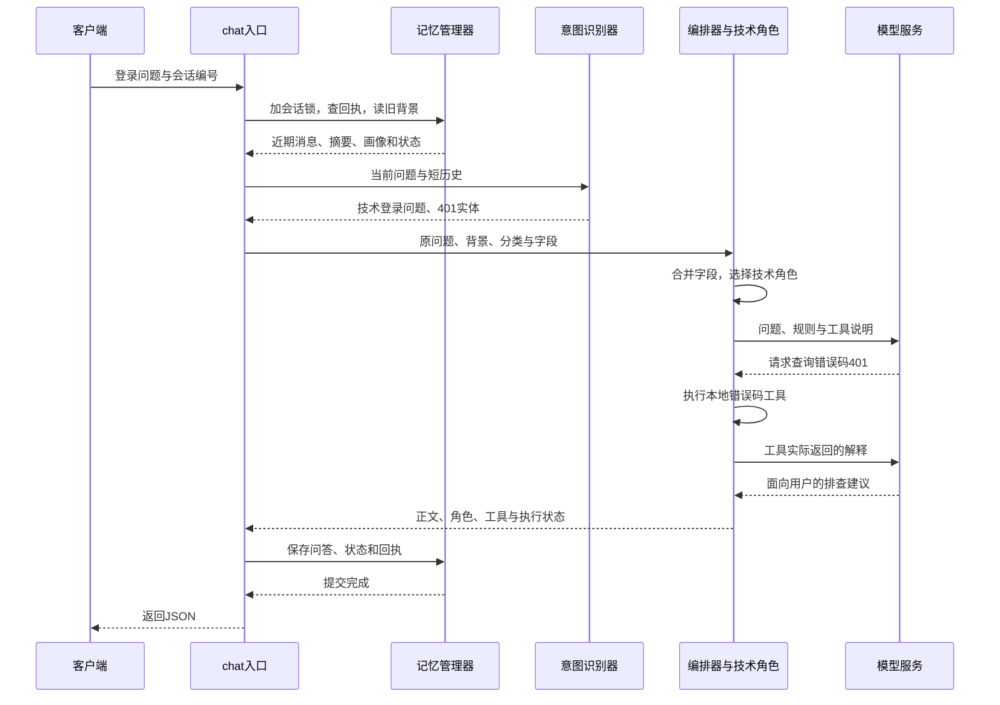

# 03 跟着一条消息，看懂后端的完整流程

> trace 合并版说明：本页保留附件的讲解与示例；当前主链增加 Context Planner、记忆演化、经验记忆、混合检索和 OTel。运行流程、接口变化与迁移以 [合并版本使用指南](../合并版本使用指南.md) 为准；文中的历史测试结果不是本次验收。

[教程目录](README.md) · [上一章](02-环境搭建与页面体验.md) · [下一章](04-请求入口鉴权与重试回执.md)

这一章先把整条路走通：用户的问题进来以后，程序依次拿到什么，交给谁，最后保存什么。第一次读只需要看懂每一步的输入和输出；想研究某一步的代码，再打开旁边的专题链接。

我们继续用“登录返回 HTTP 401，怎么处理？”这个例子。你可以把下面的流程想成一次客服接单：先确认这是谁的问题，再查看前文，判断交给哪个角色，查到依据后回答，最后留下处理记录。

- [固定这一轮的输入](#section-01)
- [先看整条路线与六个变量](#section-02)
- [服务对象从哪里来](#section-03)
- [确认身份、查回执、读背景](#section-04)
- [识别问题并整理工作请求](#section-06)
- [选择角色，让模型与工具合作](#section-08)
- [整理结果，保存后返回](#section-10)
- [下一轮和重试有什么不同](#section-12)

<a id="section-01"></a>

## 1. 固定输入，避免一开始就混进旧数据

客户端向 `POST /chat` 发送：

```json
{
  "message": "登录返回 HTTP 401，怎么处理？",
  "user_id": "reader_01",
  "conv_id": "demo-login",
  "client_request_id": "msg-001"
}
```

本章假设这是新用户、新会话，没有旧回执；模型、Redis 和 ChromaDB 都可用。为了讲清工具往返，还假设识别结果是 `technical_login`，模型会选择 `lookup_error_code`。这些是教学条件，真实模型的分类、分数和工具选择可能不同。

如果你已经在第 02 章发过这条消息，本章是在回放那次处理，不要求再发一次。原样重发通常会直接取回原响应。想观察一次新执行，用新的消息 ID；想观察空会话，还要换会话。启用鉴权后，用户身份由 Token 绑定，修改 JSON 中的 `user_id` 不会换人。

FastAPI 把 JSON 检查并转换成 `ChatRequest` 对象，交给 [api/main.py 的 chat()](../../api/main.py)。之后 `req.message` 就代表用户原话。缺少必填字段等问题会先返回 422，正常业务代码还没有开始。具体校验规则见[第 04 章](04-请求入口鉴权与重试回执.md#input)。

<a id="section-02"></a>

## 2. 先看整条路线，再记变量名



记忆管理器、识别器、编排器和角色主要是同一个 Python 应用里的对象，不是分别部署的四个服务。Redis、ChromaDB 和模型服务才是它需要访问的外部依赖。

<a id="objects"></a>

代码里变量很多，但先记住这六份材料就够了：

| 变量 | 用日常话怎么理解 | 本例里的内容 |
| --- | --- | --- |
| `req` | 用户交来的问题 | 登录报 401，以及用户、会话、消息编号 |
| `mem_ctx` | 找回来的旧记录 | 第一轮为空；下一轮可包含已有问答和字段 |
| `intent_result` | 对问题的初步判断 | 技术登录问题、错误码 401、紧急度 |
| `orch_req` | 交给执行者的工作单 | 原问题 + 背景 + 分类 + 业务字段 |
| `result` | 执行者交回的结果 | 回答正文、实际角色、用过的工具、执行状态 |
| `response` | 准备发给客户端的响应 | 整理成接口规定的字段，提交后再返回 |

它们是同一条消息经过不同阶段形成的数据，不是六条用户消息。下文每一步都会说明“谁产生、谁接住、下一步给谁”。

<a id="section-03"></a>

## 3. 这些服务对象是在什么时候准备好的

应用启动时，`lifespan()` 读取配置，创建 `_memory`、`_orchestrator` 等对象，加载 Skills，连接存储。它们会被后续请求反复使用，不会每来一句话就重新创建整套服务。

这能帮助你区分两种故障：启动失败时，先检查配置和依赖；服务已就绪但某次聊天失败时，再看那一轮的分类、模型和工具。启动与本机调试步骤见[第 02 章](02-环境搭建与页面体验.md)。

<a id="section-04"></a>

## 4. 入口先确认身份，再判断是否需要重新处理

`chat()` 先确定真实用户。配置了应用 Token 时，用 Token 映射的用户覆盖请求中的 `user_id`。本例未启用鉴权，仍使用 `reader_01`。

接着取得同用户、同会话的锁，再查 `msg-001` 的回执。这里的锁相当于“这段对话正在处理，请下一条先等一下”，防止两次请求同时读到同一份旧状态。

| 查到什么 | 接下来怎么做 |
| --- | --- |
| 没有回执 | 继续读背景、调用模型 |
| 同编号、同正文，已有 success 或 partial | 直接返回原响应 |
| 同编号、不同正文 | 返回 409，要求新消息使用新编号 |
| 已有 failed | 根据 retryable 决定是否可以重新执行 |

本例第一次处理，没有回执，所以往下走。锁等待和后续处理受整轮 50 秒预算约束。完整身份、两层锁和失败回执规则见[第 04 章](04-请求入口鉴权与重试回执.md)。

<a id="section-05"></a>

## 5. 读取旧背景，返回给 mem_ctx

入口中的关键一行是：

```python
mem_ctx = await _memory.get_context(req.user_id, conv_id, query=req.message)
```

可以读成：“按用户和会话取旧记录，再找与当前问题有关的历史；等读取完成，把结果放进 `mem_ctx`。”`await` 表示等待这一步的结果；等待网络时，程序也可以处理其他请求。

在新用户、新会话条件下，五份背景通常是：

```text
recent_messages = []   最近的原文消息
relevant_history = []  与当前问题有关的历史摘要
user_profile = {}      用户偏好等长期线索
summary = ""           当前会话较早内容的摘要
state = {}             当前任务保存的业务字段
```

当前这句登录问题还没有写进去。这一步先取旧记录，回答完成后再保存新的一轮。新会话也可能读取同用户的画像和跨会话历史；“换会话”和“换用户”不是同一种清空方式。读取细节见[第 05 章](05-上下文读取与多轮状态.md#context)。

<a id="section-06"></a>

## 6. 分类器判断问题，背景另行整理

入口从近期消息取最多五条，得到 `history`，供分类器理解“还是不行”这类省略表达。首次没有历史时，它是 `None`。

```python
intent_result = await _orchestrator.recognize_intent(req.message, history=history)
full_context = mem_ctx.to_prompt_text()
```

第一行得到分类；第二行把旧记录整理成回答模型能阅读的文字。两者分工不同：`history` 帮助判断在问什么，`full_context` 帮助回答者理解此前发生了什么。

本章假设分类结果为：

```text
intent = technical_login
intent_group = technical
entities.error_code = ["401"]
urgency = LOW
confidence = 0.84
```

`0.84` 是第 06 章固定三路分数的演算结果，不保证真实运行得到同样数字，也不是“84% 确定账号故障原因”。分类器还没查错误码工具。三路融合的计算见[第 06 章](06-意图识别与三路融合.md#vote)。

<a id="section-07"></a>

## 7. 把分散材料整理成内部工作请求

`chat()` 将原问题、用户、会话、背景、分类结果和旧状态装进内部 `Request`，命名为 `orch_req`。后面的角色和工具就可以从同一份对象读取材料。

这里容易混淆两个编号：

| 编号 | 本例 | 用来做什么 |
| --- | --- | --- |
| 客户端消息编号 | `msg-001` | 识别重试，查原回执 |
| 服务端执行编号 | 文中简称 `R1`，实际是 UUID | 查这次角色与工具执行轨迹 |

内部 `Request` 创建时生成服务端编号。API 还为有副作用的工具绑定保护回调；本例是只读查表，不触发该保护。完整字段与回调见[第 07 章](07-Agent路由Skills与工具执行.md#section-01)。

<a id="section-08"></a>

## 8. 编排器先合并字段，再选择角色

```python
result = await _orchestrator.run(orch_req)
```

这句还没执行完时，入口正在等待，处理位置已经进入 `run()`。内部的参数也叫 `req`，但它代表刚才的工作请求，不是最初的 HTTP 对象。

编排器先合并旧状态与本轮实体。本例旧状态为空，于是建立技术领域，保存错误码 `401`，并记录字段来自本次执行 `R1`。第二轮如果继续讨论同一个问题，就有机会保留这个字段。换订单、换任务时的清理规则见[第 05 章](05-上下文读取与多轮状态.md#state)。

然后根据意图、关键词、实体和角色可用性选择处理者。技术角色健康时，本例交给 `TechnicalAgent`，再调用它的 `handle()`。角色不可用或执行失败时可能回退到 General；这不是分类一定出错。路由细节见[第 07 章](07-Agent路由Skills与工具执行.md#section-02)。

<a id="section-09"></a>

## 9. 模型提出工具请求，Python 执行后把结果交回

技术角色把三类内容交给模型：`system` 放处理规则，`messages` 放背景、实体和当前问题，`tools` 放允许使用的工具名称及参数说明。

教学路径分成五步：

1. 模型提出 `lookup_error_code`，参数为 `{"error_code":"401"}`。这时查询还没发生。
2. Python 查工具白名单，检查参数必须是字符串，再执行真实 handler。
3. handler 返回“认证失败”和排查建议，并明确 `server_log_checked=False`。
4. Agent 把这个真实结果包装成 `tool_result`，连同前面的消息再次发给模型。
5. 模型生成可读的建议，工具循环把它交回上层。

因此，同一条用户消息里可以请求模型多次。代码负责执行工具，模型负责提出请求和组织回答。工具没有读取日志，所以最终不能声称“已检查日志并修复账号”。

本例只查本地错误码表，没有查询知识库。完整工具数据格式见[第 07 章](07-Agent路由Skills与工具执行.md#section-06)；用公司资料回答的路径见[第 08 章](08-知识库RAG与MCP扩展.md)。

<a id="section-10"></a>

## 10. 结果沿调用链返回，入口终于接到 result

```text
工具与模型循环 → AgentCallResult
角色 handle    → AgentResponse
编排器 run     → OrchestratorResult
HTTP 入口      → result 接到这份编排结果
```

每层包装自己的字段，例如角色、耗时、路由与请求编号；这几次包装不代表又调用了几个模型。正常教学结果里有回答正文、`agent_type=technical`、`tools_used=[lookup_error_code]` 和 `status=success`。

<a id="section-11"></a>

## 11. 整理响应，保存后才返回客户端

入口把执行结果整理成 `ChatResponse`：正文和工具来自 `result`，识别分数来自 `intent_result`，实体来自合并后的 `orch_req`。第一次阅读不必记住全部字段，完整示例在[第 09 章](09-记忆提交压缩与画像更新.md#section-01)。

随后按顺序做三件事：

1. **等待 `commit_turn()`。** success/partial 保存用户消息、助手消息、业务状态和回执；failed 不追加正常问答和新状态，但保存失败回执及有值的轨迹。
2. **提交后台维护待办。** 非 failed 结果可安排摘要与画像更新；这里不等待整个后台任务。
3. **返回响应。** success/partial 通常是 HTTP 200，failed 是带业务响应的 HTTP 503。入口超时等错误可能只有 `detail`。

保存顺序很重要：下一轮需要读取已有问答，相同消息重试需要读取回执。客户端成功收到响应，不代表后台画像也已经更新；模型生成了文字，也不代表 Redis 提交一定成功。

这部分的事务、压缩与失败边界在[第 09 章](09-记忆提交压缩与画像更新.md)展开。

<a id="section-12"></a>

## 12. 下一轮和重试，在入口就分开了

| 用户或客户端在做什么 | 编号怎么填 | 服务端会发生什么 |
| --- | --- | --- |
| 追问“重登过了，还是不行” | 保留会话，使用新消息 ID | 读取上一轮历史和状态，重新回答 |
| 断线后重发原消息 | 会话、消息 ID、正文全部保持原样 | 有可复用回执时直接返回原响应 |
| 开始新话题 | 使用新会话和新消息 ID | 近期会话记录重新开始，同用户长期背景仍可能存在 |

读完后，先用自己的话回答三个问题：为什么先读历史再写本轮？为什么模型返回工具名还不算执行过？为什么有回答以后仍要等待提交？能讲清这三个先后关系，就已经抓住了主线。

想亲自观察，在 `get_context()` 返回后、`_route_decision()` 返回后、`commit_turn()` 前各放一个断点，分别看背景、角色和最终响应。具体调试配置见[第 12 章](12-测试与故障排查.md#section-02)。接下来第 04—10 章按这条路线拆解各环节，可根据当前问题选择阅读。
