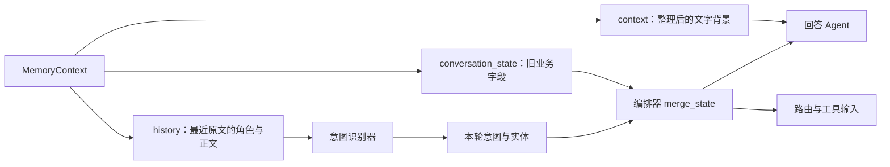

# 05 多轮对话怎样接续：文字历史与结构化状态

> trace 合并版说明：本页保留附件的讲解与示例；当前主链增加 Context Planner、记忆演化、经验记忆、混合检索和 OTel。运行流程、接口变化与迁移以 [合并版本使用指南](../合并版本使用指南.md) 为准；文中的历史测试结果不是本次验收。

[教程目录](README.md) · [上一章](04-请求入口鉴权与重试回执.md) · [下一章](06-意图识别与三路融合.md)

> **第一次读先看这里：** 先读[三种上下文的分工](#prompt)，再看[字段继承规则](#state)和[已有离线实验](#exercise)。先回答“上轮的 401 从哪里来、什么时候会被清掉”，再研究 Redis 如何编码、排序消息。

上一章的请求已经确定身份、获得会话锁，并且没有可直接返回的回执。现在主线请求 `reader_01 / demo-login / msg-001` 开始读取记忆：**“登录返回 HTTP 401，怎么处理？”**

第一轮可能没有任何前文。第二轮用户只说“重登过了，还是不行”，系统需要知道“还是”指登录故障，并保留前面提到的 401。这需要两种信息：可以给模型阅读的文字，以及可以稳定传给路由/工具的字段。本章先解释信息怎样读出来，再沿着一组退款例子逐句解释字段继承和清理。

- [MemoryContext 和 Message 的完整结构](#context)
- [Redis 如何保存与还原消息顺序](#working)
- [情景记忆和画像怎样补充背景](#longterm)
- [history、context、state 分别给谁](#prompt)
- [状态合并的调用位置](#request)
- [merge_state 的每个条件与三轮数据](#state)
- [离线验证字段继承与清理](#exercise)

## 先看这一章的输入与输出

| 阶段 | 输入 | 输出交给谁 |
| --- | --- | --- |
| `get_context()` | 最终用户、会话、当前问题 | 返回 `MemoryContext` 给 HTTP 入口 |
| HTTP 入口构造 `history` | 最近原文消息 | 给意图识别器理解省略表达 |
| `to_prompt_text()` | 摘要、相关历史、画像、最近原文 | 给回答 Agent 阅读文字背景 |
| `merge_state()` | 旧状态、本轮实体、本轮意图组 | 合并字段给路由、Agent 和工具 |
| 本轮最终提交 | 正常/部分回答与合并状态 | 保存后，下一轮再读回来 |

源码主要在 [memory/conversation_memory.py](../../memory/conversation_memory.py)、[core/conversation_state.py](../../core/conversation_state.py)、[api/main.py](../../api/main.py) 和 [agents/agent_orchestrator.py](../../agents/agent_orchestrator.py)。这里的“状态”专指当前任务的业务字段，不是 HTTP 状态码，也不是 Agent 的健康状态。

<a id="context"></a>

## 1. 先读懂 Message：一条消息不只是正文

源码先定义了消息角色与消息对象：

```python
class MsgRole(Enum):
    USER = "user"
    ASSISTANT = "assistant"
    SYSTEM = "system"

@dataclass
class Message:
    role: MsgRole
    content: str
    timestamp: datetime = field(default_factory=datetime.now)
    metadata: Dict[str, Any] = field(default_factory=dict)
```

`Enum` 把允许使用的角色名字集中定义。`MsgRole.USER` 是 Python 对象，`MsgRole.USER.value` 则是字符串 `"user"`，保存 JSON、构造模型消息时用后者。

`@dataclass` 可以理解成“给这个装数据的类自动补上初始化方法”。因此下面这一句会创建一条带角色、正文、时间和附加字段的消息：

```python
message = Message(
    role=MsgRole.USER,
    content="登录返回 HTTP 401，怎么处理？",
    metadata={"request_id": "msg-001"},
)
```

字段逐个看：

- `role` 区分谁说的话，不能把助手建议和用户事实混成同一来源。
- `content` 是这条消息的原文。
- `timestamp` 是时间对象，没传时在创建消息的那一刻调用 `datetime.now()`。
- `metadata` 是附加字典，例如这条消息对应哪个客户端消息编号。

`field(default_factory=dict)` 表示每次创建对象时生成一个新的空字典。这样一条消息增加 metadata，不会把其他消息的 metadata 一起改掉。`Dict[str, Any]` 表示字典的键是字符串，值可以是不同类型；它是代码中的类型说明，不等于每个值都经过业务核验。

正常 HTTP 提交会直接把消息编码为 JSON，读回时才恢复成这个 `Message` 对象；`add_message()` 等路径则也会先创建它。两种写入路径不要混成同一段执行过程。

## 2. MemoryContext：五份信息装进一个对象

`get_context()` 返回的不是已经拼好的大段字符串，而是完整的 `MemoryContext`：

```python
@dataclass
class MemoryContext:
    recent_messages: List[Message]
    relevant_history: List[str]
    user_profile: Dict[str, Any]
    summary: str
    state: Dict[str, Any] = field(default_factory=dict)
```

`List[Message]` 是消息对象列表，`List[str]` 是字符串列表。列表保留顺序，用 `recent_messages[-1]` 可以取最后一条；字典按名字取值，用 `state["entities"]` 可以取实体字段。两者没有必要提前合成一种格式。

| 字段 | 数据形状 | 来自哪里 | 解决什么问题 |
| --- | --- | --- | --- |
| `recent_messages` | `[Message(...), Message(...)]` | Redis 工作消息列表 | 最近几句到底说了什么 |
| `relevant_history` | `["历史摘要一", "历史摘要二"]` | ChromaDB `episodic` | 同用户以前有没有相关经历 |
| `user_profile` | `{"preferences": [...]}` 等 | ChromaDB `user_profile` | 同用户跨会话的偏好和线索 |
| `summary` | 一段字符串 | Redis 会话摘要 | 已压缩的较早前文 |
| `state` | `{"domain": ..., "entities": ..., "sources": ...}` | Redis 业务状态 | 当前任务已提取到哪些字段、来自哪次执行 |

对一个从未使用过的用户和会话，常见初始值是：

```python
MemoryContext(
    recent_messages=[],
    relevant_history=[],
    user_profile={},
    summary="",
    state={},
)
```

`[]` 是空列表、`{}` 是空字典、`""` 是空字符串。它们都表示各自结构中暂时没有内容，但仍然保持类型；`None` 则表示没有提供这份值。后面的状态合并特意区分 `{}` 与 `None`。

### 2.1 get_context() 的实际读取顺序

核心代码保留了下面的顺序：

```python
recent = await self._get_working_memory(user_id, conv_id)
history = await self._search_episodic(
    user_id, conv_id,
    query or (recent[-1].content if recent else ""),
)
profile = await self._get_profile(user_id)
summary = await self._redis.get(self._summary_key(user_id, conv_id)) or ""
state_raw = await self._redis.get(self._state_key(user_id, conv_id))

return MemoryContext(
    recent_messages=recent,
    relevant_history=history,
    user_profile=profile,
    summary=summary,
    state=json.loads(state_raw) if state_raw else {},
)
```

主线 HTTP 入口明确传入 `query=req.message`，所以情景检索使用当前“登录返回 HTTP 401，怎么处理？”。其他调用方没有给 query 时，才用最近一条消息正文；没有最近消息时用空字符串。

这五个读取按源码顺序等待，当前没有用 `gather()` 并行。`await` 会让网络等待期间的其他任务有机会运行，但不会把这五行自动变成同时读取。

`state_raw` 是 Redis 中的 JSON 文本，`json.loads()` 恢复字典。没有保存过状态时返回 `{}`。情景检索和画像读取有自身降级处理；Redis 读取错误或已保存 JSON 损坏并没有在这里统一伪装成空记忆，因此不能认为所有故障都会返回上述初始值。

<a id="working"></a>

## 3. Redis 保存的是 JSON 文本，读回来才是消息对象

Redis 列表不能直接保存 Python 的 `Message` 实例。正常提交先用 `json.dumps()` 把字段编码成字符串，示意如下：

```json
{
  "role": "user",
  "content": "登录返回 HTTP 401，怎么处理？",
  "ts": "2026-10-14T10:00:00",
  "metadata": {"request_id": "msg-001"}
}
```

这里时间是形状示例。`timestamp.isoformat()` 把时间对象变成这种文本；读取时 `datetime.fromisoformat()` 再恢复时间对象。`metadata.request_id` 在正常 `commit_turn()` 写入路径中使用客户端消息编号；结构化状态 `sources` 使用内部执行编号，二者不要混淆。

会话消息的键由 `_wm_key()` 产生，当前是 `wm_v2:<用户和会话的摘要>`；摘要和状态分别使用 `summary_v2:`、`state_v1:`。每个键都把用户和会话纳入范围，因此同一个 `conv_id` 在不同用户下不会直接共用工作消息。

### 3.1 LPUSH 为何让消息顺序反过来

`commit_turn()` 用这句写一整轮：

```python
pipe.lpush(key, raw("user", message), raw("assistant", response["response"]))
```

`LPUSH` 向列表左端逐个放入值。先放用户消息，再把助手消息放到它左边，因此第一轮的列表是：

```text
Redis 左端（最新）                           右端（较早）
[assistant_1, user_1]
```

再提交第二轮后：

```text
[assistant_2, user_2, assistant_1, user_1]
```

这样的存法方便在列表头取最新数据；模型阅读对话时却更适合从早到晚。读取代码负责把顺序还原：

```python
raws = await self._redis.lrange(
    self._wm_key(user_id, conv_id), 0, self.WORKING_MAX - 1
)
return self._messages_from_raw(raws)
```

`WORKING_MAX=20`，所以 `LRANGE 0 19` 最多取最近 20 **条消息**，不是 20 个问答回合。这个读取上限不会直接删除列表中更旧的条目；删除/压缩由后面的维护流程处理。

### 3.2 逐句还原消息

```python
msgs = []
for raw in reversed(raws):
    d = json.loads(raw)
    msgs.append(Message(
        role=MsgRole(d["role"]),
        content=d["content"],
        timestamp=datetime.fromisoformat(d["ts"]),
        metadata=d.get("metadata", {}),
    ))
return msgs
```

把刚才的两轮列表代进去：

1. `reversed(raws)` 先读 `user_1`，再读 `assistant_1`、`user_2`、`assistant_2`。
2. `json.loads(raw)` 把一条 JSON 字符串变成字典 `d`。
3. `MsgRole(d["role"])` 把 `"user"` 转回 `MsgRole.USER`；其他合法角色同理。
4. 恢复正文、时间和 metadata；旧消息没有 metadata 时，`.get("metadata", {})` 给空字典。
5. `append()` 把恢复的对象加在结果列表末尾，得到正确的阅读顺序。

最终返回：

```text
[user_1, assistant_1, user_2, assistant_2]
```

本轮正在处理的用户问题还没有加入这份列表。先读旧历史，再单独把当前问题给分类器/回答模型；执行完成后才提交这一轮。否则模型输入容易把同一句新问题重复算作历史和当前消息。

<a id="longterm"></a>

## 4. 近期原文不够时，情景记忆和画像怎样补充

### 4.1 情景记忆检索的是已压缩摘要

`_search_episodic()` 的处理顺序是：

1. 清理并去掉 query 首尾空白；为空就返回 `[]`，不检索。
2. 在 `episodic` 集合中，先用同用户、同会话条件检索，最多取 `HISTORY_TOP_K=5` 条。
3. 得到不足 5 条时，再用**仅同用户**的条件检索；这个范围允许当前会话和其他会话，代码没有排除当前会话。
4. 将两批文档连接起来，按文字去重，最多返回 5 条。

第 09 章的压缩过程把摘要作为 `documents` 保存。原始片段前 500 字符放在 `metadata.full_text`，这里取的是返回的 documents，不会自动把 full_text 展开成完整聊天档案。

例如主线用户以前在另一会话说过“验证码一直收不到”，那段对话经过压缩并保存后，当前登录问题可能检索到它。它是参考背景，不能证明当前验证码也一定有问题。

检索异常时记录日志并返回 `[]`。因此 `[]` 既可能表示没有相关历史，也可能表示本次检索失败；需要结合日志区分。

### 4.2 画像按用户读取，不按会话读取

`_get_profile()` 先用稳定文档 ID `user_profile:<user_id>` 直接读取；没有该文档时，兼容按 `user_id` 查询旧记录并选取最新一条。异常时返回 `{}`。

画像不带当前 `conv_id`，因为“喜欢分步说明”等偏好可以跨会话使用。它由后台任务提炼，不保证本轮说出一个订单号后立即就有新画像。当前订单字段需要走 `state` 路径，不能依赖画像即时保存。

一次新会话会换会话消息、摘要和字段范围，但同用户画像与其他会话摘要仍可能进入背景。想观察完全空的记忆，使用新用户；启用 Token 时真实用户来自服务端映射，单改请求 JSON 的 `user_id` 不会换人。

### 4.3 读到哪份库，也会影响你看到的结果

开发模式连接独立 ChromaDB 失败时，可以降级为本地 `PersistentClient`；生产模式禁止自动切换。独立库和本地目录不一定保存同一份数据，比较结果前先看服务启动日志中的连接方式。

这些记忆向量由 ChromaDB 的默认嵌入机制生成，与第 06 章意图识别中的 `IntentEmbedding` 是不同路径。配置意图向量 provider 不会自动改变这两份 ChromaDB 记忆集合的向量来源。

<a id="prompt"></a>

## 5. 同一份 MemoryContext，为什么要拆成三路输入



这三个名字在代码中很相近，职责却不同：

| 名称 | 数据类型 | 实际构造方式 | 给谁使用 |
| --- | --- | --- | --- |
| `history` | 消息字典列表或 `None` | API 从最近消息取最后 5 条 | 分类器；其 LLM 分支再取最后 3 条 |
| `context` | 一段字符串 | `mem_ctx.to_prompt_text()` | 回答 Agent 的背景消息 |
| `conversation_state` | 字典或 `None` | HTTP 路径传 `mem_ctx.state` | 分类后合并字段，影响路由和角色/工具 |

### 5.1 history：把“还是不行”连回上文

API 入口的代码是：

```python
history = [
    {"role": m.role.value, "content": m.content}
    for m in mem_ctx.recent_messages[-5:]
] if mem_ctx.recent_messages else None
```

`[-5:]` 是列表切片，表示最后最多 5 条。列表推导式 `[...] for m in ...` 把每个 `Message` 转成只保留 role/content 的小字典。

主线第一轮没有原文，得到 `None`。第一轮成功提交后，第二轮发 `msg-002`：“重登过了，还是不行”，history 可以是：

```python
[
    {"role": "user", "content": "登录返回 HTTP 401，怎么处理？"},
    {"role": "assistant", "content": "这里是第一轮实际回答"},
]
```

分类器实际再取 `history[-3:]`，指最后 3 **条消息**，不是完整 3 回合。LLM 分支读它；当前向量和关键词分支只读当前正文，没有单独接收这份历史。

### 5.2 context：按实际顺序拼成一段可阅读背景

`to_prompt_text()` 的顺序是**会话摘要 → 相关历史 → 用户画像 → 最近对话**：

```python
parts = []
if self.summary:
    parts.append(f"[会话摘要]\n{self._clean(self.summary)}")
if self.relevant_history:
    parts.append("[相关历史]\n" + "\n".join(
        f"- {self._clean(h)}" for h in self.relevant_history[:3]
    ))
if self.user_profile:
    parts.append(f"[用户画像]\n{json.dumps(self.user_profile, ensure_ascii=True)}")
if self.recent_messages:
    parts.append("[最近对话]")
    for m in self.recent_messages[-8:]:
        parts.append(f"{m.role.value}: {self._clean(m.content)}")
return "\n\n".join(parts)
```

`append()` 增加一个片段，`join()` 用分隔符连接片段。末尾用两个换行连接，因此每个大段和每条最近消息之间都有空行。没有内容的段落直接省略；五份内容都空时返回空字符串。

注意三个切片不同：工作记忆最多读 20 条，分类 history 最多给 5 条，文字背景最多展示 8 条；相关历史检索最多 5 条，正文最多展示其中 3 条。它们各自控制输入长度，不能互相当成同一个上限。

为了看清输出，假设已有如下演示数据。这是人工构造的函数输入，**不表示首次登录请求已经触发压缩或画像生成**：

```python
summary = "用户正在排查登录认证问题。"
relevant_history = ["以前曾遇到验证码延迟。"]
user_profile = {"preferences": ["step-by-step"]}
recent_messages = [
    Message(MsgRole.USER, "登录返回 HTTP 401，怎么处理？"),
    Message(MsgRole.ASSISTANT, "请先重新登录，并确认认证信息。"),
]
```

这些值交给 `to_prompt_text()`，真实拼接形状为：

```text
[会话摘要]
用户正在排查登录认证问题。

[相关历史]
- 以前曾遇到验证码延迟。

[用户画像]
{"preferences": ["step-by-step"]}

[最近对话]

user: 登录返回 HTTP 401，怎么处理？

assistant: 请先重新登录，并确认认证信息。
```

画像用 `ensure_ascii=True` 编码；若画像有中文，会显示成 `\u....` 转义文本，模型仍能读这份 JSON。`_clean()` 移除不能正常 UTF-8 编码的代理字符，目的是避免编码错误，不是把背景内容全部变成经过可信验证的事实。

`state` 没有拼入这段背景。它在下面的第三路另行合并，再通过 `req.entities` 给角色和工具。

### 5.3 state：给代码稳定使用的字段

主线第一轮提取到 `error_code=["401"]` 并成功提交后，状态可以长成：

```python
{
    "domain": "technical",
    "entities": {
        "order_id": [], "product": [], "date": [], "amount": [],
        "error_code": ["401"],
    },
    "sources": {"error_code": "第一轮的内部request_id"},
}
```

第二轮只说“还是不行”，本轮正则未必提取到错误码。若仍属同领域、没有换任务，合并函数保留旧 `401`，代码就不需要从背景字符串里重新搜索它。

Agent 的 `_call_llm()` 会将文字背景作为 `[背景信息]` 消息加入，将合并后的 `req.entities` 作为 `[结构化实体]` 消息加入，最后再加当前用户消息。角色输入契约和工具也使用这些字段。文字能补充上下文，字段提供明确键值；实体有值仍不代表已经校验用户身份或业务归属。

<a id="request"></a>

## 6. 状态为什么在分类之后、角色执行之前合并

HTTP 入口已经识别本轮意图，再构造内部 `Request`：

```python
orch_req = Request(
    message=req.message, user_id=req.user_id, conv_id=conv_id,
    context=full_context, history=history,
    entities=intent_result.entities,
    intent=intent_result.intent,
    intent_group=intent_result.intent_group,
    urgency=intent_result.urgency,
    intent_confidence=intent_result.confidence,
    conversation_state=getattr(mem_ctx, "state", {}),
)
```

这里 `entities` 是**本轮提取结果**，`conversation_state` 是**旧状态**。它们尚未合并。

编排器 `run()` 收到这个请求，因为已有 `req.intent`，不会再分类一次。接着执行：

```python
if req.conversation_state is not None:
    req.conversation_state = merge_state(
        req.conversation_state, req.entities,
        req.intent_group, req.message, req.request_id,
    )
    req.entities = req.conversation_state["entities"]
```

分类在前，因为需要知道这轮是继续技术排查，还是切换到退款；路由在后，因为保留的错误码、金额等会影响选角色。合并后 `req.entities` 被替换，后续响应中的 `entities` 也来自这个更新后的字段集合。

`is not None` 特意保留了一个调用边界：

- HTTP 第一轮没有旧状态时仍传 `{}`，它不是 None，会调用 `merge_state()` 并建立初始状态。
- 其他调用方直接构造 `Request`，默认 `conversation_state=None`，会跳过合并。

所以不能看到同一个 `run()` 就认为所有调用路径都有 HTTP 多轮状态行为。本章后面的实验直接测合并函数，也不会帮你自动完成存储。

<a id="state"></a>

## 7. merge_state：逐个条件看它何时保留旧字段

现在改用退款三轮例子，因为订单变化最容易看清“保留”和“清理”的差别：

```text
第 1 轮：订单号 #12345，昨天支付99元
第 2 轮：退款多久到？
第 3 轮：另一笔订单 #67890
```

这些是教学输入，不是真实订单核验。下面用 `R1`、`R2`、`R3` 表示三次内部执行编号，方便阅读；正式运行中它们是 `Request.request_id` 的 UUID，客户端消息编号应另用新 ID。

### 7.1 先确定领域，再识别“中性”表达

```python
previous = previous if isinstance(previous, dict) else {}
domain = {"billing": "commerce", "query": "commerce"}.get(intent_group, intent_group)
neutral = domain in {
    "greeting", "feedback", "other", "complaint", "request", "escalation"
}
```

`isinstance(previous, dict)` 检查旧状态是不是字典；不合法就从空字典开始。`billing` 和 `query` 都映射为 `commerce`，因此退款账单与订单查询可以共享订单字段。`technical` 则仍为 `technical`。

“中性”在这里是合并策略名：这些分类不一定说明任务领域变了，例如用户说“帮我看一下”可能仍指前面的订单。因此代码允许它们延续旧领域。它不表示用户情绪中性，也不表示投诉没有业务含义。

随后读取旧字段和来源，并确保它们是字典：

```python
old = previous.get("entities", {})
sources = previous.get("sources", {})
old = old if isinstance(old, dict) else {}
sources = sources if isinstance(sources, dict) else {}
```

`.get(key, default)` 表示没有这个键时使用 default；第一轮 `previous={}`，所以 `old={}`、`sources={}`。

### 7.2 检查是否换订单、是否明确换任务

```python
changed_order = bool(
    entities.get("order_id") and old.get("order_id")
    and entities["order_id"] != old["order_id"]
)
new_task = bool(re.search(
    r"(?:换个|新的|另一个)(?:问题|订单)|另一笔订单", message
))
```

`changed_order` 需要三个条件同时满足：本轮有订单号、旧状态也有订单号、两份订单号列表不同。

- 旧 `order_id=["12345"]`，本轮 `[]`：不是换订单，只是本轮没重复说。
- 旧 `order_id=["12345"]`，本轮 `["12345"]`：相同，仍是原订单。
- 旧 `order_id=["12345"]`，本轮 `["67890"]`：列表不同，判为换订单。
- 旧没有订单号，本轮首次给出 `["12345"]`：不属于“与旧订单不同”。

`new_task` 用正则查固定表达，例如“换个问题”“新的订单”“另一个问题”“另一笔订单”。这是有限的文本规则，并没有让模型理解所有换任务说法；“换一下吧”等其他表达不一定命中。正则中的 `(?:...)` 是分组，`|` 表示两种模式任选其一，`re.search()` 查找是否出现。

### 7.3 中性意图怎样决定 domain

```python
if neutral:
    domain = (
        "commerce" if entities.get("order_id") else "general"
    ) if new_task else previous.get(
        "domain", "commerce" if entities.get("order_id") else "general"
    )
```

这行较长，可以按两个分支理解，行为与源码一致：

1. 中性意图 **且明确新任务**：本轮有订单号则用 `commerce`，没有则用 `general`。
2. 中性意图 **且没有明确新任务**：优先沿用旧 domain；旧状态没有 domain 时，本轮有订单号用 `commerce`，否则用 `general`。

特别注意：只检测到订单变化、却没有命中 `new_task` 时，中性意图仍可能沿用旧 domain；字段是否清理由下一行单独决定。当前实现没有因为本轮出现新订单就无条件把所有旧领域改成 commerce。

### 7.4 一个 keep 条件决定复制还是清空

```python
keep = (
    not changed_order
    and not new_task
    and (neutral or domain == previous.get("domain"))
)
merged = {
    key: list(value) for key, value in old.items()
    if isinstance(value, list)
} if keep else {}
origins = dict(sources) if keep else {}
```

保留旧字段需要：没换订单、没明确新任务，并且是中性意图或仍在同领域。只有全部成立才复制旧值；否则 `merged={}`、`origins={}`，从空字段开始。

`old.items()` 遍历每个键值；只复制列表字段。`list(value)` 新建列表，`dict(sources)` 新建来源字典，使合并后的对象不直接复用旧容器。

| 情况 | `keep` | 实际含义 |
| --- | --- | --- |
| 同 commerce 领域，只问退款时效 | true | 不用每轮重复订单、金额、日期 |
| 同 technical 领域，只说还是不行 | true | 可以继承旧错误码 |
| 本轮提到不同订单号 | false | 旧金额和日期不能继续归给新订单 |
| 命中换任务表达 | false | 当前任务字段重新开始 |
| 非中性意图从 commerce 切到 technical | false | 清理不相关业务字段 |
| 中性意图，未换订单也未换任务 | true | 延续已有字段和领域 |

第一轮 `previous={}`、`domain="commerce"` 时，没有旧 domain 可相等，所以 keep 为 false；从空状态建立新字段即可。

### 7.5 当前非空值覆盖，空值不擦掉已有值

```python
for key, value in entities.items():
    if value:
        merged[key] = list(value)
        origins[key] = request_id
    else:
        merged.setdefault(key, [])
return {"domain": domain, "entities": merged, "sources": origins}
```

本轮实体形如 `{"order_id": ["12345"], "amount": ["99元"], ...}`。列表非空时：写入这个字段，并把来源改成本轮内部执行编号。空列表时：`setdefault(key, [])` 只在尚无该键时建立空列表，不覆盖已经保留的值。

这不是把旧列表与新列表全部拼接。例如旧金额 `["99元"]`，本轮金额 `["199元"]`，结果是 `["199元"]`，来源改成本轮。若本轮重新明确说了相同金额，值虽相同，来源也会更新，因为它在这轮再次被提取到了。

## 8. 三轮完整数据怎样变化

为贴合识别器的形状，本例实体都包含五个键。只有本轮非空字段会拥有来源记录。

### 第 1 轮：建立订单上下文

```python
previous = {}
entities = {
    "order_id": ["12345"], "product": [], "date": ["昨天"],
    "amount": ["99元"], "error_code": [],
}
intent_group = "billing"
message = "订单号 #12345，昨天支付99元"
request_id = "R1"
```

`billing → commerce`；非中性；没有旧订单；没有新任务表达；没有同领域旧状态，因此从空开始。写入三个非空字段，得到：

```python
{
    "domain": "commerce",
    "entities": {
        "order_id": ["12345"], "product": [], "date": ["昨天"],
        "amount": ["99元"], "error_code": [],
    },
    "sources": {"order_id": "R1", "date": "R1", "amount": "R1"},
}
```

日期和金额保留原文写法；“昨天”没有转换成真实日期，“99元”没有转换成货币对象。

### 第 2 轮：省略字段仍延续原订单

```python
entities = {
    "order_id": [], "product": [], "date": [], "amount": [], "error_code": [],
}
intent_group = "billing"
message = "退款多久到？"
request_id = "R2"
```

与旧 commerce 相同，没有新订单或新任务，keep 为 true。先复制旧值，本轮五个空列表只会 `setdefault()`，因此结果仍然是：

```python
{
    "domain": "commerce",
    "entities": {
        "order_id": ["12345"], "product": [], "date": ["昨天"],
        "amount": ["99元"], "error_code": [],
    },
    "sources": {"order_id": "R1", "date": "R1", "amount": "R1"},
}
```

来源仍为 R1，说明这三个字段从第一轮继承，并非第二轮重新提取。R2 本轮没有凭空发明订单或金额。

### 第 3 轮：换订单后，旧金额与日期清空

```python
entities = {
    "order_id": ["67890"], "product": [], "date": [], "amount": [], "error_code": [],
}
intent_group = "billing"
message = "另一笔订单 #67890"
request_id = "R3"
```

旧订单与本轮不同，`changed_order=True`；又命中“另一笔订单”，`new_task=True`。keep 为 false，先清空旧字段和来源，再写本轮，得到：

```python
{
    "domain": "commerce",
    "entities": {
        "order_id": ["67890"], "product": [], "date": [], "amount": [], "error_code": [],
    },
    "sources": {"order_id": "R3"},
}
```

现在工具不能把 99 元或昨天套用到 67890。若需要金额或日期，应询问当前订单对应的信息，而不是沿用旧值。

三个步骤改变的是**结构化字段**。旧订单仍可能出现在最近原文或摘要里，清理 state 不等于删除整段对话。模型仍要结合本轮问题与合并字段区分讨论对象。

## 9. 合并完成还不等于保存完成

`merge_state()` 是一个在内存中计算新字典的函数，没有 Redis 客户端，没有网络写入。只有后续 HTTP 入口调用 `commit_turn(..., state=orch_req.conversation_state)`，下一轮才能读回这份新状态。

- success/partial 轮次会随消息一起保存状态。
- failed 轮次保存失败回执，不提交新的正常消息与状态。
- 合并后但最终提交前超时，不能假设下一轮已经读得到新字段。

实体来自第 06 章的正则提取；`product` 当前始终为空。字典字段齐全、订单号存在，都不代表查到了真实订单或验证了它属于该用户。业务工具仍需验证这些信息。

<a id="exercise"></a>

## 实验：追问保留字段，换订单清理字段

下面直接运行当前 `merge_state()`，不请求模型、不连接存储。在项目根目录执行：

```bash
python3.12 - <<'PYCODE'
from core.conversation_state import merge_state

first = merge_state({}, {"order_id": ["12345"], "amount": ["99元"],
                        "date": ["昨天"]}, "billing", "订单号 #12345，昨天支付99元", "R1")
followup = merge_state(first, {"order_id": [], "amount": [], "date": []},
                      "billing", "退款多久到？", "R2")
changed = merge_state(followup, {"order_id": ["67890"], "amount": [], "date": []},
                     "billing", "另一笔订单 #67890", "R3")
assert followup["entities"]["amount"] == ["99元"]
assert followup["sources"]["amount"] == "R1"
assert changed["entities"]["order_id"] == ["67890"]
assert changed["entities"]["amount"] == []
assert changed["entities"]["date"] == []
print("PASS：追问继承旧字段；新订单清理旧金额和日期")
PYCODE
```

预期打印 `PASS：追问继承旧字段；新订单清理旧金额和日期`。程序固定了意图组和实体，验证的是确定性字段合并；它没有验证分类准确率、业务订单真实性、Redis 提交或下一轮读取。为了让实验更短，只传了三个字段，因此函数也只给出这些键，正文的五字段示意则采用完整识别器形状。

可以在末尾增加 `print(first)`、`print(followup)`、`print(changed)`，观察值与来源怎样变化。再把第三轮改成原订单 `12345`、正文“这个订单呢”，应继续保留 99 元与昨天；把意图组改成 `technical` 则会清理 commerce 旧字段。

完整 HTTP 状态测试见[第 12 章](12-测试与故障排查.md)：还需要验证上一轮实际提交、下一轮实际读取和响应的合并字段。继续读第 06 章前，确认你能区分：history 是给分类用的消息列表，context 是给回答用的文字，state 是供代码继承和清理的字段字典。
