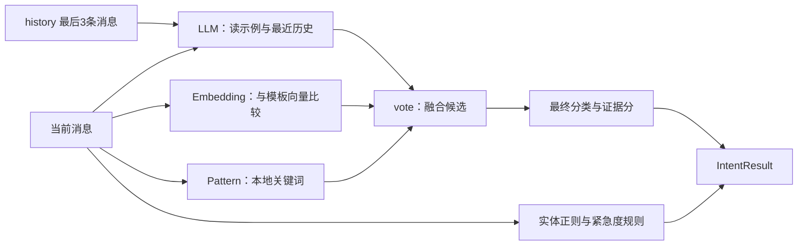

# 06 意图识别：三路候选怎样变成一个结果

> trace 合并版说明：本页保留附件的讲解与示例；当前主链增加 Context Planner、记忆演化、经验记忆、混合检索和 OTel。运行流程、接口变化与迁移以 [合并版本使用指南](../合并版本使用指南.md) 为准；文中的历史测试结果不是本次验收。

[教程目录](README.md) · [上一章](05-上下文读取与多轮状态.md) · [下一章](07-Agent路由Skills与工具执行.md)

> **第一次读先看这里：** 先看[三路各读什么](#parallel)、[0.84 怎样算出来](#vote)和[固定输入实验](#exercise)。本地向量的散列细节、缓存和 learn() 可以第二遍再读。遇到真实分类错误时，再按来源分数回到对应分支。

我们继续处理 `reader_01 / demo-login / msg-001`：**“登录返回 HTTP 401，怎么处理？”**。入口已经读取旧记忆，现在需要判断它属于哪类问题，再把分类、紧急度和实体交给编排器。

“读到一句话”与“知道应该选哪个角色”之间，还缺少这一步。当前项目让 LLM、向量模板匹配和关键词规则各给出候选，再按照明确的代码规则融合。本章会从模板如何构造输入讲起，手算主线的 0.84，并解释三路不一致、分类失败、实体遗漏和缓存时实际发生什么。

- [输出对象与调用入口](#entry)
- [三路怎样实际运行](#parallel)
- [LLM 的模板与 Few-shot](#llm)
- [向量、余弦与模板匹配](#embedding)
- [关键词规则怎样计分](#pattern)
- [逐步累积与融合](#vote)
- [实体与紧急度的独立处理](#entities)
- [缓存、来源、失败与学习](#return)
- [配置观察和固定输入实验](#exercise)

## 先约定本章的数字怎样阅读

主线的 **LLM 0.90、向量 0.80 是为了方便手算而固定的教学假设**，真实调用会变化。关键词规则 0.50 可以从当前源码和主线原文直接算出；三路都投给 `technical_login` 时，默认权重融合得到 0.84。

融合分是启发式证据分，不是经过校准的“这次一定正确的概率”。分类器在这一阶段没有查询真实登录系统，也没有执行错误码工具。

<a id="entry"></a>

## 1. 意图识别返回什么，后面怎样使用

HTTP 入口调用：

```python
intent_result = await _orchestrator.recognize_intent(req.message, history=history)
```

编排器这里是一个薄包装：

```python
async def recognize_intent(self, message, history=None):
    return await self._intent_recognizer.recognize(message, history=history)
```

实际算法在 [core/intent_recognizer.py](../../core/intent_recognizer.py)。`IntentResult` 保存完整识别结果：

```python
@dataclass
class IntentResult:
    intent: IntentCategory
    confidence: float
    urgency: UrgencyLevel
    intent_group: str
    entities: Dict[str, List[str]]
    reasoning: str
    latency_ms: float
    source_scores: Dict[str, float] = field(default_factory=dict)
    embedding_source: str = "local-ngram"
```

第 05 章已经解释 `dataclass`：它是把一组相关数据装进同一个对象。这里逐个字段的职责如下：

| 字段 | 主线教学值 | 后续怎样使用 |
| --- | --- | --- |
| `intent` | `IntentCategory.TECHNICAL_LOGIN` | 具体问题类别 |
| `intent_group` | `"technical"` | 状态领域与角色路由的大方向 |
| `confidence` | `0.84` | 弱证据判断与响应展示 |
| `urgency` | `UrgencyLevel.LOW` | 升级与路由依据之一 |
| `entities` | `error_code=["401"]`，其他字段空 | 与旧状态合并，给角色和工具 |
| `reasoning` | LLM 返回的一句说明 | 调试参考，不是完整融合过程 |
| `source_scores` | LLM .90、向量 .80、规则 .50 | 展示各路原始分 |
| `embedding_source` | `local-ngram` 或远端来源 | 判断这一结果使用的向量路径 |
| `latency_ms` | 本次分类实测耗时 | 分类诊断，区别于聊天总耗时 |

### 1.1 枚举对象与接口字符串的区别

源码用 `Enum` 定义类别，例如：

```python
class IntentCategory(Enum):
    TECHNICAL = "technical"
    TECHNICAL_LOGIN = "technical_login"
    TECHNICAL_CRASH = "technical_crash"
    OTHER = "other"
```

上面只展示本章相关成员，源码还有订单、账单、账户等类别。Python 内部可以比较 `intent == IntentCategory.TECHNICAL_LOGIN`；接口 JSON 则输出 `intent.value`，也就是字符串 `"technical_login"`。

具体类别会映射到更宽的组：

| 具体意图 | 意图组 |
| --- | --- |
| `order_status`、`logistics` | `query` |
| `refund`、`invoice`、`payment_issue` | `billing` |
| `account_security` | `account` |
| `technical_login`、`technical_crash` | `technical` |
| `human_handoff` | `escalation` |

没有单独映射的类别以自身作为组。分类得到 `technical_login` 后组为 technical；第 05 章的状态合并再把 billing/query 两组统一映射为 commerce。**意图组映射和会话领域映射是相邻但不同的两步。**

<a id="parallel"></a>

## 2. 三路实际读取哪些输入，怎样同时推进



| 分支 | 实际输入 | 输出形状 | 擅长/限制 |
| --- | --- | --- | --- |
| LLM | 当前问题、最近 3 条消息、每类第一条模板 | 意图、0—1 分数、说明 | 能结合前文，可能超时或返回非法 JSON |
| Embedding | 当前问题、各类全部模板 | 意图、相似度、实际来源 | 按相近表达匹配，不单独读取 history |
| Pattern | 当前问题 | 意图、命中分 | 无外部网络，子串规则不能完整理解否定 |

`recognize()` 的核心调用顺序：

```python
llm_task = asyncio.create_task(self._llm_recognize(message, history))
emb_task = asyncio.create_task(self._embedding_recognize(message)) if self._embedding_enabled else None
pat = self._pattern_recognize(message)

if emb_task:
    llm, emb = await asyncio.gather(llm_task, emb_task)
else:
    llm = await llm_task
    emb = {"intent": IntentCategory.OTHER, "confidence": 0.0}

intent, confidence, source_scores = self._vote(llm, emb, pat)
entities = self._extract_entities(message)
urgency = self._urgency(message, intent)
```

逐步看：

1. `create_task()` 把 LLM 和向量异步函数安排为可以推进的任务。
2. 当前函数先同步运行关键词规则，通常很快，不请求模型。
3. `await gather(...)` 等待两个任务，允许它们的网络等待重叠；得到的两个值顺序与参数顺序一致，不是“谁快谁排前面”。
4. 等三路都形成候选后，再调用 `_vote()`。
5. 最后另行提取实体、判断紧急度，组装 `IntentResult`。

如果一次 LLM 分支用时 2 秒，向量分支用时 1 秒，并行等待通常接近较慢的那一路再加本地处理开销，而不是简单加成 3 秒。这是说明调度作用的示意，不是项目保证的实测耗时。

默认 `_embedding_enabled=True`。`INTENT_EMBEDDING_PROVIDER=local` 是“向量使用本地来源”，没有关闭向量分支。只有内部开关为 false 时，才跳过它；当前没有一个 HTTP 参数让单次聊天随意改变这个开关。

<a id="llm"></a>

## 3. LLM：先给已标注示例，再给当前问题

### 3.1 模板是什么，Few-shot 为什么需要它

`_TEMPLATES` 是“标签 → 多条示例句子”的字典。以相关两类为例：

```python
_TEMPLATES = {
    IntentCategory.TECHNICAL: ["应用一直崩溃", "无法登录", "出现500错误"],
    IntentCategory.TECHNICAL_LOGIN: ["登录一直报401", "验证码收不到", "无法登录账号"],
}
```

这段只截取两个条目，实际字典还含退款、发票、物流等类别。模板不是答案，也不是错误码知识库；它教分类器“这种表达大致属于哪个标签”。

Few-shot 指在模型输入里提供少量已标注示例，让模型依照格式和类别判断新输入。它不意味着这次请求训练了一个新模型。

源码每类只取第一条来构造 LLM 示例：

```python
examples = "\n".join(
    f'  消息: "{t}" → 意图: {cat.value}'
    for cat, tpls in _TEMPLATES.items()
    for t in tpls[:1]
)
```

`_TEMPLATES.items()` 依次拿到类别和它的模板列表；`tpls[:1]` 是最多第一条；f-string 将 `cat.value` 和句子插入字符串。因此这两个类别会贡献：

```text
消息: "应用一直崩溃" → 意图: technical
消息: "登录一直报401" → 意图: technical_login
```

向量分支会使用每类**全部**模板；LLM 每类一条是控制提示词长度的选择，不代表剩下两条完全没用。

### 3.2 history 怎样进入提示词

```python
ctx = ""
if history:
    ctx = "\n最近对话:\n" + "\n".join(
        f"  {self._clean_text(m.get('role', 'user'))}: {self._clean_text(m.get('content', ''))}"
        for m in history[-3:]
    )
```

第一轮 history 为 None，ctx 为空。第二轮当前问题是“重登过了，还是不行”，最近三条里可能有第一轮用户的 401 问题和助手回答，LLM 因而能知道这句省略表达仍在讨论登录。

这里 `history[-3:]` 是最后 3 条消息。代码注释说“最近 3 轮”，实际切片没有取完整 3 回合；阅读时以代码行为为准。

### 3.3 模型收到的提示词与返回格式

实际 prompt 包含：客服意图分析职责、优先使用细粒度标签的要求、全部 Few-shot 示例、最近对话、当前正文、可选标签和 JSON 格式要求。核心要求是：

```text
如果用户问题能匹配细粒度业务意图，请优先返回细粒度意图，而不是宽泛大类。
例如退款优先返回 refund，发票优先返回 invoice，登录故障优先返回 technical_login。
```

模型调用为：

```python
resp = await asyncio.wait_for(self.client.messages.create(
    model=self.model,
    max_tokens=256,
    temperature=0.1,
    messages=[{"role": "user", "content": prompt}],
), timeout=max(0.1, float(os.getenv("ECHOMIND_INTENT_TIMEOUT_S", "8"))))
```

`self.model` 是启动时配置的聊天模型。`max_tokens=256` 是输出预算；输入 Few-shot 并没有因此被限制为 256 tokens。`temperature=0.1` 是生成参数，不能据此认定每次响应绝对一致。

`wait_for()` 最多等待指定秒数，默认 8 秒；这个分支预算仍在第 04 章整轮 50 秒预算之内。不会在这一步给总请求额外续 8 秒。

主线假设模型返回如下合法 JSON：

```json
{
  "intent": "technical_login",
  "confidence": 0.9,
  "reasoning": "用户遇到登录认证错误"
}
```

### 3.4 返回文字不是直接相信，先解析和校验

```python
raw = extract_text_content(resp.content)
s, e = raw.find("{"), raw.rfind("}") + 1
data = json.loads(raw[s:e])
try:
    data["intent"] = IntentCategory(data["intent"])
except ValueError:
    data["intent"] = IntentCategory.OTHER
confidence = data.get("confidence")
```

`extract_text_content()` 收集模型的文本块。接着从第一处 `{` 到最后一处 `}` 截取并解析 JSON；不是保证能修复任意错误输出的解析器。

- `"technical_login"` 转为对应的枚举成员。
- 未知标签会改为 OTHER；如果分数本身合法，这不一定被标记为 LLM 调用失败。
- 缺失 intent、不是合法 JSON、没有有效数值分数等，会走异常处理。
- 分数必须是 0—1 的有限数字；字符串 `"0.9"`、布尔值 `true`、无穷或 NaN 都不接受。Python 的布尔值与数字有类型关系，所以代码先排除了 bool。

异常时返回：

```python
{
    "intent": IntentCategory.OTHER,
    "confidence": 0.0,
    "reasoning": "LLM 失败",
    "failed": True,
}
```

`failed=True` 很关键：融合器会走专门的失败分支，行为不同于“LLM 正常判断 OTHER，分数很低”。

<a id="embedding"></a>

## 4. 向量：怎样把一句话拿来比较相似度

### 4.1 先用小数字理解向量和余弦

向量就是一串按固定顺序排列的数值，例如 `[3, 4]`。项目把句子转换为向量后，比较两份向量的方向是否接近；它不会把“401”直接换算成“登录故障概率”。

余弦相似度的代码：

```python
def _cosine(a, b):
    dot = sum(x * y for x, y in zip(a, b))
    na = sum(x * x for x in a) ** 0.5
    nb = sum(x * x for x in b) ** 0.5
    return dot / (na * nb) if na and nb else 0.0
```

`zip(a,b)` 把两个列表同位置的数字配对，`sum()` 累加，`**0.5` 是开平方。拿 `a=[3,4]`、`b=[0,5]` 手算：

```text
点积 dot = 3×0 + 4×5 = 20
长度 na = √(3² + 4²) = 5
长度 nb = √(0² + 5²) = 5
余弦 = 20 / (5×5) = 0.80
```

同方向的 `[3,4]` 与 `[6,8]` 得到 1；互相垂直的 `[1,0]` 与 `[0,1]` 得到 0；方向相反可以得到负数。任一向量长度为零时，这个实现返回 0，避免除零。

这组二维数字只用于解释算法，**不是主线文本真正生成的向量**。实际分数 0.80 在本章仍是教学假设。文本向量必须使用相同维数和相同生成方式，否则“相同位置”没有可比较的含义。

### 4.2 当前项目的向量从哪里来

[IntentEmbedding](../../core/intent_embedding.py) 有两种实际来源：

| 来源 | 做法 | 本章理解重点 |
| --- | --- | --- |
| 远端 `siliconflow/BAAI/bge-m3` | 调远端 embeddings 接口，把问题和模板转成向量 | 同一模型空间内比较；外部请求可能失败 |
| `local-ngram` | 本地 256 维字符片段哈希向量 | 不下载完整语义模型；主要近似字符表达的相近程度 |

本地函数的关键过程：

```python
normalized = text.lower().strip()
vec = [0.0] * 256
tokens = set()
for n in (1, 2, 3):
    if len(normalized) >= n:
        tokens.update(
            normalized[i:i + n]
            for i in range(len(normalized) - n + 1)
        )
```

n-gram 是长度为 n 的连续字符片段。用最短例子“登录”：长度 1 的片段是“登”“录”，长度 2 是“登录”，没有长度 3 的片段。`set()` 是集合，用来避免相同片段重复计数。

每个片段再通过 MD5 摘要决定落到 256 个位置中的哪一个，以及加 1 还是减 1：

```python
digest = hashlib.md5(token.encode("utf-8")).digest()
idx = int.from_bytes(digest[:4], "big") % 256
sign = 1.0 if digest[4] % 2 == 0 else -1.0
vec[idx] += sign
```

`%256` 取余，保证位置在 0—255。同样的片段总会落到同样的位置，因此模板和问题包含共同片段时可能更接近；不同片段也可能碰巧撞到同一位置。这个方法没有学习“身份认证”和“登录”的完整语义对应关系，不能独立可靠处理上下文、改写和否定。

### 4.3 不是每类平均：先取类内最大，再取全局最大

`_embedding_recognize()` 先取得模板向量与本轮问题向量：

```python
templates, msg_vec, source = await self._embedding.vectors(
    self._clean_text(message), _TEMPLATES, self._local_embedding
)
best_cat, best_score = IntentCategory.OTHER, 0.0
for cat, vecs in templates.items():
    score = max(_cosine(msg_vec, v) for v in vecs)
    if score > best_score:
        best_score, best_cat = score, cat
```

例如人工假设这些相似度：

| 模板类别 | 类内三条模板的相似度 | 该类拿去竞争的分数 |
| --- | --- | ---: |
| technical_login | 0.80、0.65、0.60 | 0.80 |
| technical | 0.55、0.70、0.30 | 0.70 |
| refund | 0.10、0.08、0.12 | 0.12 |

technical_login 类取 0.80；各类再比较，最终给出 technical_login/0.80。不是三条模板取平均，也不是找到第一条接近模板就结束。

`best_score` 从 0 开始，只有严格更高才替换。若所有分数不大于 0，仍返回 OTHER/0；相同最高分时保留较早遇到的类别。最后分数会被限制在 0—1 范围。

### 4.4 远端失败时为何要整套回退

第一次远端匹配会批量生成模板向量，每批最多 32 句；模板缓存之后复用。本轮问题仍需要自己的向量。模板字典先做快照与指纹，避免请求期间 `learn()` 改变模板数量或顺序。

如果远端问题向量请求失败，不能用本地问题向量去比较远端模板。两份数值来自不同生成方法，坐标含义不一致。当前 `vectors()` 会整套使用本地模板与本地问题向量，并把实际来源返回为 `local-ngram`。

远端调用外层预算 8 秒，HTTP 客户端预算 6 秒；失败后冷却 60 秒。远端返回也会检查行数、索引、向量维数、有限数值和非零长度，并归一化。它不会因为 HTTP 200 就无条件采用任意向量。

因此“远端请求失败”常常并不等于“向量候选失败”：本地回退仍可能返回有效候选。如果整个 `_embedding_recognize()` 出错，才返回 OTHER/0。

<a id="pattern"></a>

## 5. 关键词规则：先找具体业务词，再找通用词

主线相关具体词表是：

```python
IntentCategory.TECHNICAL_LOGIN: ["无法登录", "登录失败", "401", "验证码"]
```

当前正文“登录返回 HTTP 401，怎么处理？”逐项判断：

| 词 | 是否在原文中 |
| --- | --- |
| 无法登录 | 否 |
| 登录失败 | 否 |
| 401 | 是 |
| 验证码 | 否 |

只有一个词命中。`_best_pattern_match()` 的核心代码：

```python
hits = sum(1 for kw in kws if kw in message)
if not hits:
    continue
score = min(1.0, 0.5 + 0.25 * (hits - 1))
if score > best_score:
    best_score, best_cat = score, cat
```

`kw in message` 是子串判断；命中一个词贡献一个计数。同一个词在正文出现三次，仍只算这一条词表项命中。

```text
1 个词：0.5 + 0.25×0 = 0.50
2 个词：0.5 + 0.25×1 = 0.75
3 个词：0.5 + 0.25×2 = 1.00
更多词：仍最多 1.00
```

所以主线规则候选确定为 `technical_login/0.50`。输入“登录失败，验证码后仍返回 401”会命中三个不同词，规则分为 1.00；这仍是词表证据强度，不是已经定位真实故障。

### 5.1 为什么“怎么”和问号不会覆盖登录类

`_pattern_recognize()` 先运行具体词表：转人工、订单状态、物流、退款、发票、支付异常、账户安全、登录故障、崩溃等。找到非 OTHER 的候选就立即返回，只有没有具体候选才运行通用词表。

```python
best_cat, best_score = self._best_pattern_match(msg, specific_patterns)
if best_cat != IntentCategory.OTHER:
    return {"intent": best_cat, "confidence": best_score}

best_cat, best_score = self._best_pattern_match(msg, generic_patterns)
return {"intent": best_cat, "confidence": best_score}
```

主线同时包含“怎么”和“？”，通用 QUERY 词表也能命中，但这次不会执行通用竞争，因为具体登录候选已经返回。这个顺序避免几乎所有问句都只剩宽泛 query。

具体词表之间按分数竞争；同分时因为使用 `>`，保留字典中较早出现的候选。规则不是“发现多个意图就全部输出”，多角色协作由后面的路由另行判断。

### 5.2 规则边界要从具体文本理解

“不是 401 的问题”仍包含 `401`，规则可能命中登录类别，因为这一路没有完整解析否定。英文先转小写，也是子串判断，不能把它理解成完整词法或语言理解。

第二轮只说“重登过了，还是不行”可能不命中登录词表；规则不单独读取历史。这时理解省略表达更依赖 LLM 分支和其他证据。

<a id="vote"></a>

## 6. 正常融合：先累积，再选组，再选组内标签

融合不是简单投票“哪个标签得到两票就胜出”。它按各路分数乘以权重，并同时保留具体标签分与业务组分。

### 6.1 先清洗分数并保存原始来源分

`_vote()` 先遍历三路候选，确认 confidence 是 0—1 的有限数字。非法分数会被替换为 OTHER/0 且 `failed=True`。然后得到：

```python
source_scores = {
    "llm": 0.90,
    "embedding": 0.80,
    "pattern": 0.50,
}
```

这是本章假设输入的**原始分**，没有先乘权重。默认向量开启时：

```python
weights = [(llm, 0.7), (emb, 0.2), (pat, 0.1)]
```

内部关闭向量时才使用 LLM 0.85、规则 0.15。provider 为 local 仍使用默认三路权重。

### 6.2 主线逐次累积字典，0.84 怎样得到

源码的累积过程：

```python
scores = {}
group_scores = {}
for result, w in weights:
    cat = result.get("intent", IntentCategory.OTHER)
    conf = result.get("confidence", 0.0)
    weighted_score = w * conf
    scores[cat] = scores.get(cat, 0.0) + weighted_score
    group = _INTENT_GROUPS.get(cat, cat)
    group_scores[group] = group_scores.get(group, 0.0) + weighted_score
```

`dict.get(cat,0.0)` 表示第一次遇到这个类别时，从 0 开始加；再次遇到时，在已有分数上继续加。`scores` 按具体标签记分，`group_scores` 按所属大组记分。

固定三路都给 technical_login 时：

| 累积步骤 | 原始分×权重 | `scores[technical_login]` | `group_scores[technical]` |
| --- | ---: | ---: | ---: |
| 处理 LLM | 0.90×0.70 = 0.63 | 0.63 | 0.63 |
| 处理向量 | 0.80×0.20 = 0.16 | 0.79 | 0.79 |
| 处理规则 | 0.50×0.10 = 0.05 | **0.84** | **0.84** |

组分最高的是 technical；这个组里标签最高的是 technical_login；它已经是细类，不需要后面的规则细化；0.84 高于默认阈值 0.5，返回 `technical_login/0.84`。

这里不是 `(0.90+0.80+0.50)/3`，也不是把规则分直接加到最终值上。

### 6.3 三路给不同标签时，为什么先选组

源码先选最高组，再在该组中选最高标签：

```python
best_group = max(group_scores, key=group_scores.get)
best_score = group_scores[best_group]
best = max(
    (cat for cat in scores if _INTENT_GROUPS.get(cat, cat) == best_group),
    key=scores.get,
)
```

`max(..., key=...)` 比较的是每个候选对应的分值。例子：LLM 给 technical/0.90，向量给 technical_login/0.80，规则给 technical_login/0.50。

```text
标签分：technical = 0.63；technical_login = 0.16+0.05 = 0.21
组分： technical = 0.63+0.21 = 0.84
```

因此选 technical 组，再选其中分数最高的粗类 technical。最终 confidence 是组分 0.84，不是这个标签自己得到的 0.63。两个不同技术标签在“大方向”上可以共同支持 technical 组。

如果向量给 refund，则其 0.16 进入 billing 组，不会加到 technical。组分与标签分分别保存，才可以明确看出这种分散。

### 6.4 同组规则细化：完整条件与算例

选定组与标签后，代码还允许规则把较弱的粗类细化：

```python
if (best in _GENERIC_INTENTS and pat_intent in _SPECIFIC_INTENTS
        and _INTENT_GROUPS.get(pat_intent, pat_intent) == best_group
        and pat_conf >= 0.5 and best_score < 0.8):
    source_scores["refined_by_pattern"] = pat_conf
    return pat_intent, max(best_score, pat_conf), source_scores
```

必须同时满足五项：

1. 当前赢的是允许细化的粗类，如 technical、billing、query、account、escalation。
2. 规则给的是具体类别，如 technical_login、refund。
3. 规则具体类属于已经获胜的**同一组**。
4. 规则原始分至少 0.5。
5. 获胜组总分小于 0.8。

例如人工固定：LLM 给 technical/0.70，向量 OTHER/0，规则给 technical_login/0.75：

```text
technical 标签贡献：0.70×0.70 = 0.490
technical_login 标签贡献：0.75×0.10 = 0.075
technical 组分：0.490+0.075 = 0.565
```

粗类 technical 赢，规则具体类同组，规则 .75≥.5、组分 .565<.8，于是直接返回 technical_login，分数取 `max(.565,.75)=.75`，并增加 `refined_by_pattern=.75`。

前一小节那个组分 .84 的例子不满足 `<.8`，所以不会因规则命中登录而自动细化。规则给 refund 时也不能跨组把已选 technical 改成 billing。

### 6.5 普通阈值在细化之后

没有细化提前返回时，最后检查：

```python
if best_score < self.threshold:
    return IntentCategory.OTHER, best_score, source_scores
return best, best_score, source_scores
```

默认 threshold 为 0.5；恰好 0.5 不低于阈值。由于细化分支在阈值之前就返回，不能描述成“所有正常分支先过阈值，再细化”。

例如 LLM technical/.20、向量 OTHER/0、规则 technical_login/.50，组分 `.20×.70 + .50×.10=.19`，仍满足同组细化条件，会返回 technical_login/.50。如果没有细化资格，低组分才变 OTHER。

编排器也不会把全部低分结果统一澄清。当前 `_needs_clarification()` 需要最终意图为 OTHER、去空白后正文长度大于 2、confidence 小于 .5 才直接返回澄清问题；低分但非 OTHER 的失败降级候选不会因此触发这个分支。

## 7. LLM 失败：走单独的优先选择，不重新算权重

LLM 候选含 `failed=True` 时，正常加权前就进入这一段：

```python
if llm.get("failed"):
    if emb.get("intent") != IntentCategory.OTHER and emb.get("confidence", 0.0) > 0:
        return emb["intent"], source_scores["embedding"], source_scores
    if pat.get("intent") != IntentCategory.OTHER and pat.get("confidence", 0.0) > 0:
        return pat["intent"], source_scores["pattern"], source_scores
    return IntentCategory.OTHER, 0.0, source_scores
```

按顺序试三个固定输入：

| LLM | 向量 | 规则 | 返回 |
| --- | --- | --- | --- |
| failed/0 | technical_login/.80 | technical_login/.50 | technical_login/.80 |
| failed/0 | technical_login/.30 | technical_login/.75 | **technical_login/.30**，向量优先 |
| failed/0 | OTHER/0 | technical_login/.50 | technical_login/.50 |
| failed/0 | OTHER/0 | OTHER/0 | OTHER/0 |

这里没有把剩余 .2/.1 重新归一化，也没有比较向量与规则谁的分更高，并且不执行正常分支的 .5 阈值。非 OTHER 且大于 0 的向量候选先被采用，这是当前具体策略。

因此“LLM 挂了，其余两路按正常加权继续”不符合源码。应通过回归用例验证这个优先顺序是否适合业务，而不能仅看宣传中的 70%/20%/10%。

还有两个诊断边界：`source_scores` 保存原始分，没有同时保存三路各自标签；只看这个字典无法完整重建意见冲突。`reasoning` 来自 LLM 原候选，最终融合或细化可能选了别的标签，所以它也不是融合器的完整解释。

<a id="entities"></a>

## 8. 实体：分类之外，再从当前原文提取字段

即使模型分类 JSON 没有 entities，项目仍能给出订单、金额等字段，因为 `_extract_entities()` 使用独立正则：

```python
return {
    "order_id": self._unique(re.findall(
        r"(?:订单号?|order(?:_id)?|#)\s*[:：#]?\s*([A-Za-z0-9_-]{4,32})",
        message, re.I)),
    "product": [],
    "date": self._unique(re.findall(
        r"(今天|明天|昨天|本周|这周|下周|\d{4}[-/.年]\d{1,2}[-/.月]\d{1,2}日?)",
        message)),
    "amount": self._unique(re.findall(
        r"((?:¥|￥)\s*\d+(?:\.\d{1,2})?|\d+(?:\.\d{1,2})?\s*(?:元|块|rmb|cny|usd|美元))",
        message, re.I)),
    "error_code": self._unique(
        re.findall(r"(?:error(?:_code)?|错误码|状态码|http)\s*[:：#]?\s*([45]\d{2})\b", message, re.I)
        + re.findall(r"\b([45]\d{2})\b", message)
    ),
}
```

正则是针对文本形状的匹配规则。`re.findall()` 返回所有匹配字符串；括号中的捕获部分决定取哪段，`re.I` 表示英文大小写都接受，`\d` 表示数字，`\s*` 表示零个或多个空白。

| 字段 | 示例输入 | 得到什么 | 不会替你做什么 |
| --- | --- | --- | --- |
| order_id | `订单号 #12345` | `["12345"]` | 不查询归属、订单是否存在 |
| product | 任意正文 | 当前 `[]` | 还没有产品提取规则 |
| date | `昨天`、`2026-10-14` | 保留原文字符串 | 不统一转换绝对日期 |
| amount | `99元`、`￥99.50` | 保留数字与单位写法 | 不做币种换算/金额核验 |
| error_code | `HTTP 401` | `["401"]` | 不执行错误码诊断工具 |

主线先由带 HTTP 前缀的规则得到 401，裸数字规则也可能再得到 401；`_unique()` 去掉重复，因此最终仍为 `["401"]`：

```python
{
    "order_id": [], "product": [], "date": [], "amount": [],
    "error_code": ["401"],
}
```

`_unique()` 按首次出现顺序保留去重后的非空字符串，不会把字段值转成业务类型。

### 8.1 为什么“分类命中 401”不代表“实体一定提到了 401”

| 正文 | 关键词登录分类 | error_code |
| --- | --- | --- |
| `登录返回 HTTP 401，怎么处理？` | 命中 `401` | `["401"]` |
| `登录返回 401，怎么处理？` | 命中 `401` | `["401"]` |
| `登录返回401，怎么处理？` | 命中 `401` | `[]` |

裸数字正则用 `\b` 检查单词边界。Python 正则里中文与数字都可能属于单词字符；“回401”中没有所需的前边界。关键词则只判断 `"401" in message`，不会检查边界。显式前缀 `HTTP`/`错误码` 等又有另一条规则，所以不要把“紧挨中文一定失败”泛化到所有格式。

如果本轮 `error_code=[]`，模型仍能阅读当前原文或旧背景，可能自行理解 401；第 05 章也可能在同任务中继承旧 401。可是这一轮新实体为空的事实没变，不能说它已经从当前正文完整走过结构化提取路径。

## 9. 紧急度：独立于分类分数的一组规则

`UrgencyLevel` 的 LOW、MEDIUM、HIGH、CRITICAL 是四级枚举，值为 1—4。当前识别先删去部分“不紧急”“无需立刻”等否定表达，再按关键词检查：

| 级别 | 部分关键词 |
| --- | --- |
| CRITICAL | 紧急、emergency、urgent、asap、立刻 |
| HIGH | 今天、马上、尽快、hurry、now |
| MEDIUM | 这周、soon、快点 |

没有这些词时，escalation/human_handoff 至少 HIGH，complaint 为 MEDIUM，其他为 LOW。主线没有命中紧急词，所以是 LOW。

“今天”也可能只是日期描述，当前规则仍可能把它作为 HIGH 证据。这再次说明正则关键词是一种简化策略，不等于充分理解真实风险。明确“不紧急”有专门清理，但没有覆盖所有自然语言否定。

编排器遇到 CRITICAL、明确转人工等会设置升级标志；当前源码创建工单、通知客服的位置仍是生产扩展注释。看到 HIGH 或 `escalated=true`，不能当成外部工单已创建。

<a id="return"></a>

## 10. 最后组装结果，交给状态合并和角色路由

主线融合完之后，`recognize()` 建立：

```python
result = IntentResult(
    intent=intent,
    confidence=confidence,
    urgency=urgency,
    intent_group=self._intent_group(intent),
    entities=entities,
    reasoning=llm.get("reasoning", ""),
    latency_ms=(time.monotonic() - t0) * 1000,
    source_scores=source_scores,
    embedding_source=emb.get("source", "local-ngram"),
)
```

这里 `_intent_group()` 把 technical_login 映射成字符串 technical；来源从向量候选取。若向量分支异常而没有 source 字段，就用默认 `local-ngram`，所以仅看默认来源不能证明一次本地向量计算必然成功，还要结合来源分和日志。

HTTP 入口把这个结果的意图、组、紧急度、置信度与本轮实体放入内部 Request。第 05 章的状态合并随后更新 entities，第 07 章才决定角色和执行工具。

因此这一步输出“technical_login、401、LOW”，并不等于已经拿到解决方案；它只是把原文整理成后续处理需要的任务说明。

## 11. 缓存：相同文本也要把前文算进去

分类器首先算缓存键：

```python
payload = {"message": self._clean_text(message)}
if history:
    payload["history"] = [
        {"role": self._clean_text(item.get("role", ""))[:20],
         "content": self._clean_text(item.get("content", ""))}
        for item in history[-3:]
    ]
raw = json.dumps(payload, ensure_ascii=False, sort_keys=True)
key = hashlib.md5(raw.encode("utf-8")).hexdigest()
```

同样一句“还是不行”，前面是登录与前面是退款，生成的键不同。缓存不直接包含 user_id、conv_id；它根据分类实际使用的正文与最近三条历史区分。`sort_keys=True` 让字典编码字段顺序稳定，MD5 在这里是缩短缓存键，不是鉴权。

命中且未到期时：

```python
if key in self._cache and time.monotonic() < self._cache_expiries.get(key, 0):
    self.cache_hits += 1
    return self._cache[key]
```

直接返回原 `IntentResult`，三路不会重新执行，实体/紧急度也在原结果中。因此分类 `latency_ms` 仍是原计算耗时，不能解释成本次查缓存时间。

普通缓存有效期 300 秒；配置为尝试远端却实际使用 local-ngram 时，缩短为 60 秒，便于之后重新尝试远端。容量到 1000 项时删除前 500 个插入项；命中不会调整顺序，所以源码注释虽写 LRU，当前并不是严格“最近最少使用”淘汰。

缓存保存于当前识别器进程内，重启不会保留。它与第 04 章回执不同：回执复用整轮响应，分类缓存只省去分类过程，新的消息仍可能执行 Agent、工具和记忆提交。

## 12. learn()：增加模板，不是训练并持久化模型

```python
tpls = _TEMPLATES.setdefault(correct, [])
if message not in tpls:
    tpls.append(message)
    self._embedding.remote_templates.clear()
    self._embedding.local_templates.clear()
    self._cache.clear()
    self._cache_expiries.clear()
```

`.setdefault()` 为缺失类别建立列表；没有重复样本时追加句子，并清空模板向量与结果缓存。下一次向量匹配会把新模板也算进去。

LLM Few-shot 仍每类只取第一条，追加在末尾的新样本不一定直接进入 LLM 示例。因此“调用 learn 就让 LLM 立刻看到全部新样本”也不符合当前输入方式。

这修改的是进程内模板，没有训练模型参数，也没有把新模板写到数据库或源码文件。进程重启后不会自动保留新增样本，当前也没有专门的 HTTP 在线学习端点。

<a id="exercise"></a>

## 配置与观察：本轮到底用了哪种向量

`INTENT_EMBEDDING_PROVIDER` 读取于 [IntentEmbedding](../../core/intent_embedding.py)，仅支持三种值：

| 配置 | 配有 `SILICONFLOW_API_KEY` | 没有该 Key |
| --- | --- | --- |
| `auto` | 尝试远端 BAAI/bge-m3，失败整次回退本地 | 本地 n-gram |
| `local` | 只用本地 n-gram | 本地 n-gram |
| `siliconflow` | 尝试远端，失败整次回退本地 | 当前仍本地，不强制启动失败 |

非法 provider 值会使初始化报错。这个 Key 与聊天模型 Key 独立；意图向量开关也不改变知识库或记忆的 ChromaDB 向量模型。

后端运行后可以查看配置状态，启用鉴权时需要 admin：

```bash
curl --noproxy '*' -H "Authorization: Bearer ${ECHOMIND_TUTORIAL_TOKEN:-}" \
  http://localhost:8000/integrations/embedding
```

`online_configured` 表示配置允许尝试远端，不代表每轮已经成功。实际某轮看 `/chat` 返回的 `intent_embedding_source`：`siliconflow/BAAI/bge-m3` 或 `local-ngram`。若这轮复用了回执或分类缓存，这个字段描述原结果，不表示本次 HTTP 又请求了远端。

401/403 先检查 Token 或角色；503 检查初始化状态。配置改动一般需要重启对应进程重新构造识别器，不能只改环境文件就假定内存中的 provider 自动切换。

## 实验：复算 0.84，而不请求模型

安装第 02 章的 Python 依赖后，在项目根目录执行。这里跳过正常构造函数，只构造纯算法所需字段，固定三路候选；没有真实 LLM 或向量请求：

```bash
python - <<'PYCODE'
from core.intent_recognizer import IntentRecognizer, IntentCategory as C

recognizer = IntentRecognizer.__new__(IntentRecognizer)
recognizer._embedding_enabled = True
recognizer.threshold = 0.5
intent, score, sources = recognizer._vote(
    {"intent": C.TECHNICAL_LOGIN, "confidence": 0.9},
    {"intent": C.TECHNICAL_LOGIN, "confidence": 0.8},
    {"intent": C.TECHNICAL_LOGIN, "confidence": 0.5})
assert intent == C.TECHNICAL_LOGIN and abs(score - 0.84) < 1e-9
assert recognizer._extract_entities("登录返回 HTTP 401，怎么处理？")["error_code"] == ["401"]
print(intent.value, round(score, 2), sources)
PYCODE
```

预期输出：

```text
technical_login 0.84 {'llm': 0.9, 'embedding': 0.8, 'pattern': 0.5}
```

`__new__()` 在这里创建对象并跳过 `__init__()` 中的网络客户端初始化，只适合这几个不依赖客户端的方法。正式服务使用正常构造的识别器。`abs(score-.84)<1e-9` 使用小误差容忍，是因为二进制浮点不保证十进制小数计算后逐位完全相等。

若导入时报 `ModuleNotFoundError`，检查是否使用第 02 章安装依赖的 Python 环境；这不说明融合公式出错，也不需要启动 Redis、ChromaDB 才能完成这个实验。

继续修改固定候选，可以亲眼验证本章分支：

1. 把 LLM 改为 `{"intent": C.OTHER, "confidence": 0.0, "failed": True}`：应直接返回向量的 0.80，而不是加权分。这对应本章第 7 节的失败分支。
2. LLM 改为 technical/.70，向量 OTHER/0，规则 technical_login/.75：应细化为 technical_login/.75，并增加 `refined_by_pattern`。
3. 对比 `_extract_entities("登录返回401，怎么处理？")`：当前 `error_code` 应为空；分类词表的 `401` 子串仍可命中。
4. 调 `_pattern_recognize("登录返回 HTTP 401，怎么处理？")`：应得到 technical_login/.50，用于核对这一路是真实规则分。

这组实验验证融合、规则和实体方法，不验证实际模型会给 .90、实际文本向量会给 .80。带真实模型的分类回归与完整失败流程见[第 11 章](11-评测Few-shot与回归基线.md)和[第 12 章](12-测试与故障排查.md)。下一章将使用分类结果、合并后的字段和紧急度，继续解释为什么主线会交给技术角色，以及它怎样选择工具。
