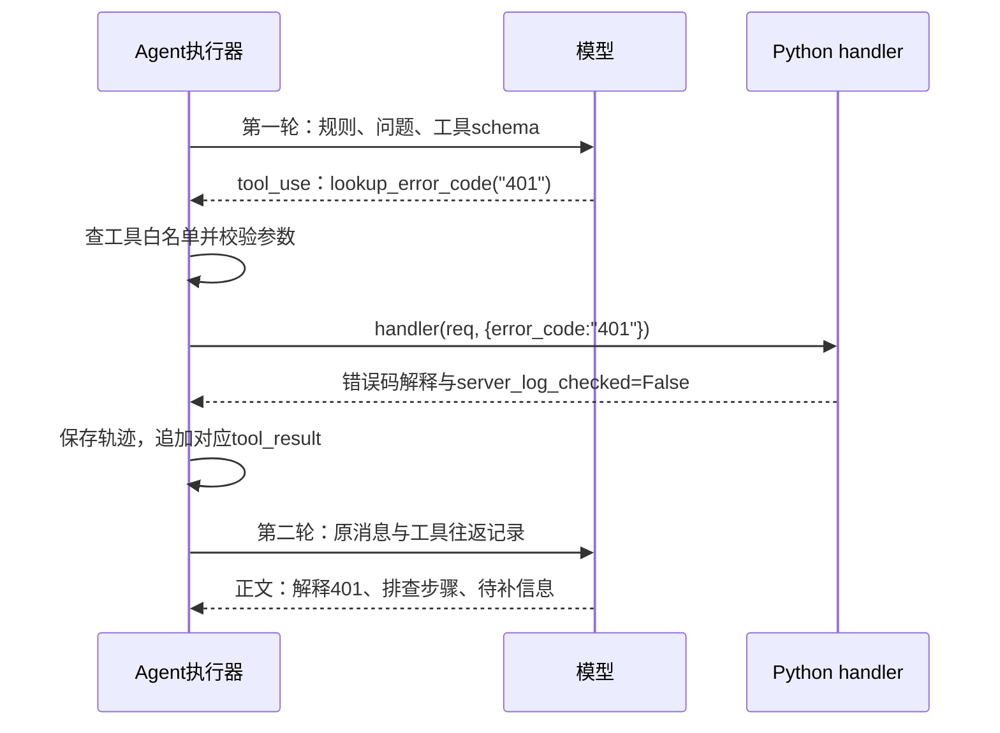

# 07 Agent 执行：谁来处理，模型怎样真正使用工具

> trace 合并版说明：本页保留附件的讲解与示例；当前主链增加 Context Planner、记忆演化、经验记忆、混合检索和 OTel。运行流程、接口变化与迁移以 [合并版本使用指南](../合并版本使用指南.md) 为准；文中的历史测试结果不是本次验收。

[教程目录](README.md) · [上一章](06-意图识别与三路融合.md) · [下一章](08-知识库RAG与MCP扩展.md)

> **第一次读先看这里：** 先看[四种角色](#section-01)、[一次工具往返](#section-06)和[Skills 怎样命中](#section-10)。暂时不用记住全部路由公式；先分清“谁处理”“能用什么工具”“工具返回了什么”。

上一章得到的是“这可能是登录故障”的识别结果。本章要把它继续变成一条有依据的回复：选处理角色，把已有信息整理给模型，按程序允许的范围执行工具，再把工具结果交回模型。我们一直追踪同一条消息：“登录返回 HTTP 401，怎么处理？”用户是 `reader_01`，会话是 `demo-login`，客户端消息编号是 `msg-001`。

为便于计算，下面**假设**本轮已识别为 `technical_login`，紧急度为 `LOW`，错误码实体为 `{"error_code":["401"]}`。这不是对真实模型输出的保证；识别也可能得到较宽的 `technical`。同样，后文的“模型选择某工具”是教学假设，工具执行以当前 Python handler 为准。

先带着三个问题阅读：选中 Technical 为什么还没有开始查错误码？模型写出工具名后，谁来检查参数？工具跑完之后，为什么还要再请求一次模型？

- [角色与输入 Request](#section-01)
- [领域路由和实例路由](#section-02)
- [system、messages、tools 怎样组成](#section-04)
- [工具往返的完整走读](#section-06)
- [结果返回、Skills、并行和失败](#section-09)
- [不用真实模型的 Skill 实验](#exercise)

<a id="section-01"></a>

## 1. 先把角色和本轮输入分清楚

### 1.1 当前四种角色具体做什么

`GeneralAgent` 是接待与澄清角色。问题不完整时，它可以用 `inspect_request_context` 查看本轮已有意图和字段，用 `suggest_required_fields` 判断还需要问什么。它拿到的是当前请求的快照，工具没有连接订单数据库。

`TechnicalAgent` 是故障诊断角色。它可以用 `lookup_error_code` 查本地错误码解释，用 `build_diagnostic_plan` 生成低风险排查顺序。它擅长整理排查建议，但当前没有“读取生产日志”的 handler。因此回答能说“401 通常与认证有关”，不能凭工具返回说“后台日志确认了令牌过期”。

`BillingAgent` 是账单核验角色。`check_billing_fields` 检查订单号、金额、时间、支付渠道是否齐全；`compare_amounts` 只算两笔已提供金额的差。字段齐全不等于账户验证完成，金额有差也不等于已确认重复扣款，更不等于已退款。

`EscalationAgent` 是人工交接节点。它虽然继承 `BaseAgent`、声明 `create_handoff_summary` 等工具范围，但当前重写了 `handle()`，直接根据意图、紧急度、实体拼出交接文字，**不进入 LLM 工具循环**。它返回 `escalate=True`、`tools_used=[]`。现有实现尚未连接真实工单队列，所以“已升级”在本项目里表示需要人工继续核验，而不是工单已创建。

前三种角色还可能拿到共享 RAG 和允许给该角色的外部 MCP 工具。每个角色最终可执行什么，以 `get_tools()` 返回的真实字典为准。

### 1.2 Request 是内部输入包，不是 HTTP 原始 JSON

[Request 的定义](../../agents/agent_orchestrator.py) 使用 `@dataclass`。可以把 dataclass 理解为“自动生成初始化方法的数据盒子”：`Request(message=..., user_id=...)` 创建的是一个有命名字段的 Python 对象。它不是模型，也不会自动执行其中的内容。

HTTP 入口先读取记忆和识别意图，再创建 `orch_req`。为突出参数来源，主线的对象可写成下面这样；`context` 和 `history` 用空会话情况，实体只展示非空字段，置信度 `0.84` 是三路演示值：

```python
orch_req = Request(
    message="登录返回 HTTP 401，怎么处理？",  # HTTP 请求的 message
    user_id="reader_01",                     # 鉴权后的最终身份
    conv_id="demo-login",                     # 本轮使用的会话
    context="",                              # MemoryContext.to_prompt_text()
    history=None,                            # 最近最多 5 条给意图识别用的消息
    entities={"error_code": ["401"]},         # 本轮识别结果
    intent=IntentCategory.TECHNICAL_LOGIN,
    intent_group="technical",
    urgency=UrgencyLevel.LOW,
    intent_confidence=0.84,
    conversation_state={},                   # 从 Redis 读到的旧业务状态
)
```

`request_id` 没有写在调用里，因为定义的 `default_factory` 会为这个对象创建一个服务端 UUID。它与 `msg-001` 不同：`msg-001` 在 API 层负责重试和回执；UUID 跟踪这次服务端执行。`field(default_factory=dict)`、`field(default_factory=list)` 和 `field(default_factory=set)` 还保证每个请求拿到独立的字典、列表、集合，避免两条请求意外共用工具记录。

`tool_attempts` 初始为空，用来记录工具是否可安全重试；`unsafe_tool_calls` 初始为空，防止本轮重复相同副作用操作；`before_unsafe_tool` 由 API 放入一个异步函数引用，在执行副作用前持久化回执标记。这些字段不作为原样 JSON 发给模型，而是执行器自己的控制数据。

`run()` 检查 `req.intent is None`：只有直接调用编排器、没有预先识别意图时才补识别。HTTP 主路径已有意图，因此跳过这一分支。接着它会 `merge_state()`，把当前实体与旧状态按任务规则合并。本轮空状态将得到技术领域与错误码来源；下一轮用户只补充“浏览器里稳定复现”，仍有机会沿用已记录的 401，规则详见第 05 章。

<a id="section-02"></a>

## 2. 第一层路由：这件事应该由哪个角色主办

当前 `run()` 调用的是 `_route_decision(req)`。文件中还有旧的 `_route(intent, urgency)` 静态映射，但只读它会漏掉主辅角色和监控降级。

路由先处理优先级最高的情况：`CRITICAL` 直接选 Escalation；意图为 `escalation` 或 `human_handoff` 也直接选 Escalation。我们的假设是 `LOW + technical_login`，所以继续计算领域分。

核心片段如下，省略了其他意图组和关键词表，计算方式保持原样：

```python
scores = {
    AgentType.GENERAL: 0.1,
    AgentType.TECHNICAL: 0.0,
    AgentType.BILLING: 0.0,
}
if req.intent in (
    IntentCategory.TECHNICAL,
    IntentCategory.TECHNICAL_LOGIN,
    IntentCategory.TECHNICAL_CRASH,
):
    scores[AgentType.TECHNICAL] += 0.75

technical_hits = sum(1 for kw in technical_kws if kw in msg)
scores[AgentType.TECHNICAL] += min(0.45, technical_hits * 0.18)
if entities.get("error_code"):
    scores[AgentType.TECHNICAL] += 0.2
```

把值代入：Technical 从 0 开始；`technical_login` 加 `0.75`；消息里的 `401` 命中一次关键词，加 `0.18`；非空错误码实体加 `0.2`，得到 `1.13`。General 保留 `0.1`，Billing 为 `0`。这份关键词表含“无法登录”“登录失败”，不含独立的“登录”，因此本例不能再额外加一次“登录”分。

随后排除当前暂不可用的专业角色，按剩余分数从高到低排列。技术实例健康时主角色就是 Technical。路由结果的 `confidence` 使用 `min(primary_score, 1.0)`，所以 `1.13` 被截到 `1.0`；这是规则分的表示，不能解释为百分之百正确的概率。

还要决定是否协作。`_collaboration_targets()` 用意图和领域关键词补充主意图没表达的第二个需求。本例只有技术信号，没有辅助角色。若消息改成“登录返回 HTTP 401，而且重复扣款”，就同时有技术和账单目标，Billing 可以成为辅助角色。

只有没有直接选出辅助目标时，程序才使用第二条补选规则：其他专业角色的分数至少 `0.45`，而且至少达到主分的 `55%`。这是补选条件，不是所有协作都必须跨过的统一门槛。

<a id="section-03"></a>

## 3. 第二层路由：同类角色中，哪个实例来执行

领域分回答“适合技术还是账单”。`_best_agent(AgentType.TECHNICAL)` 则回答“技术池中的哪个对象来执行”。当前默认每类只有一个实例；池能存多个对象，不代表运行时已经启动了多套服务。

代码是先过滤可用实例，再选运行分最大的一个：

```python
eligible = [
    a for a in agents
    if agent_type not in (AgentType.TECHNICAL, AgentType.BILLING)
    or a.stats.available()
]
return max(eligible, key=lambda a: a.stats.routing_score()) if eligible else None
```

这里 `a` 是一个实例，`a.stats` 是它自己的统计对象。`routing_score()` 用成功率、平均延迟、监控惩罚计算：

```python
latency_score = 1.0 / (1.0 + self.avg_ms / 1000)
base_score = self.success_rate * 0.7 + latency_score * 0.3
return base_score * max(0.0, 1.0 - self.monitor_penalty)
```

例如成功率 0.9、平均 1000 毫秒、惩罚 0.2：延迟分是 0.5，基础分为 `0.9×0.7 + 0.5×0.3 = 0.78`，运行分为 `0.78×0.8 = 0.624`。这个 `0.624` 与刚才领域分 `1.13` 含义完全不同。冷却和恢复探测见第 10 章。

### 读懂 TechnicalAgent(BaseAgent)、self 和 super()

`class TechnicalAgent(BaseAgent)` 表示 Technical 继承 Base 的通用执行能力。它不需要把模型请求和工具循环重新复制一份，只定义角色提示、Profile 和两个扩展方法。

调用 `technical.handle(req)` 时，Python 会把当前技术实例自动作为 `self` 传入。`self._client` 是这个实例使用的模型客户端，`self.profile` 是它的角色配置。Base 的 `handle()` 调用 `self._call_llm(req)`，再由 `self.get_tools()` 取当前角色实际工具表。

Technical 的工具方法是：

```python
def get_tools(self) -> Dict[str, AgentToolSpec]:
    tools = super().get_tools()
    tools.update(technical_tools())
    return tools
```

`super().get_tools()` 先执行父类实现，取得共享工具的副本；`update()` 再加入技术本地工具；`return` 把合并后的白名单交回执行器。`super()` 不是另外创建一个 BaseAgent，而是沿继承关系调用当前实例的父类方法。

因此执行顺序是 `run → _execute → Technical.handle（继承 Base 实现）→ _call_llm`。Technical 失败时 `_execute` 还可能转 General，所以 `primary_agent` 表示路由计划，单角色结果的 `agent_type` 表示实际完成处理的角色。

<a id="section-04"></a>

## 4. 发给模型的输入：system、messages、tools 各装什么

模型没有拿到整个 `Request` 对象。`_call_llm()` 把内部数据拆成三部分。

### 4.1 system 告诉模型“按什么规则处理”

`_build_system_prompt(req)` 从 Technical 的固定提示开始，追加 Profile 的使命、处理顺序、输入输出要求、升级条件、实际工具范围，最后追加命中的 Skills。Technical 当前使用温度 `0.1`、最大输出 `1200` tokens；角色模型可通过 `ECHOMIND_TECHNICAL_MODEL` 覆盖默认模型。

Profile 是带命名字段的 `@dataclass(frozen=True)` 对象。`frozen=True` 防止直接给配置字段重新赋值；启动时用 `dataclasses.replace(profile, model=...)` 生成替代配置。它描述角色的契约，不会自动给角色开权限。

### 4.2 messages 告诉模型“这轮已经知道什么”

有 `req.context` 时先插入一条 `[背景信息]` 消息；有实体时插入 `[结构化实体]` 消息；再插入 `[角色输入契约]` 和当前用户问题。中间的“好的，我已了解……”是程序构造的助手文字，不是额外请求了一次模型。

Technical 的 `_build_role_packet()` 先调用父类取得通用包，再补诊断字段。本例生成的 JSON 可以展开为：

```json
{
  "agent_type": "technical",
  "intent": "technical_login",
  "intent_group": "technical",
  "urgency": "LOW",
  "intent_confidence": 0.84,
  "available_entities": {"error_code": ["401"]},
  "diagnostic_fields": {
    "error_codes": ["401"],
    "environment_hint": "请从用户消息和背景中确认设备、系统、版本、网络",
    "risk_boundary": "不得要求密码、验证码、完整密钥；不得建议破坏性操作"
  }
}
```

`json.loads(super()._build_role_packet(req))` 把父类的 JSON 字符串变回字典，修改字段；最后 `json.dumps(..., ensure_ascii=False)` 再转成中文可读的 JSON 字符串。环境提示明确说“请确认”，因为程序并未从这一句消息确定浏览器版本。

`req.history` 在此处不会再逐条追加；它先供意图识别使用，近期原文已经由 MemoryManager 格式化进 context。不要误以为传入 history 就一定等于原样发送全量历史。

### 4.3 tools 告诉模型“可以提出哪些动作”

模型请求的核心代码如下：

```python
request_kwargs = {
    "model": self._model,
    "max_tokens": self.profile.max_tokens,
    "temperature": self.profile.temperature,
    "system": self._build_system_prompt(req),
    "messages": messages,
}
if tools:
    request_kwargs["tools"] = [
        {"name": spec.name, "description": spec.description,
         "input_schema": spec.input_schema}
        for spec in tools.values()
    ]
resp = await asyncio.wait_for(
    self._client.messages.create(**request_kwargs),
    timeout=max(1, _env_float("ECHOMIND_LLM_TIMEOUT_S", 15)),
)
```

`**request_kwargs` 将字典展开成同名关键字参数。`await` 表示在这里等异步请求结果，等待期间事件循环可以推进其他请求；不是另起一条用户消息。默认单次模型调用超时为 15 秒，API 整轮 50 秒还包含记忆读取、识别和提交，所以每个子步骤有自己的等待上限。

模型收到名称、说明、参数规则，但收不到 Python 函数本体。下一节解释函数怎样仍然能够被正确执行。

<a id="section-05"></a>

## 5. 工具登记卡：把模型认识的名字绑定到真实函数

[agents/tools.py](../../agents/tools.py) 中，`AgentToolSpec` 保存工具定义：

```python
@dataclass(frozen=True)
class AgentToolSpec:
    name: str
    description: str
    input_schema: Dict[str, Any]
    handler: AgentToolHandler
    allowed_agents: Optional[Tuple[str, ...]] = None
    retry_safe: bool = True
```

`handler` 是函数引用。注册时写 `lookup_error_code`，没有括号；含义是“把这个可调用对象存起来”，此时还没有查询。真正运行时才写 `spec.handler(req, args)`。`handler` 的约定是接收当前请求和工具参数，返回普通值或可等待结果。

`technical_tools()` 用 `make_tool()` 登记错误码工具。由它得到的 schema 是：

```json
{
  "type": "object",
  "properties": {
    "error_code": {"type": "string", "description": "例如 401、403、500"}
  },
  "required": ["error_code"],
  "additionalProperties": false
}
```

schema 是输入的规则说明：整体必须是对象，必须有 `error_code`，值必须是字符串，不能偷偷加 `delete_logs` 等多余字段。模型看到它有助于按格式输出，但执行器仍要独立校验；模型并不总能遵守格式。

共享工具还先按 `allowed_agents` 过滤。`None` 表示不额外限制角色；否则只有包含当前角色字符串的登记卡进入 `get_tools()`。Profile 的 `tool_scope` 是职责说明，真实权限来自这个工具字典和执行前检查。

<a id="section-06"></a>

## 6. 一次正常往返：模型提议动作，程序执行，再让模型写正文

假设模型第一轮认为需要查 401，返回下面的块。这是模型的结构化响应，不是程序已经查完的证据：

```json
{
  "type": "tool_use",
  "id": "toolu_demo_401",
  "name": "lookup_error_code",
  "input": {"error_code": "401"}
}
```

`type` 标识工具请求；`name` 用来查本地白名单；`input` 是参数；`id` 让下一次工具结果能对应这一条请求。同一响应可有多个 tool_use，每个应有各自 ID。



注意两次模型调用属于同一个 `msg-001` 的服务端处理。用户不用再点击一次发送。

<a id="section-07"></a>

### 6.1 查名字、验参数、执行 handler，逐句代入

执行器从响应中取 `name="lookup_error_code"`、`args={"error_code":"401"}`，执行 `spec = tools.get(name)`。若字典没有该名字，只构造错误结果，不按模型给的字符串动态导入函数。

找到登记卡后，先用 jsonschema 校验。当前验证函数的关键实现是：

```python
if not isinstance(args, dict):
    raise ValueError("工具参数必须是 JSON 对象")
validators.validator_for(spec.input_schema)(spec.input_schema).validate(args)
```

`validator_for()` 根据 schema 选择对应验证器；`.validate(args)` 不返回业务结果，参数违规时抛异常。`{"error_code":401}` 中的 401 是数字，会被拒绝；`{"error_code":"401"}` 是字符串，才进入 handler。缺字段、多字段也会被拒绝。

对默认 `retry_safe=True` 的错误码工具，随后记录尝试并执行：

```python
req.tool_attempts.append({"tool_name": name, "retry_safe": spec.retry_safe})
result = spec.handler(req, args)
if inspect.isawaitable(result):
    result = await result
tools_used.append(name)
if isinstance(result, dict) and "success" in result:
    result_success = bool(result.get("success"))
```

`lookup_error_code()` 是同步函数，立刻返回字典；`inspect.isawaitable(result)` 为假，跳过 await。知识搜索是 `async def`，调用先得到一个协程对象，必须 await 才能得到片段结果。这段兼容逻辑把两种 handler 放在同一循环里。Agent 执行层不会自动把所有同步 handler 移到线程池，因此新增耗时同步工具时要自行避免阻塞；第 08 章的知识库适配已明确使用 `asyncio.to_thread()`。

错误码 handler 取参数，转大写并去掉两端空白，在本地 mapping 查找。代入 `"401"` 后，**真实返回字典**为：

```json
{
  "error_code": "401",
  "meaning": "认证失败",
  "next_steps": [
    "确认 Token/API Key 是否过期",
    "确认请求时间戳和签名",
    "确认账号登录状态"
  ],
  "server_log_checked": false
}
```

它没有 `success` 字段，故 `result_success` 保持 `None`。这不是失败；执行器已正常拿到返回值。它也没有检查用户的真实 Token，没有检查服务端日志，所以不能把可能原因升级成已验证根因。

<a id="section-08"></a>

### 6.2 返回值不是直接 HTTP 返回，而是先变成 tool_result

执行器保留模型原始响应：`messages.append({"role":"assistant","content":resp.content})`。然后把 handler 返回字典序列化为字符串，生成工具结果：

```python
tool_results.append({
    "type": "tool_result",
    "tool_use_id": tool_use_id,
    "content": json.dumps(result, ensure_ascii=False),
    "is_error": not call_success or result_success is False,
})
messages.append({"role": "user", "content": tool_results})
```

本例 `call_success=True`，`result_success=None`，所以 `is_error=False`；`tool_use_id="toolu_demo_401"` 对上第一轮工具 ID。这里 role 为 user 是 Anthropic 兼容协议的工具结果消息格式，不是收到新的 HTTP 请求。

为了读起来清楚，可把第二轮新增的两条消息展开为：

```text
assistant:
  tool_use(id=toolu_demo_401,
           name=lookup_error_code,
           input={"error_code":"401"})
user:
  tool_result(tool_use_id=toolu_demo_401,
              content="上一小节完整字典的JSON字符串",
              is_error=False)
```

这个展示将 SDK 对象与 JSON 字符串简化成文字，实际 `content` 是完整序列化结果，不能把上面的说明字符串复制成生产代码。

第二轮模型因此能结合“认证失败”“未读日志”写正文，例如“401 通常表示认证未通过。先确认登录状态，再检查令牌有效期和签名时间。若仍失败，请补充发生时间、环境版本和 request_id；目前尚未核验后台日志。”这段正文是教学示意，真实措辞由模型生成。

### 6.3 第二轮还想用工具，程序怎样继续

例如模型第一轮查错误码，第二轮又提出 `build_diagnostic_plan`，第三轮才给最终正文。每次都是“保存 assistant 的 tool_use → 执行工具 → 插入 user 的 tool_result → 下一轮模型”。若同一轮请求多个工具，当前 `for block in tool_uses` 会按顺序执行，处理完后一起回传。

循环是 `for _ in range(3)`，所以最多请求模型三轮，不是最多调用三个工具。第三轮仍返回工具请求时，程序照常执行这些工具，但没有第四轮生成正文，最后抛 `AgentCallError`。第三轮即使包含一段文字，只要仍有 tool_use，也不会作为最终正文直接返回。

没有 tool_use 的响应才提取文本：空白文本是失败；非空且 `stop_reason="max_tokens"` 表示截断，返回 `status="partial"`；正常非空文本返回 `status="success"`。

<a id="section-09"></a>

## 7. 工具轨迹和结果对象怎样一路回到 API

工具执行后，本例会记录下面这样的轨迹。耗时 `0.2` 是示意值，其余结构按当前代码展开：

```json
{
  "agent_type": "technical",
  "tool_name": "lookup_error_code",
  "tool_use_id": "toolu_demo_401",
  "input": {"error_code": "401"},
  "success": true,
  "result_success": null,
  "latency_ms": 0.2,
  "cached": false,
  "reranked": false,
  "error": "",
  "source": "local",
  "mcp_server": null,
  "mcp_tool": null,
  "retry_safe": true
}
```

这里 `success` 表示名字、参数、handler 的执行层面正常；`result_success` 表示 handler 显式返回的业务 success，没有该字段就是 null。例如 RAG handler 正常返回 `{"success":false,...}`，轨迹可以同时出现 `success=true` 和 `result_success=false`，模型收到的 `is_error` 仍为真。

`tools_used` 只在 handler 返回后追加名字，表示执行器拿到了返回值，不能单独证明业务成功。轨迹也不保存完整工具正文，若要核对知识证据，还需查看返回片段或固定测试输入。

随后有三层返回：

```text
_call_llm → AgentCallResult(content, tools_used, tool_traces, status)
handle    → AgentResponse(agent_type, content, success, latency_ms,
                          escalate, tools_used, tool_traces, status, error_code)
run       → OrchestratorResult(request_id, response, 路由信息,
                              tools_used, tool_traces, status, retryable, ...)
```

第一层只表达本次模型循环结果；第二层加实际角色、耗时和升级建议；第三层加本轮服务端 UUID、路由计划和重试状态。`handle()` 用回答中的简单关键词检测 `escalate`，`run()` 再合并紧急度和明确人工意图。这个升级标志并不触发真实工单创建。

API 从 OrchestratorResult 装配 `ChatResponse`。本例只查错误码时 `tools_used=["lookup_error_code"]`，`knowledge_used=False`；只有成功的 `search_knowledge_base` 轨迹才会使该布尔值为真。第 09 章继续解释这份响应怎样与用户消息一起提交。

<a id="section-10"></a>

## 8. Skills 怎样命中，怎样改变这轮 system

项目自己的 [SkillManager](../../core/skill_loader.py) 扫描 `skills/`，加载 Markdown、文本和 JSON 规范。比如 [技术支持 Skill](../../skills/technical_support/SKILL.md) 的头部配置含 `agents: technical`、`keywords: ...401...`、`enabled: true`。

对本例，它依次判断：规则启用吗？当前角色 technical 在允许角色内吗？消息含任一关键词吗？`401` 命中，因此生成说明文本，再拼入 system。默认单份正文最多 3200 字符，整次 Skill 块预算为 5000 字符，标题、说明和提示前缀还有开销，长文件后半段可能不会进入模型。

实际调用是：

```python
skill_prompt = self._skill_manager.prompt_for(req.message, self.agent_type.value)
if not skill_prompt:
    return base_prompt
return f"{base_prompt}\n\n[动态 Skills]\n{skill_prompt}"
```

关键词只检查当前 `req.message`。例如下一轮仅说“还是不行”，即使 context 中仍有 401，也不保证再次命中这份关键词 Skill。无 keywords 的 Skill 则对允许的角色全局注入。每次模型轮次都重新构建 system，日志可能对同一请求出现多次“Skills 已注入”。

Skill 中写“先确认现象”“不得编造日志”“解释每一步的目的”，会影响模型的处理方式，但不会执行 Python，也不会新增工具。要让系统真的查某种数据，必须实现 handler、登记 schema、给目标角色开放工具，再写如何使用该能力的 Skill。仅写“自动退款”无法连接支付平台。

<a id="section-11"></a>

## 9. 复合问题：主辅角色并行后，还要合成

把消息改成“登录返回 HTTP 401，而且重复扣款”。路由计划假设为 Technical 主办、Billing 辅助。`run_parallel()` 对计划角色各建一个 `_execute(req, at)` 协程，再执行：

```python
responses = await asyncio.gather(*tasks, return_exceptions=True)
valid_responses = [r for r in responses if isinstance(r, AgentResponse)]
composed = await self._composer.compose_result(req, valid_responses)
```

`gather` 允许两个角色的等待重叠；`return_exceptions=True` 使一个分支异常时仍能收集另一个结果。每个角色仍有自己的消息列表和模型工具循环，不是两角色轮流续写同一条模型 messages。

Composer 先选 `success=True` 且内容非空的回答：没有可用回答则 failed；只有一个则直接采用，其他分支失败使最终为 partial；多个则额外请求模型合成。合成输入包含用户原问题和各角色正文，要求去重、保留排查步骤与资金核验边界，不能补造退款结果。

若合成模型报错或回复空白，代码按原顺序拼接已有回答，第二份起加“补充说明：”。回退状态按原专业响应是否完整计算，因此合成失败但已有回答都完整时，不一定标为 partial。合成文本被 max_tokens 截断才另标 partial。

返回的 `primary_agent` 和 `supporting_agents` 是计划；并行 `agent_type` 仍保留计划主角色；`agent_types` 优先列实际成功的角色。专业分支可能各自兜底到 General，要结合 `agent_fallback` 轨迹解释实际经过谁。

并行共享同一 `Request`，包括工具尝试和副作用去重集合。它有利于在本轮统一判断是否允许重试，但新增会改数据的工具时，还必须有业务系统自己的幂等约束。两个角色一起工作也不保证更快：多次模型往返后还有合成调用。

<a id="section-12"></a>

## 10. 失败分支：哪些能修正，哪些不能自动重放

### 参数或工具错误：先给模型机会纠正

陌生名字返回“工具不在白名单中”；`{"error_code":401}` 返回 schema 类型错误；handler 抛异常则包装成 `{"success":false,"error":...}`。执行器把这些转成 `is_error=True` 的 tool_result，再进入下一模型轮次。模型可以改成字符串再试，也可以向用户说明缺少能力。一次工具错误不必然让整轮 HTTP 失败。

### 模型循环失败：保留发生过的工具记录

模型超时、回复空白、超过三轮等抛 `AgentCallError`，其中保存本轮已有 `tools_used` 和 `tool_traces`。Base `handle()` 捕获后返回 failed 的 AgentResponse，避免已经执行过的工具在失败结果里完全消失。Technical/Billing 失败时，`_execute()` 通常尝试 General，并把原轨迹、`agent_fallback` 事件、新轨迹合并。General 和 Escalation 不走这个专业兜底分支。

### 有副作用的工具：执行前先保存“结果待核验”

当前这些本地查表、字段检查、算术工具默认可安全重试。若新增 `retry_safe=False` 的工具，执行器先把 `[name,args]` 规范序列化，检查同一请求是否已出现完全相同操作；未出现则加入 `unsafe_tool_calls`。接着记录 attempt，并在 handler **之前** `await req.before_unsafe_tool(name)`。

API 放入的这个函数是闭包：函数定义在 `chat()` 内部，记住外层 `client_id`、会话、原消息、`orch_req.request_id`。以后执行器调用它时，不必再传所有这些参数，它仍可写入该请求的 failed、retryable=false、`tool_outcome_unknown` 回执。第 09 章展示这份提交的具体结构。

若此后超时或进程中断，原 `msg-001` 重试先读到标记，避免自动再执行一次结果不明的修改。若角色失败且已有任何不安全工具尝试，General 兜底也被阻止。这个机制只保护当前应用的重放边界；外部业务真正做没做成，仍要用幂等 ID 和业务查询核验。

理解这一循环后，第 08 章就可以把 `lookup_error_code` 换成 `search_knowledge_base`，追踪真实文档片段如何进入同一 tool_result。

<a id="exercise"></a>
## 实验：确认 Skill 加载并命中技术角色

先在项目根目录使用 Python 3.12 观察实际文本选择，不请求模型：

```bash
python3.12 - <<'PYCODE'
from core.skill_loader import SkillManager

manager = SkillManager("skills")
manager.load()
assert not manager.errors, manager.errors
prompt = manager.prompt_for("登录返回 HTTP 401，怎么处理？", "technical")
assert "技术支持处理规范" in prompt
print("loaded:", manager.summary()["count"])
print(prompt[:300])
PYCODE
```

修改已有 Skill 后，运行中的服务需要重新加载，使用 admin 身份：

```bash
curl --noproxy '*' -X POST -H "Authorization: Bearer ${ECHOMIND_TUTORIAL_TOKEN:-}" \
  http://localhost:8000/skills/reload
```

先检查返回的 `count` 和 `errors`，再用新 `client_request_id` 发送消息，并在日志查找 `Skills 已注入`。只看 `/skills` 的加载列表不能证明某一轮命中；同编号重试也不会重新生成提示词。Skills 是 Python 处理规范，本教程中的加载器与客户端自身的 Skills 功能无关。

检查点：要添加真实能力，应在 `agents/tools.py` 注册 handler/schema，并让目标角色的 `get_tools()` 返回它；仅修改 Skill 正文只能改处理规则。工具循环的确定性往返测试见第 12 章，无需靠多次真实模型请求碰运气。
