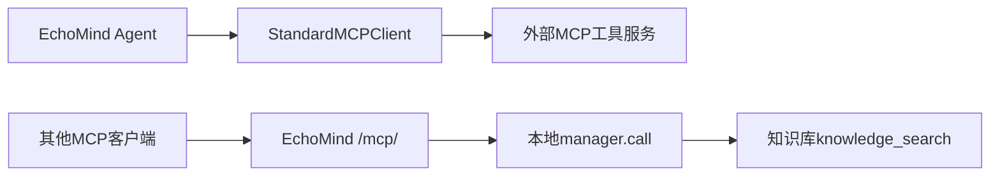

# 08 知识库与 MCP：一篇资料怎样进入模型的回答

> trace 合并版说明：本页保留附件的讲解与示例；当前主链增加 Context Planner、记忆演化、经验记忆、混合检索和 OTel。运行流程、接口变化与迁移以 [合并版本使用指南](../合并版本使用指南.md) 为准；文中的历史测试结果不是本次验收。

[教程目录](README.md) · [上一章](07-Agent路由Skills与工具执行.md) · [下一章](09-记忆提交压缩与画像更新.md)

> **第一次读先看这里：** 先完成[已有的导入与检索实验](#section-10)，再对照[三个搜索名字](#section-02)和[结果如何交回模型](#section-09)。需要排查召回问题时再细读改写、去重、重排；MCP 双向接入可以作为第二遍阅读。

第 07 章的错误码工具能说出 401 的一般含义，但不知道你自己的产品怎样重新授权、应该收集哪些排查信息。本章继续使用 `reader_01 / demo-login` 的登录问题，先导入一篇“登录异常处理规范”，再追踪它怎样被切成片段、检索、排序，最后回到聊天模型。

这里有两类模型：聊天模型负责面向用户组织回复；检索链路还可能请求模型改写查询和重排候选。它们是不同调用，不能把一次聊天理解为必然只请求一次模型。文中的查询改写、召回顺序和分数均为教学示例，真实值取决于文档库、向量模型和模型输出。

- [RAG 与 MCP 分别解决什么](#section-01)
- [先导入并检索一篇教学规范](#section-10)
- [三个搜索名字及其调用关系](#section-02)
- [改写、并行召回、去重、重排的走读](#section-04)
- [文档更新、缓存和标准 MCP 双向接入](#section-11)

<a id="section-01"></a>

## 1. 先用两句话把 RAG 和 MCP 分清楚

**RAG** 可以按“先找资料，再据资料回答”来理解。模型无需把公司的每篇政策记在参数里；应用先从资料库检索相关片段，再把片段放入模型这一轮可读的输入。当前本地资料存在 ChromaDB 的 `knowledge_base` 集合中。

**MCP** 是客户端与工具服务沟通的协议。比如 EchoMind 可以作为客户端访问配置允许的外部资料服务，也可以作为服务端，把本地知识搜索暴露给其他 MCP 客户端。

RAG 是处理过程，MCP 是通信方式。当前本地 RAG 的 Python handler 直接调用本地管理器与 ChromaDB，名字 `MCPToolManager` 不表示这些调用自动经过了远端 MCP。

本章的主线为：

```text
规范文件 → /knowledge/add → 切片与向量存储
用户问题 → Agent工具请求 → 改写与召回 → 去重与重排
                                      ↓
                         片段字典 → tool_result → 聊天模型正文
```

记忆模块的 `episodic`、`user_profile` 与知识库 `knowledge_base` 是不同集合。公司规范不是用户历史；它们有不同写入入口、过滤和检索规则，不能因为都存 ChromaDB 就混用。

<a id="section-10"></a>

## 实验一：先导入一篇规范，再直接检索

先选好练习环境，再执行下方命令。新建的开发环境可以直接使用；如果当前库里有要保留的资料，使用[附录的独立练习环境](附录-接口配置与数据字典.md#tutorial-environment)，不要靠换 user_id 或 conv_id 隔离知识库。

此实验会写入 `tutorial-login-policy`，所有使用该知识库的会话都可能检索到它。同 ID 重复上传会更新原资料。当前没有 HTTP 文档删除接口，所以本教程用独立数据卷实现整套练习数据的清理，具体命令在附录；不要删除整个正式知识集合来清理一篇教程文档。

服务运行后，在项目根目录执行。开启鉴权时使用 admin 的 `ECHOMIND_TUTORIAL_TOKEN`。独立练习环境默认关闭鉴权，不需要设置这个变量。

```bash
curl --noproxy '*' -i -H "Authorization: Bearer ${ECHOMIND_TUTORIAL_TOKEN:-}" \
  -H 'Content-Type: application/json' http://localhost:8000/knowledge/add \
  --data-binary @- <<'JSON'
{"documents":[{"document_id":"tutorial-login-policy","title":"教程：登录异常处理规范","content":"出现 HTTP 401 时，先确认登录状态和令牌有效期。仍无法定位时，收集发生时间、客户端版本和 request_id。当前资料仅为教程示例，不代表真实企业政策。"}]}
JSON

curl --noproxy '*' -H "Authorization: Bearer ${ECHOMIND_TUTORIAL_TOKEN:-}" \
  http://localhost:8000/knowledge/stats

curl --noproxy '*' -X POST -H "Authorization: Bearer ${ECHOMIND_TUTORIAL_TOKEN:-}" \
  --get --data-urlencode 'query=HTTP 401 登录规范' --data-urlencode 'top_k=3' \
  http://localhost:8000/search
```

最后一条明确使用 **POST + URL 查询参数**，不是 JSON 请求体。它会请求改写模型，候选足够时还会请求重排模型，因此不是离线实验。

导入返回应包含 `added_chunks`、`total_chunks`，但 `added_chunks` 表示本次写入量，不是库净增长。检索返回 `results` 数组，检查标题、`content`、`document_id`、`version`，确认示例规范是否被召回；不能只检查数组非空。库中有其他文档时，不保证每条结果都是教程文档。

之后在 `/chat` 发送“请按知识库的登录规范排查 HTTP 401”，使用新的客户端消息 ID。只有模型实际调用 `search_knowledge_base` 且工具返回成功，`knowledge_used` 才为真。直接 `/search` 的成功可以独立证明检索链路可用，不能保证聊天模型必定选择该工具。


### 从这次导入看清后台究竟存了什么

实验上传的文档短于 500 字符，因此只形成一个片段。它不是只把标题存入库，也不是把整篇文章放进 system；实际保存的是片段正文、对应向量和元数据。

`add_knowledge()` 先把 Pydantic 文档对象转换为字典，再调用：

```python
count = await kb.add_documents_async(
    [d.model_dump(exclude_none=True) for d in body.documents]
)
```

其中 `exclude_none=True` 去掉没提供的可选字段。`add_documents_async()` 使用 `asyncio.to_thread(self.add_documents, documents)`，把同步 ChromaDB 写入放到线程池；`await` 等入库完成后再返回 `added_chunks`。如果客户端刚收到成功响应，服务端已经等过这次写入。

在 [KnowledgeBase.add_documents](../../tooling/knowledge_base.py) 中，每篇先检查标题、正文是否非空字符串，显式 ID 是否非空字符串，再计算身份：

```python
identity = json.dumps(
    ["explicit", explicit_id] if explicit_id else ["title", title],
    ensure_ascii=True,
)
document_id = hashlib.sha256(identity.encode()).hexdigest()
chunks = self._chunk_text(content, chunk_size=500)
version = hashlib.sha256(content.encode()).hexdigest()
ids = [f"{document_id}:{i}" for i in range(len(chunks))]
```

代入实验参数，`identity` 编码的是 `["explicit","tutorial-login-policy"]`，因此文档身份由显式编号决定；检索返回的 `document_id` 是 64 位哈希，不是上传的 `tutorial-login-policy` 字符串。`version` 只根据正文计算，正文不变则版本不变。标题改了但显式编号不变，仍视为同一份资料。

假设把这篇规范扩充为三组句子，长度分别约 220、220、180 字符。切片器按句号和换行拆句，按 500 字符预算组合：前两组能放进第一片，第三组进入第二片，得到索引 0、1。单句超过 500 字符时还会拆成较短段；没有片段重叠，切片后也没有自动把邻片补到搜索结果中。因此一项命中可能只拿到操作步骤，拿不到另片中的例外条件。

对两个片段，写入结构如下。`doc_hash`、`version_hash` 是为了可读替代真实哈希，正文也使用示意；字段结构与源码一致：

```python
self._collection.upsert(
    ids=["doc_hash:0", "doc_hash:1"],
    documents=["规范前半段全文", "规范后半段全文"],
    metadatas=[
        {"title": "教程：登录异常处理规范", "document_id": "doc_hash",
         "version": "version_hash", "chunk_index": 0, "total_chunks": 2},
        {"title": "教程：登录异常处理规范", "document_id": "doc_hash",
         "version": "version_hash", "chunk_index": 1, "total_chunks": 2},
    ],
)
```

`upsert` 表示同 ID 已有就更新，没有就新增。未传 `embedding_function` 时使用 ChromaDB 客户端默认文本向量模型，由客户端将文本转向量，传给 ChromaDB 保存。它与第 06 章意图识别的 BGE/local-ngram 路线独立；修改意图向量配置不会自动改变这份知识库的向量。

<a id="section-02"></a>

## 2. 三个“搜索”名字，其实在三个入口层

最容易绕晕的是三个名字都像搜索，却不是同一个接口：

| 名字 | 谁会看到它 | 最后进入哪里 |
| --- | --- | --- |
| `search_knowledge_base` | 聊天模型的工具列表 | Agent 包装 handler → `search_with_rewrite()` |
| `knowledge_search` | 本地 `MCPToolManager` 的登记表 | `kb.search_handler` → ChromaDB |
| `search_local_knowledge` | 其他客户端读取本应用 MCP 工具目录 | MCP 服务 → `manager.call("knowledge_search",...)` |

HTTP `/search` 又是单独的调试入口：直接调用 `search_with_rewrite("knowledge_search", query, top_k)`，不要求聊天模型先选工具。

### 为什么要有外层和内层两份登记

模型需要的接口是“给我问题和 top_k，返回可用于回答的片段”。工具管理器还要处理超时、缓存、熔断、统计，所以内层保存 `Tool` 登记卡，绑定真正的知识库 handler。

启动时在 [api/main.py 的 lifespan](../../api/main.py) 中注册：

```python
_tool_manager.register(Tool(
    name="knowledge_search",
    description="搜索知识库（基于 ChromaDB 向量检索）",
    handler=kb.search_handler,
    schema={
        "type": "object",
        "properties": {
            "query": {"type": "string", "minLength": 1, "maxLength": 2000},
            "top_k": {"type": "integer", "minimum": 1, "maximum": 20},
        },
        "required": ["query"],
    },
    cache_ttl=300.0,
    supports_rerank=True,
    fallback=knowledge_fallback,
))
```

`kb.search_handler` 是绑定方法引用：它已经记住 `kb` 这个实例，管理器以后只需传 `params, context`，Python 自动把 kb 作为 self。登记时没有括号，所以不会提前搜索。导入接口还通过 `tool.handler.__self__` 找回这个知识库实例。

外层 `build_shared_rag_tools(tool_manager)` 在内部定义一个异步函数，再把它放进 AgentToolSpec。这个函数是闭包，会记住构建时传入的 manager：

```python
async def search_knowledge_base(req, args):
    query = str(args.get("query") or req.message or "").strip()
    top_k = args.get("top_k", 5)
    result = await tool_manager.search_with_rewrite(
        "knowledge_search", query, top_k=top_k,
    )
    # 后续把 ToolResult 转成普通字典
```

API 刷新共享工具时，给线上 Agent 接入线上 manager，给评测 Agent 接入隔离的评测 manager。因此文本可用同一库，缓存、熔断、运行统计却不应相互污染。闭包让外层工具名称保持一致，同时选择正确管理器。

<a id="section-03"></a>

## 3. 用户问题如何变成一次检索输入

用户可以在同会话继续问“请按知识库的登录规范排查 HTTP 401”，使用尚未用过的客户端编号，例如 `msg-003`。如果第 02 章已经用 `msg-002` 发送“重登过了，还是不行”，这里不能把它复用于另一段文字，否则会得到 HTTP 409。技术角色收到的背景包括已提交的前文，而模型是否查资料仍由这一轮响应决定。

假设它提出：

```json
{
  "type": "tool_use",
  "id": "toolu_demo_kb",
  "name": "search_knowledge_base",
  "input": {"query": "HTTP 401 登录规范", "top_k": 3}
}
```

第 07 章的执行器先检查 Agent 白名单和 schema。此工具要求 query 是 1—2000 字符的非空字符串，top_k 是 1—20 的整数，拒绝多余参数。通过后调用外层异步 handler；这里 `req` 来自当前请求，`args` 来自模型的 input。

外层取到 `query="HTTP 401 登录规范"`、`top_k=3`，`await search_with_rewrite(...)`。这个 await 会等待“改写、召回、去重、重排”完成，得到 `ToolResult` 后才回到 Agent 循环。原用户消息不必整段用作搜索词；模型可以提炼关键词，但程序对其参数范围负责。

接下来沿这个 query 走完检索链路。

<a id="section-04"></a>

## 4. 查询改写：保留原问题，再增加搜索角度

`search_with_rewrite()` 先检查 query 与 top_k，避免空问题和非法数量进入后续调用。再执行 `await self.rewrite_query(query, n=3)`。

改写模型收到的是要求返回 JSON 数组的提示，例如“将 HTTP 401 登录规范改写为 3 个不同角度的搜索子查询”。教学假设它返回：

```json
["登录身份认证失败处理规范", "令牌过期重新授权步骤", "401排查需要收集哪些信息"]
```

程序从输出文字中解析数组，过滤非字符串和空字符串，每项最多 2000 字符，再与原查询合并：

```python
return list(dict.fromkeys(
    [query] + [q[:2000] for q in queries if isinstance(q, str) and q.strip()][:n]
))
```

`dict.fromkeys()` 在这里保留首次出现顺序并去重。于是本例最多得到四条：原问题在前，三个新角度随后。改写模型重复输出原查询时不会重复搜；输出三项不代表新增三项一定不同。

为什么保留原查询？改写可能把重点偏移到 Token；原查询仍有机会命中直接写着“HTTP 401”的规范。改写超时默认 10 秒，模型报错或 JSON 解析失败时返回 `[query]`，继续只查原问题。这样改写不可用不必让整个搜索中断。

`n=3` 控制改写角度，`top_k=3` 控制最终片段数量，两者只是本例数值相同，不能混为一个参数。

<a id="section-05"></a>

## 5. 并行召回：四条查询怎样通过缓存、熔断和 handler

每条 query 先召回 `max(top_k,5)` 条，本例就是五条，给后续筛选留空间：

```python
recall_k = max(top_k, 5)
tasks = [
    self.call(tool_name, {"query": q, "top_k": recall_k}, context, use_cache=True)
    for q in sub_queries
]
results = await asyncio.gather(*tasks, return_exceptions=True)
```

每项任务都是调用同名内层 `knowledge_search`，参数的 query 不同。`gather` 让等待重叠，返回结果列表仍对应输入任务顺序。四条×五个候选位置不意味着有二十篇不同资料；同一规范片段可能被四路反复找到，库里不足五片时也只返回现有数量。

`manager.call()` 的真实顺序是：找登记工具 → 校验参数 → 查缓存 → 检查熔断 → 限时执行 handler → 缓存成功结果。

参数校验失败直接返回失败 ToolResult，不累计成“知识库服务坏了”。缓存以工具名、参数、上下文、重排设置和缓存版本构造键；本地查询默认缓存 300 秒。相同 query 但 top_k 从 5 改为 3，是不同键。缓存命中会跳过这次 ChromaDB 搜索，却不会跳过外层的模型改写；当前外层仍先生成子查询再逐条查缓存。

缓存没命中才看熔断器。默认连续五次依赖执行失败后打开，60 秒后允许一次恢复探测；探测未结束时其余请求仍降级。缓存可在熔断检查之前命中，所以熔断期间可能仍返回未过期的成功缓存。

真正执行由下面这一行限制超时，Tool 的默认等待上限是 30 秒：

```python
data = await asyncio.wait_for(
    self._run_handler(tool, params, context), timeout=tool.timeout_s
)
```

内层 `_run_handler()` 优先 await 异步 handler；历史同步 handler 则用线程池执行，以免堵住事件循环。成功拿到列表后更新统计并缓存。调用抛异常或超时则返回 `success=False`，fallback 可生成“知识库暂不可用”的说明，但仍保留失败标记，不能把这段说明当成真正文档证据。

<a id="section-06"></a>

## 6. 向量检索：查询文本怎样对应入库片段

`kb.search_handler(params, context)` 从 params 取 query、top_k，再调用 `search_async()`；后者用 `asyncio.to_thread(self.search, query, top_k)` 等同步 ChromaDB 操作。当前 handler 不使用 context，也没有自动按租户分区知识库。

`search()` 的核心是：

```python
count = self._collection.count()
if not count:
    return []
results = self._collection.query(
    query_texts=[query],
    n_results=min(top_k, count),
)
```

`query_texts` 是列表，即使只查一条也写 `[query]`；ChromaDB 用同一个文本向量方法表示查询，搜索与它接近的片段向量。`count` 是片段数，不是原始文章数。只有三片资料时，`n_results` 不会要求返回五片。

ChromaDB 原始结果按“第几个查询”嵌套：`documents[0]`、`metadatas[0]`、`distances[0]` 是本次这一个 query 的结果。代码用 `zip()` 把正文、元数据、距离一项项对应，转换成普通片段字典：

```python
items.append({
    "title": meta.get("title", ""),
    "content": doc,
    "score": round(1.0 - dist, 4),
    "chunk": meta.get("chunk_index", 0),
    "document_id": meta.get("document_id", ""),
    "version": meta.get("version", ""),
})
```

例如距离假设为 0.23，显示 score 为 `1-0.23=0.77`。这只是对底层距离的变换，距离度量由集合配置决定，当前代码没有把它校准为概率，也不保证一定在 0—1。不要依据 `0.77` 直接断言“77% 确认该规范适用”。

这一步返回的是 `List[Dict]`。管理器把它装成 `ToolResult(success=True,data=items,tool_name="knowledge_search",...)`，再交回外层召回任务。一次底层调用可能成功返回空列表；外层还要判断是否最终有任何可用片段。

<a id="section-07"></a>

## 7. 合并去重：多路命中同一片段只保留一次

假设四路列表分别为 `[A,B,C]`、`[A,D]`、`[B,E]`、`[A,C]`。A 是登录规范第一片，B 是第二片，C/D/E 是库里其他资料。代码按任务顺序逐路扫描，只接收 `ToolResult.success=True` 且 data 是列表的结果。

对于有 content 的字典，片段身份使用 `document_id、title、content、chunk` 四项，转为排序后的 JSON，再算 SHA-256：

```python
identity = {
    k: item.get(k)
    for k in ("document_id", "title", "content", "chunk")
}
key = hashlib.sha256(
    json.dumps(identity, sort_keys=True, ensure_ascii=False).encode()
).hexdigest()
if key not in seen:
    seen.add(key)
    merged.append(item)
```

第一路加入 A/B/C；第二路 A 已见过，跳过，只加 D；第三路 B 跳过，加 E；第四路全重复。最后 `[A,B,C,D,E]` 共五片。这避免同一条政策因为四路都命中，被当成四份独立证据。

这里没有先按各路 score 全局排序：保留首次出现的片段和顺序。跨查询分数也没有专门归一化。去重身份不含 version，所以同一内容、身份、标题和位置不因版本字段不同就重复保留。

某一路报错，不会阻断其他路的成功片段。若所有路都失败或只返回空列表，merged 为空，外层返回 `success=False,data=[]`，附“检索无可用结果”及能够收集到的错误。它不会把 fallback 的安慰文字拼进资料列表。

<a id="section-08"></a>

## 8. 重排：从五个候选里选最适合当前问题的三个

有了五片候选，还不能简单拿向量召回的前几片作为唯一依据。`_rerank_with_status(query, merged, top_k=3)` 用模型理解原问题与候选关系。

候选不超过 3 片时直接返回全部，`reranked=False`，不额外请求模型。超过 3 片时，代码给每项编号，生成简短预览：

```python
items_text = "\n".join(
    f"{i}. {json.dumps(item, ensure_ascii=False)[:200]}"
    for i, item in enumerate(items)
)
```

`enumerate()` 产生 0—4 的索引，模型需要返回这些索引的相关性顺序，不是重新写五篇文档。预览取的是**整份片段字典 JSON 的前 200 字符**，其中包含标题等字段，正文后半部分可能被截掉；重排模型并非一定看到了完整政策。

教学假设它返回 `[3,0,4]`。程序先检查每项是严格整数、位于 0—4；去除重复索引；再按原顺序补全遗漏项，得到 `[3,0,4,1,2]`；最后截取前三项，返回原候选对象 D/A/E，`reranked=True`。

因为选取的是 `items[i]`，交回聊天模型的是这些项的完整正文，不是 200 字符预览。但没有被选中的 B 若恰好含某个例外条件，就不会自动随 A 一起回来。这也是为什么内容质量不能只看“成功重排”。

非法索引如 `[9,0]`、字符串索引、空数组、模型截断或默认 30 秒超时，都会回退到原始前三片 A/B/C，`reranked=False`。这让排序模型故障时仍有基础召回结果；是否更相关必须在目标问题上评测，第 11 章继续讲。

<a id="section-09"></a>

## 9. 最终片段怎样回到工具循环和用户回答

`search_with_rewrite()` 返回 ToolResult，外层 Agent handler 把它展开成普通字典。假设只有教程规范一片可用，完整的业务结构可以表示为：

```json
{
  "success": true,
  "query": "HTTP 401 登录规范",
  "top_k": 3,
  "results": [
    {
      "title": "教程：登录异常处理规范",
      "content": "出现 HTTP 401 时，先确认登录状态和令牌有效期。仍无法定位时，收集发生时间、客户端版本和 request_id。当前资料仅为教程示例，不代表真实企业政策。",
      "score": 0.77,
      "chunk": 0,
      "document_id": "3cea1494c4929c1791d5660f8e68311ff9de68b4c325465ee9e62cbff11d11c3",
      "version": "67edca1984a9e6dbea4642d0e338434b080dc4add066d70df968bfd015a155dd"
    }
  ],
  "reranked": false
}
```

这里两个哈希按实验中原样上传的 ID 与正文计算，score 为教学值，不保证实际搜索得到同样分数；`top_k=3` 是期望上限，只有一片时返回一片是正常的。此结构没有 cached 字段，外层也没有汇总各分支 ToolResult 的 cached，所以 Agent 轨迹 `cached=False` 不能证明各子查询都查了数据库。

第 07 章的执行器收到字典后，将 `result_success=True` 记入轨迹；字典转成 `tool_result.content` 的 JSON 字符串；`tool_use_id` 对应 `toolu_demo_kb`；下一轮聊天模型才有这些资料。它可以据此说“按教程规范，先确认登录状态和令牌有效期，再补充时间、版本和 request_id”。资料中带“教程示例”的边界也应保留，不能改成真实企业承诺。

API 的 `knowledge_used=True` 是通过轨迹检查成功的 `search_knowledge_base` 得到的，不是从正文有没有“知识库”三个字判断。它表示检索工具已成功提供资料；当前没有逐句验证最终正文是否都得到片段支持，也没有统一强制引用格式。

如果片段正确但回答错误，先看模型是否忽略资料或曲解条件；如果片段本来就不正确，先查文档、切片、query 和召回。先用 `/search` 独立核对返回内容，能够把资料问题与聊天工具选择问题拆开诊断。

<a id="section-11"></a>

## 10. 文档更新：旧片段和缓存怎样一起换掉

继续使用同一 `document_id="tutorial-login-policy"` 上传修订正文，身份哈希不变，正文 version 改变。没有显式 document_id 时以标题为身份，因此同标题不同资料要主动给不同显式编号，否则会互相覆盖。

更新逻辑先查询旧片段 ID，再 upsert 新片段，最后删除旧版不再使用的 ID。假设原来四片 `hash:0` 到 `hash:3`，新版两片：更新 `hash:0/hash:1`，删除 `hash:2/hash:3`。这样旧尾部不会继续被搜索命中。

`added_chunks=2` 表示本次写入了两片，不代表库净增长两片；这个例子反而净减少两片。同一批次重复相同文档身份时，预处理字典只采用最后一份。线程写锁串行化当前 KnowledgeBase 实例的写入，但并不把所有跨进程读写变成数据库级完整文档事务；失败时仍需核对实际库内容。

为什么导入后还要清缓存？旧 query 可能已经缓存了旧正文，即使数据库更新，查询仍可能返回旧片。导入接口在 finally 中对线上和评测 manager 都执行：

```python
_tool_manager.invalidate_cache("knowledge_search")
if _eval_tool_manager is not None:
    _eval_tool_manager.invalidate_cache("knowledge_search")
```

管理器先把该工具的缓存版本加一，再删已有缓存。一个搜索若在更新前开始、更新后才返回，它记录的旧版本与当前版本不相等，就不能把旧结果重新写进缓存。这保护“正在路上的旧查询”窗口；不表示那个在途调用的返回值会自动变成新版本，也不提供多进程共享失效通知。

知识库还支持 `.txt`、`.md`、JSON 数组上传，最大 10 MB。开发空库默认可导入示例资料；生产空库不会自动种入这些示例政策。生产远端 ChromaDB 不可用时初始化失败，不悄悄换到本地空库。集合连接与示例配置可在[环境模板](../../.env.example)核对，操作前应确认自己使用的是哪个资料库。

<a id="section-12"></a>

## 11. 标准 MCP：同一个应用为什么既有客户端，又有服务端



左半边是“我去调用别人的工具”；右半边是“别人来调用我的工具”。关掉左边不等于关掉右边，`MCP_EXTERNAL_ENABLED=false` 只关闭外部客户端，不关闭本地 RAG 和 `/mcp/`。

### 11.1 外部客户端：先配置、初始化、发现，才登记给 Agent

当前 [config/mcp_servers.json](../../config/mcp_servers.json) 包含 Microsoft Learn 服务。以下按实际配置展开：

```json
{
  "name": "mslearn",
  "enabled": true,
  "transport": "streamable_http",
  "url": "https://learn.microsoft.com/api/mcp",
  "allowed_tools": ["microsoft_docs_search", "microsoft_docs_fetch"],
  "agents": ["general", "technical"],
  "read_only": true,
  "timeout_s": 25,
  "cache_ttl": 300,
  "max_result_chars": 12000
}
```

`name` 用于区分来源和构成本地别名；transport 选择 HTTP 长连接协议或 stdio 子进程；allowed_tools 是远端目录的过滤白名单；agents 决定哪个本地角色能见到；read_only 要求远端工具声明只读且不声明破坏性；timeout/cache/output 上限控制一次访问的成本。远端名称即使出现在目录里，未满足这些条件也不会登记。

[StandardMCPClient](../../tooling/mcp_client.py) 启动连接任务，建立 SDK ClientSession 后 `await session.initialize()` 协商协议，再 `list_tools()` 取目录。它处理分页和目录变化通知，将通过过滤的工具登记到本地 manager，并生成 AgentToolSpec。例如别名 `mcp_mslearn_microsoft_docs_search` 同时标明来源和动作，避免两个服务同名工具碰撞。

模型看到这个别名后仍走第 07 章白名单和参数校验；Agent handler 调 manager.call；manager 再通过 `session.call_tool(remote_name,args)` 发给远端。返回结果包装为 `success/data/error/cached/source="external_mcp"/mcp_server/mcp_tool`。资料内容不能改变角色权限；没有成功调用就不能声称查到了远端资料。

远端断开时撤销登记，重连成功再重新发现和刷新白名单。外部资料结果不自动存进本地知识库，也不自动调用本地改写与重排。它们经过相同管理器的超时、缓存、熔断，但不是本章前面的 `search_with_rewrite()` 主线。

stdio 配置会启动指定 command/args 的子进程，客户端只传受控环境变量；`env_vars` 指定额外允许传的变量。HTTP 可用 `headers_env` 将请求头名称映射到环境变量名，避免在配置里写死凭据。配置读取自 `MCP_SERVERS_CONFIG` 指定文件，省略时用仓库默认文件。改了磁盘配置应重启服务使连接按新配置建立；当前没有文档化的通用配置热重载入口。

### 11.2 本地服务端：标准协议访问 /mcp/，不按普通 REST 直接发 query

[tooling/mcp_server.py](../../tooling/mcp_server.py) 用 FastMCP 声明只读工具 `search_local_knowledge` 和资源 `echomind://knowledge/stats`，HTTP 应用挂载在 `http://localhost:8000/mcp/`。`search_local_knowledge` 使用 Pydantic/Field 限制 query 1—2000 字符和 top_k 1—20 的严格整数。

调用该工具时执行：

```python
result = await tool_manager.call(
    "knowledge_search", {"query": query, "top_k": top_k}
)
if not result.success or result.error:
    raise ToolError("知识库检索失败，请稍后重试")
return KnowledgeSearchResult(results=result.data)
```

这里直接进入底层 manager.call，**没有模型改写和重排**。返回 `KnowledgeSearchResult` 由 MCP SDK 包装成协议结果，其结构化正文是 `{"results":[...],"source":"echomind_knowledge"}`。stats resource 返回当前片段数量，是资源读取，不是聊天回答。

MCP 不是 `POST /mcp/ {"query":...}` 的 REST 约定。客户端需 initialize，发现 tools，再按工具调用协议提供 name 和 arguments；下面 SDK 实验替你完成协议消息和传输管理。启用应用 Token 时同样要带有效身份。Host/Origin 校验由传输安全配置处理；自定义域名需显式配置允许名单，localhost 实验按默认设置即可。

## 实验二：分别验证 MCP 客户端和服务端

外部客户端的连接状态与工具别名通过以下接口查看，要求 admin：

```bash
curl --noproxy '*' -H "Authorization: Bearer ${ECHOMIND_TUTORIAL_TOKEN:-}" \
  http://localhost:8000/integrations/mcp
```

在 `servers[].state` 为 `connected` 且 `tools` 中已出现目标名称时，把下列 `name` 换成返回的本地别名。参数按该远端工具的 schema 填写；下面对应仓库默认 Microsoft Learn 搜索工具配置，外部连接需要 `MCP_EXTERNAL_ENABLED=true`：

```bash
curl --noproxy '*' -H "Authorization: Bearer ${ECHOMIND_TUTORIAL_TOKEN:-}" \
  -H 'Content-Type: application/json' http://localhost:8000/integrations/mcp/call \
  --data-binary '{"name":"mcp_mslearn_microsoft_docs_search","arguments":{"query":"HTTP 401 authentication"}}'
```

直接调试入口不请求聊天模型。返回 `success=false` 就先检查连接、白名单、远端错误和参数，不要先改 Agent 提示词。默认配置文件的存在不能代替实际连接结果；关闭外部客户端时 `servers` 为空。

项目还提供反向能力：把自己的知识库通过 [tooling/mcp_server.py](../../tooling/mcp_server.py) 暴露给其他 MCP 客户端。地址是 `http://localhost:8000/mcp/`，包含只读工具 `search_local_knowledge` 和资源 `echomind://knowledge/stats`。它使用标准 MCP 初始化与调用流程，不能当作普通 REST 接口直接 POST `{query: ...}`。

下面使用已安装的 MCP SDK 连接本地服务；需要当前后端正常运行，但不需要外部 MCP 连接或真实聊天模型调用。启用鉴权时可使用有效 user 或 admin Token：

```bash
python - <<'PYCODE'
import asyncio
import os
import httpx
from mcp import ClientSession
from mcp.client.streamable_http import streamable_http_client

async def main():
    headers = {}
    if os.getenv("ECHOMIND_TUTORIAL_TOKEN"):
        headers["Authorization"] = "Bearer " + os.environ["ECHOMIND_TUTORIAL_TOKEN"]
    async with httpx.AsyncClient(headers=headers, timeout=30, trust_env=False) as http:
        async with streamable_http_client("http://localhost:8000/mcp/", http_client=http) as (read, write, _):
            async with ClientSession(read, write) as session:
                await session.initialize()
                catalog = await session.list_tools()
                print("tools:", [tool.name for tool in catalog.tools])
                result = await session.call_tool("search_local_knowledge", {"query": "HTTP 401 登录规范", "top_k": 3})
                assert not result.isError, result
                print("results:", result.structuredContent)
                stats = await session.read_resource("echomind://knowledge/stats")
                print("stats:", stats.contents[0].text)

asyncio.run(main())
PYCODE
```

这个本地 MCP 工具直接走管理器的 `call("knowledge_search", ...)`，不会做 `/search` 的模型改写与重排。自定义域名访问时，按配置扩充 `MCP_ALLOWED_HOSTS` / `MCP_ALLOWED_ORIGINS`；默认教程使用 localhost，避免把 Host 拒绝误判成知识检索失败。
