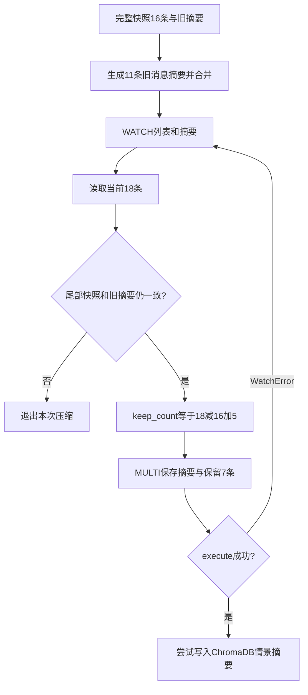

# 09 记忆写入：一轮回答怎样保存，旧对话怎样安全整理

> trace 合并版说明：本页保留附件的讲解与示例；当前主链增加 Context Planner、记忆演化、经验记忆、混合检索和 OTel。运行流程、接口变化与迁移以 [合并版本使用指南](../合并版本使用指南.md) 为准；文中的历史测试结果不是本次验收。

[教程目录](README.md) · [上一章](08-知识库RAG与MCP扩展.md) · [下一章](10-监控降权与恢复.md)

> **第一次读先看这里：** 先看[保存顺序](#section-01)、[下一轮与重试](#section-03)和[章末检查](#exercise)。只要先分清“本轮提交必须等，后台整理可以稍后做”，就能理解为什么有聊天记录但还没有摘要。需要研究并发时，再读 16 条变 18 条的例子。

第 07、08 章得到了回答和工具轨迹，但这些数据此时还在本轮 Python 对象里。服务重启、用户刷新或下一轮提问时，程序不能依赖那个已经结束的函数。本章接着追踪 `reader_01 / demo-login / msg-001` 的登录 HTTP 401 问题：先把本轮消息、状态和回执一起提交到 Redis，再让后台处理摘要和用户画像。

“保存本轮”和“整理旧对话”分成两个时刻。前者是 HTTP 返回前必须等待的提交；后者通过队列异步执行，可能稍后完成，也可能因为失败而延期。理解这个先后关系，就不会把首轮没有摘要误判成“系统没记住消息”。

- [响应怎样装配与提交](#section-01)
- [Redis 写入、顺序、回执、状态和 TTL](#section-02)
- [后台队列与压缩快照](#section-04)
- [16 条快照变 18 条，为什么保留 7 条](#section-06)
- [情景记忆、画像与失败边界](#section-07)
- [提交后检查实验](#exercise)

<a id="section-01"></a>

## 1. 从 Agent 的结果到 ChatResponse：哪些字段来自哪里

API 中 `result = await _orchestrator.run(orch_req)` 得到 OrchestratorResult 后，创建 `ChatResponse`。这一步负责把内部对象转换成外部接口能序列化的字段：Enum 用 `.value` 转字符串，角色列表逐项转换，耗时和置信度按当前格式取整。

关键的来源可以沿三条线读：执行正文、实际角色、路由和工具来自 `result`；识别分数、来源和意图组来自 `intent_result`；实体和待保存业务状态来自已被合并过的 `orch_req`。

```python
response = ChatResponse(
    conv_id=conv_id,
    request_id=result.request_id,
    response=result.response,
    intent=result.intent.value if result.intent else "other",
    intent_group=intent_result.intent_group,
    agent_type=result.agent_type.value,
    agent_types=[agent_type.value for agent_type in result.agent_types],
    primary_agent=result.primary_agent.value if result.primary_agent else result.agent_type.value,
    supporting_agents=[agent_type.value for agent_type in result.supporting_agents],
    tools_used=result.tools_used,
    routing_reason=result.routing_reason,
    routing_confidence=result.routing_confidence,
    escalated=result.escalated,
    latency_ms=round((time.monotonic() - started) * 1000, 1),
    knowledge_used=any(
        t.get("tool_name") == "search_knowledge_base" and t.get("result_success") is True
        for t in result.tool_traces
    ),
    entities=orch_req.entities,
    intent_confidence=round(intent_result.confidence, 4),
    intent_source_scores=intent_result.source_scores,
    intent_embedding_source=getattr(intent_result, "embedding_source", "local-ngram"),
    status=result.status,
    retryable=result.retryable,
    error_code=result.error_code,
)
```

`knowledge_used` 检查轨迹中是否有成功的知识库业务结果；查了 `lookup_error_code` 并不会使它为真。`entities` 已含本轮与旧状态按规则合并的字段，但识别分数仍代表本轮意图识别，不能把它理解为历史实体的核验分数。

### 1.1 一份完整的教学响应

假设第 07 章只有技术角色正常查表并给出正文，下列响应展示当前 ChatResponse 的全部字段。UUID、耗时、正文和识别分数是教学值，不是一次真实服务调用的记录；假设三路同意技术意图，来源分数 `0.90/0.80/0.50` 按默认权重得到 `0.84`。

```json
{
  "conv_id": "demo-login",
  "request_id": "9cf9ff1c-351a-4d67-8d23-d9be21cb5e46",
  "response": "401 通常表示认证未通过。请先确认登录状态，再检查令牌有效期与签名时间；仍失败时补充发生时间、客户端版本和 request_id。目前尚未核验后台日志。",
  "intent": "technical_login",
  "intent_group": "technical",
  "agent_type": "technical",
  "agent_types": ["technical"],
  "primary_agent": "technical",
  "supporting_agents": [],
  "tools_used": ["lookup_error_code"],
  "routing_reason": "intent=technical_login, group=technical, primary=technical, supporting=none, scores=[technical=1.13, general=0.10, billing=0.00]",
  "routing_confidence": 1.0,
  "escalated": false,
  "latency_ms": 2100.4,
  "knowledge_used": false,
  "entities": {
    "order_id": [],
    "product": [],
    "date": [],
    "amount": [],
    "error_code": ["401"]
  },
  "intent_confidence": 0.84,
  "intent_source_scores": {"llm": 0.9, "embedding": 0.8, "pattern": 0.5},
  "intent_embedding_source": "local-ngram",
  "status": "success",
  "retryable": false,
  "error_code": null
}
```

这里的教学 UUID 是第 03 章简称 `R1` 的示例展开，仍代表同一轮 `msg-001`，不是又执行了一轮。HTTP 成功响应中没有 `client_request_id`，但 API 仍保留局部变量 `client_id="msg-001"` 来构造回执。服务端 UUID 用来查执行轨迹；客户端 ID 用来判断这条消息是否已经处理过。

### 1.2 三个动作必须看清先后

```python
await _memory.commit_turn(
    req.user_id, conv_id, client_id, req.message, response.model_dump(),
    _orchestrator.get_tool_trace(result.request_id),
    state=orch_req.conversation_state,
)
if response.status != "failed" and _profile_updater is not None:
    _profile_updater.submit(req.user_id, conv_id)
return render(response)
```

`model_dump()` 把 Pydantic 对象转成普通字典。`await commit_turn(...)` 等 Redis 提交完成；`submit()` 只是把维护待办放进内存队列；`return` 再把响应交给 FastAPI。正常 success/partial 是 HTTP 200，failed 由 render 返回带 ChatResponse 结构的 HTTP 503。

如果 commit 本身出错，代码不会顺着这个正常返回路径继续，不能说“模型已经写出答案，所以一定成功返回且记住了”。普通请求提交成功后，后台失败则不会撤回已返回的答案。

<a id="section-02"></a>

## 2. commit_turn 逐行走读：什么一起保存，什么不在这个事务里

[MemoryManager.commit_turn](../../memory/conversation_memory.py) 的接口是：

```python
async def commit_turn(
    self, user_id, conv_id, request_id, message, response,
    trace=None, *, state=None,
):
```

这里参数名 `request_id` 容易误导：HTTP 调用方给它传的是 **client_id**，本例为 `msg-001`，不是响应里的服务端 UUID。`trace` 通过位置传入；星号后的 `state` 必须用关键字，避免误把状态放进轨迹位置。

### 2.1 先确定写入哪个会话键

`_conversation_id()` 用用户和会话两项组成 JSON 数组再哈希：

```python
return hashlib.sha256(
    json.dumps([cls._safe_text(user_id), cls._safe_text(conv_id)],
               ensure_ascii=True).encode()
).hexdigest()
```

本例数组是 `["reader_01","demo-login"]`。这样不会把 `a:b + c` 和 `a + b:c` 误拼成同一个字符串。工作消息、状态和摘要都使用同一个会话身份哈希，但各自有前缀，是不同 Redis 键。

回执还加客户端 ID 的哈希：

```python
return (
    "turn_receipt:" + self._conversation_id(user_id, conv_id)
    + ":" + hashlib.sha256(request_id.encode()).hexdigest()
)
```

因此其他用户、其他会话、其他消息 ID 不会因为都叫 `msg-001` 而命中同一回执。提交前还会处理可确认归属的旧版工作/摘要键迁移，具体键检查见附录。

### 2.2 把两条消息包装成可存储 JSON

函数里的 `raw()` 用闭包记住外层客户端 request_id：

```python
def raw(role, content):
    return json.dumps({
        "role": role,
        "content": self._safe_text(content),
        "ts": datetime.now().isoformat(),
        "metadata": {"request_id": request_id},
    })
```

代入用户消息得到下面的内容，排版是解码后的可读形式；实际 Redis 存的是 JSON 字符串，默认可能以 Unicode 转义表示中文：

```json
{
  "role": "user",
  "content": "登录返回 HTTP 401，怎么处理？",
  "ts": "2026-10-14T22:35:00.000000",
  "metadata": {"request_id": "msg-001"}
}
```

assistant 原文同样包装为 role、content、时间、metadata。两次 `raw()` 各自取时间，时间值不必完全相同；排序主要依靠列表顺序，不依赖这两个时间做重新排序。

### 2.3 事务里先排命令，再 execute

核心实现如下，变量与条件按源码，轨迹脱敏细节在下一小节解释：

```python
key = self._wm_key(user_id, conv_id)
async with self._redis.pipeline(transaction=True) as pipe:
    if response.get("status") != "failed":
        pipe.lpush(key, raw("user", message), raw("assistant", response["response"]))
        pipe.expire(key, 86400)
        if state is not None:
            pipe.setex(self._state_key(user_id, conv_id), 86400, json.dumps(state))
    pipe.setex(
        self.receipt_key(user_id, conv_id, request_id), 86400,
        json.dumps({"message": message, "response": response}),
    )
    if trace:
        from core.redaction import redact
        encoded_trace = json.dumps(redact(trace))
        pipe.setex("trace:" + response["request_id"], 7 * 86400, encoded_trace)
        pipe.lpush("trace:recent", response["request_id"])
        pipe.ltrim("trace:recent", 0, 199)
    await pipe.execute()
```

pipeline 可以理解为“一次提交的一组命令”。`transaction=True` 使用 Redis 事务执行这组命令：`lpush/expire/setex` 在这里排队，直到 `await pipe.execute()` 才发送执行，不是写下一行就已经落库。

它保证正常情况下其他客户端不会插入这组命令之间，避免用户消息保存了、助手消息还没保存的半轮状态。HTTP 外层还持有 conversation 锁，串行化同用户同会话的读状态、执行、提交。两个机制有不同作用：会话锁保护整个聊天决策过程；Redis 事务保护最终一组写命令。

Redis 事务不是关系数据库那种“任何命令报错就回滚所有已执行命令”的承诺。键类型不正确或运行时命令错误仍需排查；这里也没有把 ChromaDB 加入 Redis 事务。

### 2.4 LPUSH 的顺序：为什么助手在列表头

`LPUSH(key, user_raw, assistant_raw)` 从左侧依次推入值。空列表先放 user，再放 assistant，最终是：

```text
Redis从索引0往后读： [A1, U1]
下一轮提交之后：    [A2, U2, A1, U1]
```

最新消息在前，最新一轮的助手回答位于用户消息之前。读取 `_messages_from_raw()` 使用 `reversed(raws)`，恢复为 `[U1,A1,U2,A2]` 的时间正序，模型才不会先看到回答再看到对应问题。

`_get_working_memory()` 只读最近最多 20 条，不会因此删除更旧消息。真正裁剪在后台 `_compress()`，不是每轮提交后立即 LTRIM 到 20。

### 2.5 状态与回执不是同一份数据

本例业务 state 的完整教学结构如下；来源 UUID 对应提取出 401 的本次服务端执行，空数组没有来源：

```json
{
  "domain": "technical",
  "entities": {
    "order_id": [],
    "product": [],
    "date": [],
    "amount": [],
    "error_code": ["401"]
  },
  "sources": {"error_code": "9cf9ff1c-351a-4d67-8d23-d9be21cb5e46"}
}
```

state 用来给后续新消息续接任务字段。例如一条尚未使用的新消息编号只补“浏览器，今天开始，稳定复现”，程序先读旧 state，符合继承规则时仍保留 401，再加入本轮能提取的日期。它不代表身份核验、日志查询或问题已解决。

回执则保存 `{"message":原用户文字,"response":完整响应字典}`，用于同消息重试。它包含上一节展示的整份 ChatResponse，而不只含最终正文，因此重复请求能够返回同一个 request_id、状态、工具列表和路由信息。

只有 response.status 不是 failed 时，提交才追加正常问答和 state。failed 时仍保存回执及有值的轨迹，但不把“抱歉处理失败”当成新的正常业务历史，不提交这轮新 state。partial 有可用正文，会和 success 一样保存。

### 2.6 轨迹为什么有自己的存储和生命周期

`trace` 来自 `_orchestrator.get_tool_trace(result.request_id)`，包含本轮意图、主辅角色、tool_calls、耗时、状态等。保存前 `redact()` 脱敏可能出现的密钥等敏感字段，再按服务端 UUID 写到 `trace:<UUID>`，七天 TTL。

`trace:recent` 保存最近执行 ID，`ltrim(0,199)` 保留最多 200 项；索引本身没有 TTL。老 trace 内容过期后，读取 recent_traces 会忽略已经不存在的内容，所以索引还在不表示正文还在。

其他 TTL 都各自计算：正常写入刷新工作消息键 24 小时，state 写入为 24 小时，每份回执从本次写入起 24 小时。首轮没有 summary 键，普通聊天也不会每轮刷新已存在 summary 的 TTL；后面只有压缩写摘要时设置其 24 小时 TTL。

<a id="section-03"></a>

## 3. 下一轮和重复请求，读取的路径有什么不同

正常追问使用新的 `client_request_id`。入口找不到该 ID 的回执，就读取工作消息、摘要、相关历史、画像、state，重新识别并执行。在 `demo-login` 中，最新两条原文和技术 state 都已经能被下一轮读到，无需等画像更新。

原 `msg-001`、原文本重试时，入口在模型执行前先读回执：success/partial 直接返回；failed 且 retryable=false 也返回已有失败结果；只有 failed 且 retryable=true 才可以重新处理。同 ID 改文字是 HTTP 409。回执命中不再追加 U1/A1，也不重新入队维护。

需要把“执行失败”和“可能有副作用、结果未知”分开。第 07 章的 before_unsafe_tool 闭包在 handler 执行前提交特殊响应，主要字段是：

```json
{
  "status": "failed",
  "retryable": false,
  "error_code": "tool_outcome_unknown",
  "response": "该请求涉及可能修改数据的工具，请先核验执行结果再发起新的请求。"
}
```

上面只展示特殊标记的四个重点字段；实际标记是完整 ChatResponse，经 `model_dump()` 带上默认字段后存回执。因为 status failed，不追加正常消息或 state。若工具后来正常完成，最终提交可用同回执键覆盖标记；若进程在中途退出，原 ID 重试先看到标记，防止自动重放结果未知的修改。

当前主线错误码查表是 `retry_safe=True`，不触发这个标记。不同失败条件如何判断可重试，见第 04、07 章；换新 ID 不能自动证明外部副作用尚未发生。

<a id="section-04"></a>

## 4. 后台维护队列：submit 以后，worker 具体怎样接手

应用启动时创建 [ProfileUpdater](../../core/concurrency.py)，默认四个 worker，最多 256 个待排用户。`start()` 用 `asyncio.create_task(self._worker())` 建立后台协程，它们没有任务时等待队列，不会阻塞 HTTP 请求。

submit 的核心是：

```python
if user_id not in self._scheduled:
    try:
        self._queue.put_nowait(user_id)
    except asyncio.QueueFull:
        logger.warning("画像更新队列已满，本次跳过")
        return False
    self._scheduled.add(user_id)
self._pending[user_id] = conv_id
return True
```

queue 放的是用户 ID，不是整条消息；pending 字典保存“这个用户最新想维护哪个会话”；scheduled 集合避免同用户反复排队。

代入 `reader_01/demo-login`：首次把 reader_01 入队，并设置 `pending[reader_01]="demo-login"`。若同用户另一个会话还没维护就提交了 `demo-other`，pending 改成新会话；尚未被取走的旧待办可能被合并掉。这是降低后台压力的取舍，不是保证每个会话每轮都维护的持久任务清单。

worker 取到用户后，取走当前 pending 的 conv_id，调用 `memory.maintain(user_id,conv_id)`。若维护期间同用户又提交了新 pending，worker 内层 while 会继续处理最新待办；全部处理完再清 scheduled 并 task_done。队列满时 submit 返回 False，API 当前不会因此把已成功的聊天改成失败。

`maintain()` 的执行顺序为：

```python
await asyncio.wait_for(self._compress(user_id, conv_id), 30)
await self.update_profile(user_id, conv_id)
```

先压缩，整个压缩阶段最多等 30 秒；未达阈值时 `_compress` 很快返回，然后仍可更新画像。压缩超时抛异常，后面的画像不会在本次 maintain 中继续，由 worker 记录失败。提交好的 Redis 本轮问答不会被撤销。

队列和 pending 都在 Python 进程内，服务重启丢失尚未执行的待办；当前没有持久重试账本。因此后台日志和存储结果应分开检查。

<a id="section-05"></a>

## 5. 压缩先拍快照，再生成摘要，不能边等模型边删原文

### 5.1 阈值按消息条数计算

`COMPRESS_AT=15`；用户和助手各算一条。正常每轮两条，七轮是 14 条，八轮是 16 条。后台何时拿到队列任务也有影响，因此不能承诺第八轮 HTTP 返回时已压缩。

`_compress()` 先用一个 Redis 事务读取完整列表和旧摘要：

```python
async with self._redis.pipeline(transaction=True) as pipe:
    pipe.lrange(key, 0, -1)
    pipe.get(skey)
    snapshot, old_summary = await pipe.execute()
if len(snapshot) < self.COMPRESS_AT:
    return
```

这里必须读取 `0,-1` 的完整快照，不能只拿最近 20 条再删整个列表。若后台延迟积累到 30 条，只读最近 20 条会把没有总结过的更早十条也裁掉。

### 5.2 16 条快照究竟总结哪些消息

把第 1—8 轮写作 U1/A1 到 U8/A8。Redis 原始快照最新在前：

```text
[A8,U8,A7,U7,A6,U6,A5,U5,A4,U4,A3,U3,A2,U2,A1,U1]
```

`_messages_from_raw(snapshot)` 反转并解码，得到正序 `[U1,A1,...,U8,A8]`。随后 `to_compress = messages[:-5]`，把前 11 条交给摘要模型，留最后五条：`[A6,U7,A7,U8,A8]`。保留数按条，不按完整问答对，因此可能从第 6 轮助手答案开始，不保证成对边界。

程序把待压缩消息格式化为 `user: ... / assistant: ...`，要求模型用 2—3 句话总结关键信息。教学摘要可以是“用户登录返回 HTTP 401；已建议核对登录态、令牌有效期和签名时间。尚未核验后台日志，待补发生时间、版本和失败 request_id。”真实内容由模型产生，不能把假设建议改成已检查完成。

### 5.3 摘要无效时，保留所有原始消息

模型请求异常、摘要空白、摘要响应因 max_tokens 截断，都会提前返回，不裁列表。这条顺序很重要：必须先得到可用摘要，才讨论删原文。压缩存在 30 秒外层上限，取消未完成的生成时也没有先裁剪。

如果已有旧摘要，`_merge_summary(old_summary,summary)` 再请求模型把两段合并，保留偏好、实体、待办、约束和未解决问题。无旧摘要直接取新摘要前 800 字符；有旧摘要时合并成功也截前 800；合并异常或空白时用 `old + newline + new` 的最后 800 字符回退，优先保留较新的尾部。

当前合并阶段只检查正文非空，没有和首次摘要相同的 max_tokens 截断检查。长度限制也可能丢掉部分旧信息；摘要始终是压缩线索，不是完整聊天档案。合并的结果供当前会话 Redis summary 使用，情景记忆后面保存的是本次新增摘要。

<a id="section-06"></a>

## 6. 摘要生成期间又来了新消息，为什么保留 7 条

摘要模型等待期间，用户可能继续聊天。如果一直持有会话锁等摘要，后续聊天就被后台任务阻塞；当前实现允许后台慢慢生成，但提交前必须检查快照仍能安全使用。

### 6.1 第一层检查：旧内容与旧摘要还在不在

模型完成后，程序 WATCH 工作列表和摘要键，再读取当前值：

```python
await pipe.watch(key, skey)
current = await pipe.lrange(key, 0, -1)
current_summary = await pipe.get(skey) or ""
if (
    len(current) < len(snapshot)
    or current[-len(snapshot):] != snapshot
    or current_summary != old_summary
):
    return
```

WATCH 可以理解为“从现在开始盯住这些键是否被其他客户端改动”。WATCH 后、MULTI 前的读取立即执行，程序据此判断，而不是把读取排到事务末尾。

为什么比较 current 的尾部？新消息通过 LPUSH 放在头部；如果只新增头部消息，旧快照仍完整留在尾部，可以继续压缩旧部分。若列表变短、旧快照尾部不再相同，可能已有另一压缩修改；若摘要不等于旧摘要，可能已有另一任务更新。任一条件不满足，本次退出，不覆盖别人的摘要，也不重复裁剪。

### 6.2 16 → 18 的具体计算

生成摘要时，快照有 16 条；期间第 9 轮提交了 U9/A9，现在 18 条：

```text
current = [A9,U9] + snapshot
        = [A9,U9,A8,U8,A7,U7,A6,U6,...,A1,U1]
```

快照旧部分仍完整相等，因此允许提交。代码计算：

```python
keep_count = len(current) - len(snapshot) + 5
```

代入得到 `18 - 16 + 5 = 7`。新增两条未进入刚生成的摘要，必须保留；快照最新五条也未进入摘要，必须保留。最终保留 `[A9,U9,A8,U8,A7,U7,A6]`。如果直接只留五条，就会把 U7/A6 中尚未总结的内容删掉，或者在其他排列情况下丢掉新内容，因此不能固定 LTRIM 到 4。

### 6.3 第二层检查：读完以后、提交之前又有变化怎么办

检查通过后，程序才进入事务：

```python
pipe.multi()
pipe.setex(skey, 86400, new_summary)
pipe.ltrim(key, 0, keep_count - 1)
pipe.expire(key, 86400)
await pipe.execute()
```

本例 ltrim 的右边界是 6，Redis 的区间两端都包含，索引 0—6 正好七条。新摘要和裁剪一起提交，避免只有摘要换了而列表没裁。

如果 WATCH 后又有新消息提交、键过期或其他任务更新摘要，Redis 拒绝这个事务，客户端抛 `WatchError`。代码捕获后最多重新尝试三次，每次重新 WATCH、读取、核对和计算。注意它不会为同一个旧快照重复请求摘要模型；仍复用已生成的新摘要，只重新检查是否还适用。

若期间另一个压缩已经改变旧快照，则一致性条件不再满足，直接退出。持续并发导致三次都无法提交时记录“本次压缩延期”，保留原始消息等待后续维护。前面的快照比较保护“拍快照到 WATCH”窗口，WATCH 保护“检查到 execute”窗口，两者缺一不可。



<a id="section-07"></a>

## 7. Redis 压缩之后，情景记忆和画像怎样更新

### 7.1 情景记忆存什么：本次摘要，不是全部原文迁移

压缩事务成功后 `_store_episodic(user_id,conv_id,text,summary)` 写入 ChromaDB 的 `episodic` 集合。这里 summary 是本次新增摘要，不是把所有旧摘要合并后的 new_summary。

核心写入为：

```python
await asyncio.to_thread(
    self._episodic.add,
    ids=[doc_id],
    documents=[summary],
    metadatas=[{
        "user_id": user_id,
        "conv_id": conv_id,
        "ts": datetime.now().isoformat(),
        "full_text": self._safe_text(text[:500]),
    }],
)
```

doc_id 基于用户、会话、当前时间生成；documents 是摘要，客户端默认 embedding 将摘要转向量；metadata 用来按用户/会话过滤，full_text 最多是待压缩原文的前 500 字符。因此它不是把刚裁掉的全部消息完整归档，不能靠这个字段恢复整段对话。

写 ChromaDB 失败只记日志，不回滚已经完成的 Redis 摘要与裁剪。两个库没有跨库事务；这次失败可能使跨会话少一段情景线索，但当前会话 summary 和剩余工作消息已经存在。ChromaDB 里的 episodic 没有这里的 24 小时 Redis TTL。

### 7.2 画像按用户聚合，先取得用户级租约

`maintain()` 压缩正常结束后调用 update_profile。它以 `reader_01` 的哈希构造 `lock:profile:<用户哈希>`，取得 Redis 租约再执行 `_update_profile()`。锁按用户而不是按会话，是为了同用户两个会话不要同时把旧画像覆盖成彼此不同的新版本。

它读取当前会话工作消息最多 20 条，取正序的最后 10 条，再读取已有画像，组成模型提示。若刚完成 18→7 压缩，画像这次能看到的是裁剪后七条；当前没有单独把最新 summary 加进画像提示，因此不能假设它读到了前十一条全部细节。

模型被要求返回 JSON，例如：

```json
{
  "preferences": ["希望按步骤获得排查建议"],
  "entities": {
    "产品": [],
    "问题类型": ["登录认证故障"]
  }
}
```

这是教学示意，偏好必须有对话依据，不能仅凭本例问题保证得出这句话。程序提取首个 `{` 到最后 `}` 的文本并 json.loads；它没有用独立严格业务 schema 证明每个偏好都是事实。模型调用默认 15 秒，失败或非法 JSON 保留已有画像并记录日志。

解析成功后，以稳定 ID `user_profile:reader_01` upsert：

```python
await asyncio.to_thread(
    self._profile.upsert,
    ids=[doc_id],
    documents=[doc_text],
    metadatas=[{
        "user_id": user_id,
        "conv_id": conv_id,
        "updated_at": datetime.now().isoformat(),
    }],
)
```

同用户后续更新覆盖同 ID，不为每轮创建重复主画像。读取先按稳定 ID get，兼容旧数据时再按 user_id 选择最新记录。画像长期存在 ChromaDB，可供后续会话参考，但它是模型提炼的线索，不是订单、支付或账户真实性证明。

### 7.3 为什么不能靠画像保存本轮任务字段

state 的 error_code 和来源在本轮提交时已经确定保存；画像任务可能尚未运行、被合并、失败或遗漏细节。下一轮要续接 401，应依赖结构化 state 和工作上下文，不能要求异步画像正好及时提炼出错误码。这也是短期业务状态与长期用户画像分开的原因。

<a id="section-08"></a>

## 8. 怎样判断系统“记住了”，以及失败后还剩下什么

可以按完成时刻理解：

```text
模型正文完成
  → 装配ChatResponse
  → await Redis commit_turn
  → submit后台待办
  → HTTP返回
       后台：取队列 → 快照摘要 → Redis压缩 → 情景摘要 → 用户画像
```

后台 worker 可能在 HTTP 真正发送完成前开始推进，但 API 不会等待整个维护链路。因此响应已成功只证明本轮提交完成，不能证明摘要和画像完成；成功的本轮问答已经可以给下一轮读取。

`ChatResponse.latency_ms` 在 commit 之前计算，包含前面的等待、读取、识别和执行，不包含本次提交耗时。中间件的 `Server-Timing` 包括请求处理和提交；后台维护不属于必须等待后才返回的工作。用这两个数字排查慢请求时要理解测量边界。

常见失败可以顺着已经完成的步骤判断：摘要为空/异常时，原文全留；摘要合并失败时，走有限长度拼接回退；WATCH 冲突时，重试或延期，不强删原文；情景存储失败时，Redis 压缩已经完成；画像失败时，已有画像保留；队列满/重启丢待办时，本轮 Redis 原文与回执依然存在，后台整理可能延后。

TTL 也不是“所有记忆一起过期”：工作消息普通提交刷新，state 单独写入刷新，回执各自计时，summary 只有压缩写入刷新，trace 七天，ChromaDB 摘要和画像持久化。某个键仍在不能说明另一个层也一定存在；全文长期保留并非当前项目的承诺。

<a id="exercise"></a>
## 实验：在提交后读回消息、状态与回执

先完成第 02 章的一次 `demo-login` 对话，再按[附录的只读检查脚本](附录-接口配置与数据字典.md#section-10)查看当前会话。开启应用 Token 时，脚本里的 `user_id` 改成 Token 映射的最终身份；不能继续查请求体里被覆盖的用户编号。

| 应检查什么 | 能得出什么结论 |
| --- | --- |
| 首次正常提交后有两条消息 | 本轮 user / assistant 已一并保存；存储顺序为最新在前 |
| `state` 中有本轮提取的字段和来源 | 业务状态已经提交，下一轮可以读取 |
| 原消息重试返回相同 `request_id` | 命中可复用回执；不能从这个编号判断画像是否完成 |
| 首轮没有 `summary` | 通常还未达到压缩阈值；不表示本轮消息未保存 |

若会话已有历史或后台已经压缩，消息数不一定恰好为两条；查新会话更容易核对。压缩阈值是消息数量，不是 token 数，也不保证在固定问答轮次立即发生。查看后台日志中 `工作记忆压缩完成`、`用户画像已更新`，才能分别确认维护结果。

### 想核对压缩与并发，直接运行已有检查脚本

首轮读取实验只能证明“消息保存了”，不能证明压缩能保留并发消息。仓库已有 [verify_memory_concurrency.py](../../tests/verify_memory_concurrency.py)，第 12 章也会使用它。它连接真实 Redis，但用固定摘要替代模型，不花费真实模型额度。

普通开发容器中执行：

```bash
docker compose exec -T echomind python tests/verify_memory_concurrency.py
```

使用附录的独立练习环境时，改为：

```bash
docker compose -p echomind-tutorial -f wiki/教程/examples/compose.tutorial.yml \
  exec -T echomind python tests/verify_memory_concurrency.py
```

脚本使用随机测试用户，结束时清理自己创建的消息和摘要。它的数字与正文演算不同，读输出时这样对应：

| 检查阶段 | 脚本里发生什么 | 应验证的结果 |
| --- | --- | --- |
| 拍快照 | 先放入 25 条旧消息，同时开始两次压缩 | 两次任务看到相同旧数据 |
| 等摘要期间 | 新增 1 条消息，当前变成 26 条 | 新增消息没有进入旧摘要 |
| 提交压缩 | 留下快照最新 5 条和新增 1 条 | 最终正好 6 条，内容与顺序都匹配 |
| 摘要失败 | 重新放入 25 条，模拟模型异常 | 全部 25 条保留，不裁剪 |

成功时打印两条 `PASS:`：一条确认并发新增保留及并发压缩不覆盖，另一条确认摘要失败不删原文。它验证 Redis 压缩流程，不验证真实摘要质量，也不验证 ChromaDB 情景写入或画像内容；这些要分别查看后台日志和真实结果。

检查点：Redis 的本轮提交不包含 ChromaDB 事务。工作消息、摘要、状态和回执各自有 TTL，画像则持久化在 ChromaDB；当前摘要的 TTL 由压缩写入刷新，并不是每条聊天都刷新。短期消息保留不代表后台维护队列可以在重启后恢复。
