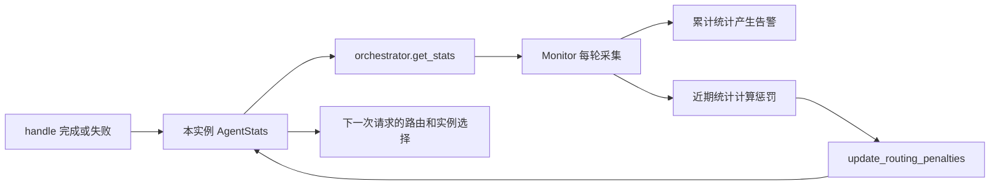
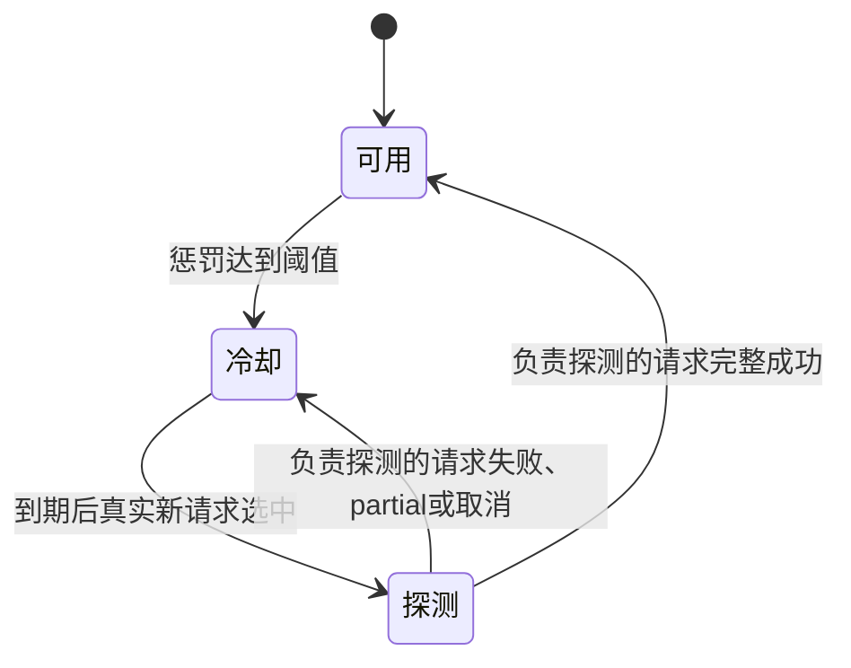

# 10 监控与路由：降权、冷却和恢复探测

> trace 合并版说明：本页保留附件的讲解与示例；当前主链增加 Context Planner、记忆演化、经验记忆、混合检索和 OTel。运行流程、接口变化与迁移以 [合并版本使用指南](../合并版本使用指南.md) 为准；文中的历史测试结果不是本次验收。

[教程目录](README.md) · [上一章](09-记忆提交压缩与画像更新.md) · [下一章](11-评测Few-shot与回归基线.md)

> **第一次读先看这里：** 先看[什么时候回退到 General](#section-05)、[如何恢复接单](#section-06)，再[查询监控](#exercise)。惩罚公式用于解释为什么发生回退，可以在观察到现象后再计算。开启鉴权的服务还要完成下方的采集凭据配置。

还是那句“登录返回 HTTP 401，怎么处理？”。前面几章解释了它为什么适合交给 Technical；这一章再加一个现实条件：Technical 的模型最近反复超时，继续把每个登录问题都交给它，用户就会反复等待。项目因此记录每个 Agent 实例的运行表现，让路由暂时绕开表现差的专业实例，过一会儿再允许一条真实请求尝试恢复。

这里的“成功”先指程序完成了一轮有效回答。回答有没有编造、是否真正帮用户解决问题，是第 11 章的内容质量评测。本章先把记录、采集、降权、恢复四个环节接起来。

- [一条请求怎样更新统计](#section-01)
- [累计统计和近期窗口为什么要同时保留](#section-02)
- [Monitor 采集后怎样反馈给路由](#section-03)
- [手算 0.6 惩罚和 0.584 运行分](#section-04)
- [专业角色不可用后怎样回退](#section-05)
- [冷却、单条探测和恢复](#section-06)
- [读懂 Prometheus 指标与不同耗时](#section-07)
- [实际查询与受控测试](#exercise)

<a id="section-01"></a>

## 1. 一次执行，从什么时候开始计数

统计对象是 [agents/agent_orchestrator.py](../../agents/agent_orchestrator.py) 中的 `AgentStats`。每个实例都有自己的 `stats`；例如 `technical_0` 表示技术角色的第一个实例，`billing_0` 表示账单角色的第一个实例。一个用户的问题若触发两个角色，会留下两份实例执行记录；命中回执的重复 HTTP 请求则不会再执行角色。

先看 `BaseAgent.handle()` 的正常路径节选。省去的是回复字段组装，统计顺序与源码一致：

```python
t0 = time.monotonic()
# 专业实例可用性检查在 total 增加之前，见第 6 节。
self.stats.total += 1
call_result = await self._call_llm(req)
ms = (time.monotonic() - t0) * 1000
complete = call_result.status == "success"
self.stats.record(complete, ms, req.request_id)
self.stats.success += int(complete)
self.stats.total_ms += ms
```

逐句代入一条教学请求：假设 `technical_0` 之前执行过 4 次，完整成功 3 次，总耗时 16000 毫秒，这次登录请求耗时 4000 毫秒，模型正常结束。

1. `time.monotonic()` 记起点。它是适合计算经过时间的时钟，系统日期调整不会让这段耗时突然变负数。
2. `total += 1` 把“已经开始的执行次数”从 4 改成 5。此时模型可能仍在等待网络响应。
3. `await` 等待 `_call_llm()` 返回；这里包括模型请求、必要的工具执行，以及把工具结果交回模型的后续请求。
4. 秒数乘 `1000` 得到毫秒，所以示例 `ms=4000`。
5. 仅当 `call_result.status == "success"`，`complete` 才是 `True`。
6. `record()` 把本次结果放进近期窗口，并把单次耗时交给 Prometheus 观察器。
7. `int(True)=1`，完整成功数从 3 变成 4；总耗时变成 20000。累计成功率是 `4/5=0.8`，累计平均耗时是 `20000/5=4000ms`。

EscalationAgent 重写了 handle，当前直接生成保守的交接文案并记录成功，不请求模型；它的耗时不能拿来表示人工已经处理完毕。

这组数字是教学假设，不是当前服务的实测值。也要留意采样时点：`total` 在执行开始就增加，`success` 和 `total_ms` 在结束才增加；监控若恰好在请求进行中读取，会看到这次执行已经进入总数、尚未进入成功数和总耗时的快照。

### 有正文为什么仍可能不计成功

`_call_llm()` 在模型因为 `max_tokens` 停止时返回 `status="partial"`。`handle()` 会把这段正文交给上层，响应对象可能仍有 `success=True`，表示拿到了可返回的结果；但 `complete=False`，所以完整成功数不增加、近期样本记录失败。不能拿 `AgentResponse.success` 代替这里的完整成功口径。

| 本轮情况 | total | success | 近期样本 | 上层怎样继续 |
| --- | --- | --- | --- | --- |
| 正常完整回答 | 加 1 | 加 1 | `True` 和耗时 | 返回 `status=success` |
| 有正文但输出截断 | 加 1 | 不增加 | `False` 和耗时 | 返回 `status=partial` |
| 模型/工具循环抛出异常 | 加 1 | 不增加 | `False` 和耗时 | 返回失败，由编排器决定是否 General 兜底 |
| HTTP 总预算取消正在执行的任务 | 已加 1 | 不增加 | `False` 和取消前耗时 | 重新抛出取消，入口处理超时 |
| 冷却/探测占用，在执行前拒绝 | 不增加 | 不增加 | 不新增 | 返回 `agent_busy`，未开始一轮模型执行 |

异常和取消也会把已用时间加到 `total_ms`，因此平均耗时包含失败执行。取消分支记录以后 `raise`，不会把超时伪装成正常回复。

<a id="section-02"></a>

## 2. 为什么既看累计，也看最近几次

累计统计回答“这个实例从进程启动到现在，整体表现如何”；近期窗口回答“最近是否突然变差”。假设前 100 次都成功，最新 5 次中有 2 次失败，累计成功率仍有 `103/105≈98.1%`，仅看它不容易发现刚发生的故障。

当前近期窗口关键代码为：

```python
samples = deque(maxlen=50)  # 每个 AgentStats 在创建时各自拥有一个

# record() 中追加：
self.samples.append((time.monotonic(), success, ms))

# recent() 中读取：
cutoff = time.monotonic() - 300
while self.samples and self.samples[0][0] < cutoff:
    self.samples.popleft()
n = len(self.samples)
```

`deque` 可以理解为一条有长度上限的队伍。新执行从右边加入，超过 50 条时最老的样本被挤掉；`popleft()` 则从左边取走已经超过 300 秒、也就是 5 分钟的样本。每条样本有三个位置：发生时间、完整成功与否、本次毫秒数。

例如近期五条完整标记是 `[True, True, False, True, False]`，Python 求和时把 `True` 当 1、`False` 当 0，于是近期成功率为 `3/5=0.6`。耗时若是 `[3000, 4000, 5000, 3500, 4500]`，均值为 `20000/5=4000ms`。

| 字段 | 计算范围 | 下一步谁用 |
| --- | --- | --- |
| `total`、`success_rate`、`avg_ms` | 当前实例、当前进程累计 | 阈值告警与同类实例基础运行分 |
| `recent_total`、`recent_success_rate`、`recent_avg_ms` | 最近 5 分钟、最多 50 条已记录样本 | Monitor 计算近期路由惩罚 |
| `monitor_penalty` | 最近一次采集写回的惩罚 | 运行分与专业实例冷却 |
| `retry_at`、`probe_running`、`probe_owner` | 当前恢复状态 | 控制是否接新请求、哪条请求负责探测 |

没有样本时成功率返回 `1.0`、平均耗时返回 `0.0`，便于新实例开始接请求；同时 `recent_total=0`。默认值表示“还没测到”，不能说已经验证健康。少于 5 条近期样本时，Monitor 写回的惩罚为 0，避免一次偶发失败立即大幅改变路由。

<a id="section-03"></a>

## 3. Monitor 怎样把记录变成告警和路由反馈

[monitor/performance_monitor.py](../../monitor/performance_monitor.py) 的 `PerformanceMonitor` 在应用启动时创建。`start()` 用 `asyncio.create_task(self._loop())` 启动后台采集：循环先采集一次，再等待 `MONITOR_INTERVAL`，默认 10 秒，之后重复。它读取已有执行记录，不主动向模型发一轮“健康问题”。



采集核心是下面几句实际代码：

```python
agent_stats = self._orchestrator.get_stats()
tool_stats = self._tool_manager.get_stats()
routing_penalties = {}
for agent_key, s in agent_stats.items():
    sr = s["success_rate"]
    ms = s["avg_ms"]
    self._check_threshold("agent_success_rate", sr, agent_key)
    self._check_threshold("agent_avg_ms", ms, agent_key)
    routing_penalties[agent_key] = (
        self._routing_penalty(s["recent_success_rate"], s["recent_avg_ms"])
        if s.get("recent_total", 0) >= 5 else 0.0
    )
```

`get_stats()` 把对象转换成按实例名索引的字典。循环读一份 `technical_0` 的统计：先用**累计**成功率和平均耗时检查告警，再用**近期**统计计算惩罚。采集函数后面会调用 `update_routing_penalties(routing_penalties)`；例如把 `{"technical_0": 0.6}` 写回对应的实例。

告警与惩罚的输入不同，所以“看见 ERROR 告警”不等于“已经冷却”，“近期表现恢复”也不等于累计历史告警马上消失。新失败样本刚写入时，下一次 Monitor 采集还没发生，惩罚也可能暂时保持旧值。

### 当前阈值到底是什么

| 累计指标 | 触发条件，等号不触发 | 告警级别 |
| --- | --- | --- |
| Agent 完整成功率 | 小于 0.90 | error |
| Agent 平均耗时 | 大于 3000ms | warning |
| 工具管理器成功率 | 小于 0.95 | warning |
| 工具管理器平均耗时 | 大于 5000ms | error |

每次采集都会检查阈值并记录触发告警，当前代码没有自动把旧告警标记为已解决。`/monitor` 展示最近 10 条未标记解决的告警、按优先级排列的前 5 条建议；建议按标题去重。工具连续失败达到 3 次时还会建议检查依赖、日志和降级。

源码还保留了统计异常检测：对一个实例的一项累计指标存最多 60 个采样点，至少有 30 个才比较当前值偏离均值的标准差倍数，默认超过 2.5 倍写警告日志。这里的“60 个”是采集点数，不是请求数；该结果本身不直接计算路由惩罚。

工具管理器的熔断也要单独看。Agent 冷却治理的是角色实例的回答表现，工具熔断治理的是某个受管理工具的依赖故障。Technical 的本地 `lookup_error_code` 并不因为出现在工具轨迹里，就自动成为工具管理器的一项统计。

<a id="section-04"></a>

## 4. 把 0.6 惩罚和 0.584 运行分亲手算出来

先采用第 2 节的教学样本：近期 5 次、3 次完整成功、平均 4000ms。这次采集达到至少 5 条样本的门槛，进入实际函数：

```python
penalty = 0.0
if success_rate < 0.90:
    penalty += min(0.5, (0.90 - success_rate) * 2)
if avg_ms > 3000:
    penalty += min(0.4, (avg_ms - 3000) / 10000)
return min(penalty, 0.9)
```

1. 成功率 `0.6 < 0.9`，原始惩罚为 `(0.9-0.6)×2=0.6`。`min(0.5, 0.6)` 限制这一项最多 0.5，因此得到 0.5。
2. 延迟 `4000 > 3000`，原始惩罚为 `(4000-3000)/10000=0.1`，小于延迟项上限 0.4，保留 0.1。
3. 相加得到 `0.5+0.1=0.6`，没有超过总上限 0.9，最终惩罚为 0.6。
4. 默认 `ECHOMIND_MONITOR_FALLBACK_PENALTY=0.5`，`0.6>=0.5`，所以尚未处于恢复流程的专业实例进入冷却。默认 `ECHOMIND_MONITOR_COOLDOWN_SECONDS=60`，截止点是单调时钟的“现在加 60 秒”。

有惩罚但还没到冷却门槛时，它会降低同类实例运行分。公式来自 `AgentStats.routing_score()`：

```python
latency_score = 1.0 / (1.0 + self.avg_ms / 1000)
base_score = self.success_rate * 0.7 + latency_score * 0.3
return base_score * max(0.0, 1.0 - self.monitor_penalty)
```

再换一组独立教学输入：累计成功率 0.9、累计平均 2000ms、当前惩罚 0.2。

```text
速度分 = 1 / (1 + 2000/1000) = 1/3 ≈ 0.333333
基础分 = 0.9×0.7 + (1/3)×0.3 = 0.63 + 0.1 = 0.73
最终分 = 0.73×(1-0.2) = 0.73×0.8 = 0.584
```

成功率和速度分都变成 0 到 1 左右的数，再按 70% 与 30% 合并。`_best_agent()` 从**同一种角色**的可用实例中选择该分数最大者；只有一个实例时，轻微降权并不会凭空出现第二个实例。

第 07 章根据技术意图、`401`关键词和错误码实体算出的领域分，是决定适合 Technical 还是 Billing；主线中的“登录”本身没有额外命中该关键词词表。这里的 0.584 是同类实例运行分，两者不直接加在一起。单实例部署仍能避开严重故障，是因为达到阈值后实例不可用，路由会排除整个不可用的专业角色。

<a id="section-05"></a>

## 5. 登录问题暂时交给 General，是哪一步决定的

`_route_decision()` 先根据请求计算领域分，再检查技术和账单角色是否所有实例都不可用。源码的判断是 `all(not agent.stats.available() for agent in agents)`：`all()` 要求该角色每个实例都不可用，才把角色视为需要回退。

假设登录请求的技术领域分最高，但唯一的 `technical_0` 还在 60 秒冷却中：路由把 Technical 从候选中排除，剩余候选里可能由 General 接住，并在 `routing_reason` 追加 `monitor_fallback=[technical]`。分类仍可以是 `technical_login`，它描述问题类别；实际回答角色 General 描述这次执行选择。

若有 `technical_0`、`technical_1` 两个实例，仅第一个在冷却，技术角色仍参与领域路由，`_best_agent()` 从可用的第二个实例中选。这就是角色选择和实例选择分开的意义。

还存在另一条回退路径：当前请求已经进入 Technical，随后模型抛错，`_execute()` 得到 `success=False`，就即时尝试 General。这发生在本轮执行中，无需等待 Monitor 下一次采集；Technical 的失败记录和 General 的后续执行会分别计数。

如果本轮已经尝试过 `retry_safe=False` 的工具，失败时 `_execute()` 会直接返回原失败，避免 General 重新执行可能修改业务数据的操作。这个限制来自已尝试工具的记录，与成功率阈值无关。

<a id="section-06"></a>

## 6. 冷却结束以后，为什么只放行一条请求

冷却像一次“暂停接单”；到期后先用一条真实新请求探路。若一下放行十条，依赖仍故障时十个用户又会一起等待。因此 `AgentStats` 除了截止时间，还保存是否正在探测和负责探测的请求编号。



先看可用性与探测占用的实际条件：

```python
# AgentStats.available() 的返回条件：
return not self.probe_running and (
    not self.retry_at or time.monotonic() >= self.retry_at
)

# 专业 Agent.handle() 执行开始前：
if not self.stats.available():
    return AgentResponse(agent_type=self.agent_type,
        content="Agent 恢复探测中", success=False,
        status="failed", error_code="agent_busy")
if self.stats.retry_at:
    self.stats.probe_running = True
    self.stats.probe_owner = req.request_id
```

按一条时间线理解，下面时间都是教学假设：

1. `t=100s` 写入惩罚 0.6，设置 `retry_at=160s`。
2. `t=110s` 再采集到 0.6。`set_penalty()` 只在 `not self.retry_at` 时设置新截止点，所以不会不停改成“现在再加 60 秒”。
3. `t=150s` 新请求来时，当前时间小于 160，实例不可用，走其他可用实例或 General。
4. `t=161s`，截止点已过且没有正在探测，`available()` 返回 `True`。没有定时器主动调用模型，必须有真实新请求选择它。
5. 请求 R2 进入 `handle()`，保存 `probe_running=True`、`probe_owner=R2`，然后才增加 `total` 并执行模型。该段占用设置发生在首次 `await` 前。
6. R2 等待模型时，另一请求 R3 看见 `probe_running=True`，绕开这个实例；不能同时启动第二个恢复探测。

### 为什么 record() 还要检查 owner

恢复结果处理的关键代码是：

```python
if self.probe_running and request_id == self.probe_owner:
    self.probe_running = False
    self.probe_owner = None
    if success:
        self.samples.clear()
        self.retry_at = 0.0
        self.monitor_penalty = 0.0
    else:
        self.retry_at = time.monotonic() + cooldown_seconds
self.samples.append((time.monotonic(), success, ms))
```

这里最后的 `cooldown_seconds` 是为便于阅读而给源码环境配置表达式取的说明名，默认 60 秒。其余逻辑与当前 `record()` 一致。

`request_id == probe_owner` 确保只有 R2 的结果能结束 R2 的探测。假如冷却之前的一条旧在途请求 R0 刚好晚结束，它可以记录自己的执行样本，但不能解除另一个请求拥有的探测状态。

R2 **完整成功**时，先清空旧近期故障窗口，再把这次成功作为第一条新样本加入，所以恢复后 `recent_total=1`。惩罚和截止点清零，实例恢复正常接单；累计 `total`、`success`、`total_ms` 保留，过去的失败没有被抹掉。R2 失败、partial 或取消都按 `success=False` 记录，再从失败结束时冷却 60 秒。

即使近期样本过期、Monitor 写回惩罚 0，已有 `retry_at` 也不会仅因此清空；解除恢复流程仍需要探测完整成功。`/monitor` 的 `recovery_state` 依据 `probe_running` 和 `retry_at` 是否非零生成，截止点已过但尚无新请求时仍可能显示 `cooldown`。它表示恢复流程未完成，并不能单独判断此刻 `available()` 的返回值。

<a id="section-07"></a>

## 7. Prometheus 的 Gauge、Counter、Histogram 分别读什么

Prometheus 是定期拉取指标并保存时间序列的服务。Python 的 `/metrics` 返回可拉取的文本，Monitor 和 HTTP 中间件负责在程序执行时更新其中的数值。

| 指标 | 类型 | 内容和单位 | 何时更新 |
| --- | --- | --- | --- |
| `agent_success_rate` | Gauge，当前读数可升可降 | 实例累计完整成功率，0—1 | Monitor 采集时 `set(sr)` |
| `agent_latency_ms` | Histogram，把单次值放进耗时区间 | 每次 Agent 执行耗时，毫秒 | `AgentStats.record()` 调观察器 |
| `chat_latency_ms` | Histogram | 通过鉴权的 HTTP 聊天耗时，毫秒，按 HTTP 状态码分组 | HTTP 处理返回时 `observe(elapsed)` |
| `requests_total` | Counter，只随请求增加 | 通过鉴权的 `POST /chat` 次数 | HTTP 中间件调用下层前 `inc()` |
| `tool_success_rate` | Gauge | 工具管理器的累计成功率，0—1，按工具名分组 | Monitor 采集时 `set(sr)` |

Histogram 常见输出后缀有 `_bucket`、`_count`、`_sum`。例如两次耗时是 1000ms、3000ms，则 `_count=2`、`_sum=4000`，总和除以次数才得到平均 2000ms；桶记录“多少次不超过某个上限”，据此才能估算分位数。当前 Agent 桶上限从 10 到 50000ms，不会每隔 10 秒把一个平均耗时重复当成一次新执行。

原样重试同一消息命中回执，HTTP 仍收到一个经过鉴权的聊天请求，`requests_total` 增加、HTTP 耗时被观察；Agent 没有再次执行，Agent 的 `total` 与耗时样本不增加。被鉴权直接拒绝的 401/403 请求在计数前返回，不进入这些聊天指标。

### 三个地址不要混用

| 地址/配置 | 作用 |
| --- | --- |
| `http://localhost:8000/monitor` | 人可阅读的 JSON，含实例、工具、告警、建议 |
| `http://localhost:8000/metrics` | Python 暴露的 Prometheus 指标文本 |
| `http://localhost:9090` | Compose 中 Prometheus 服务的查询网页 |
| `PROMETHEUS_PORT` | 可选额外指标监听端口；默认 0 不开额外端口，API `/metrics` 仍存在 |

[config/prometheus.yml](../../config/prometheus.yml) 每 10 秒拉取容器网络内 `echomind:8000/metrics`。这是 Prometheus 拉取间隔，和 Monitor 的统计采集间隔是两个时钟。开启 API 鉴权后 `/metrics` 是管理员接口，当前拉取配置没有附带 Token；若页面显示目标 DOWN 且返回 401，需要给拉取端配置可用的管理员鉴权，不能仅靠启动 9090 服务解决。

<a id="metrics-auth"></a>

### 开启鉴权后，怎样让 Prometheus 继续采集

这一节适用于第 02 章的根目录 Compose 环境；附录的最小练习环境没有启动 Prometheus。若应用没有启用 Token，当前采集配置就可以继续使用，不必加下面的文件。

Prometheus 也是一个访问 API 的客户端。你在终端用 Token 成功请求 `/metrics`，不会自动把这个 Token 交给 Prometheus。需要给采集进程单独提供一份凭据。

**第一步：准备已配置的管理员 Token。** 它必须出现在服务端 `ECHOMIND_API_TOKENS` 中，角色为 admin；不能填模型 Key。下面的命令会隐藏输入，先用它访问本地 `/metrics`，成功后才保存到已被 Git 忽略的 `data/tutorial/`。需要本机 Python 3.12；输入时粘贴 Token 后按回车。

```bash
python3.12 - <<'PYCODE'
from getpass import getpass
from pathlib import Path
import urllib.error
import urllib.request

value = getpass("请输入已配置的管理员 Token（不回显）：").strip()
if not value or any(ch.isspace() for ch in value):
    raise SystemExit("Token 不能为空，也不能包含空白字符。")
request = urllib.request.Request("http://localhost:8000/metrics",
    headers={"Authorization": "Bearer " + value})
opener = urllib.request.build_opener(urllib.request.ProxyHandler({}))
try:
    with opener.open(request, timeout=10) as response:
        response.read()
except urllib.error.HTTPError as error:
    raise SystemExit(f"接口返回 HTTP {error.code}；先检查 Token、角色和服务配置。")
folder = Path("data/tutorial")
folder.mkdir(parents=True, exist_ok=True)
folder.chmod(0o700)
path = folder / "metrics-admin-token"
path.write_text(value, encoding="utf-8")
path.chmod(0o644)  # 容器中的 Prometheus 用户需要读取这个只读挂载文件。
print("已验证 /metrics 并保存凭据文件；未输出 Token。")
PYCODE
```

目录只允许当前宿主机用户进入；文件通过 Compose secret 只读提供给 Prometheus。不要把这份文件添加到版本控制或分享给别人。

**第二步：检查配置并重新创建采集容器。** [Prometheus 配置](examples/prometheus.auth.yml)用 `authorization.credentials_file` 读取凭据；[Compose 叠加文件](examples/compose.metrics-auth.yml)负责挂载它。先让 promtool 检查语法，再启动：

```bash
docker compose -f docker-compose.yml -f wiki/教程/examples/compose.metrics-auth.yml config --quiet
docker compose -f docker-compose.yml -f wiki/教程/examples/compose.metrics-auth.yml \
  run --rm --no-deps --entrypoint promtool prometheus check config /etc/prometheus/prometheus.yml
docker compose -f docker-compose.yml -f wiki/教程/examples/compose.metrics-auth.yml \
  up -d --no-deps --force-recreate prometheus
```

若已有其他 Python 部署叠加文件，仍按原顺序保留，把监控鉴权文件放到最后。`--no-deps` 表示这一步只重建 Prometheus，不重启聊天服务。原来的 Prometheus 数据卷仍保留。

**第三步：确认真的采集成功。** 打开 [Prometheus Targets](http://localhost:9090/targets)，等待至少一个采集周期，`echomind-app` 应为 UP。也可以查询：

```bash
curl --noproxy '*' --get --data-urlencode 'query=up{job="echomind-app"}' \
  http://localhost:9090/api/v1/query
```

返回的 `data.result` 应有一项，它的 `value` 第二个值为字符串 `"1"`。`"0"` 表示最近一次采集失败；空数组表示还没有该指标，先检查目标和配置是否加载。401 查凭据，403 查 admin 角色，连接失败查应用与容器网络，文件权限错误查 `docker compose ... logs prometheus`。

更换 Token 后重新运行第一步，再执行第二步。若以后关闭应用鉴权、恢复原采集配置，用原来的配置组合（去掉监控鉴权文件）重新创建 Prometheus；不要仅重启仍挂着旧配置的容器。

Agent 统计、告警和恢复状态存在 Python 进程内，重启重新开始。Prometheus 自己保存的历史指标和 Redis 会话不会自动重建这些内存对象。

<a id="section-08"></a>

## 8. 同一条消息为什么出现几种不同的耗时

| 数值 | 当前实际计时范围 |
| --- | --- |
| Agent 的 `latency_ms` | `handle()` 实际处理耗时，普通角色含模型与工具循环 |
| 编排结果的 `latency_ms` | `orchestrator.run()` 内分类/状态/路由/角色等其实际执行部分 |
| HTTP JSON 的 `ChatResponse.latency_ms` | `chat()` 计时起点到构造响应，包含锁等待、记忆读取、分类和回答，尚未包含后面的提交 |
| 响应头 `Server-Timing: chat;dur=...` | 鉴权通过后调用 HTTP 下层到下层处理返回，含 Redis 提交 |
| 浏览器等待 | 服务处理之外还包括网络、代理和前端处理 |

教学假设：等待会话锁 1 秒、记忆和分类 2 秒、角色执行 4 秒、提交 0.1 秒。那么 JSON 约 7000ms，`Server-Timing` 约 7100ms，Agent 执行约 4000ms。不能因为前两项比角色耗时大，就认定角色统计漏算了模型时间。

也不要把 `avg_ms=2000` 解释为“95% 的请求两秒内完成”。平均值把所有耗时相加再除以次数，P95 则描述排序后约 95% 请求所在的位置。实际查询先核对范围与单位，再讨论哪里慢；回答是否有依据继续进入第 11 章。

<a id="exercise"></a>
## 实验：先观察在线数字，再验证恢复逻辑

后端完成几次请求后查看监控，开启鉴权时使用 admin：

```bash
curl --noproxy '*' -H "Authorization: Bearer ${ECHOMIND_TUTORIAL_TOKEN:-}" \
  http://localhost:8000/monitor
curl --noproxy '*' -H "Authorization: Bearer ${ECHOMIND_TUTORIAL_TOKEN:-}" \
  http://localhost:8000/metrics
```

先看 `agent_stats` 中实际执行实例的 `total`、`recent_total`、`recent_success_rate`、`monitor_penalty` 和 `recovery_state`。监控采集有间隔，读到新执行样本不代表惩罚已经更新；默认少于 5 条近期样本不计算路由惩罚。

相同消息回执重试会增加通过鉴权的 HTTP 聊天请求计数，但不会再次执行 Agent，角色 `total` 不应因此增加。真正新提问需要新的 `client_request_id`。

Prometheus 服务网页是 `http://localhost:9090`；`/metrics` 是 Python 暴露的数据。即使 `PROMETHEUS_PORT=0`，API 的 `/metrics` 仍可用，该变量只关闭额外的指标监听端口。数值单位为毫秒，且平均延迟不能代表 P95。

不用让在线模型故意失败来演示冷却。安装开发依赖后可运行仓库现有恢复测试，不请求真实模型：

```bash
INTENT_EMBEDDING_PROVIDER=local python -m pytest -q \
  tests/test_agent_orchestrator.py::test_monitor_penalty_falls_back_to_general_agent \
  tests/test_agent_orchestrator.py::test_recovery_probe_allows_only_one_request_and_recovers
```

检查点：冷却结束只允许真实新请求尝试恢复，并没有定时器主动调用模型。恢复探测完整成功后清理近期故障窗口；进程累计统计仍然保留。
