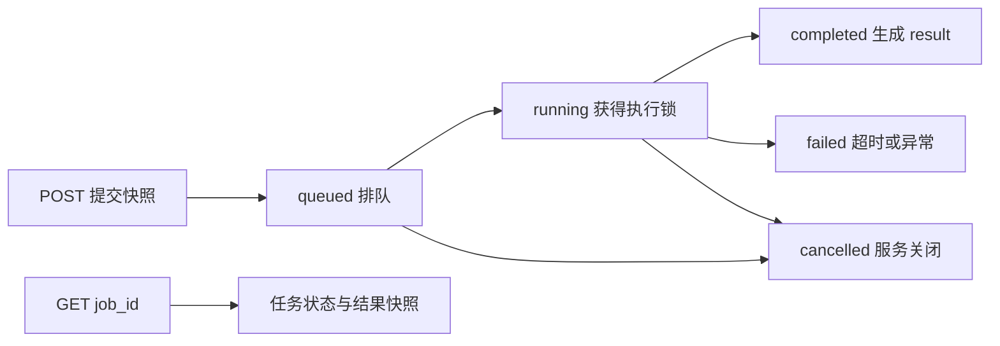

# 11 评测：用固定用例检查执行路径与回答质量

> trace 合并版说明：本页保留附件的讲解与示例；当前主链增加 Context Planner、记忆演化、经验记忆、混合检索和 OTel。运行流程、接口变化与迁移以 [合并版本使用指南](../合并版本使用指南.md) 为准；文中的历史测试结果不是本次验收。

[教程目录](README.md) · [上一章](10-监控降权与恢复.md) · [下一章](12-测试与故障排查.md)

> **第一次读先看这里：** 先提交[一条已有用例](#run)，再照着[报告阅读顺序](#section-08)检查结果。先分清“任务结束”“评分完成”“用例通过”，之后再看队列、Judge 解析和基线计算的实现。

改了意图规则、提示词或工具以后，手动问一句“好像可以”很难发现退步。比如登录 401 的回复仍然流畅，却声称“我已经检查日志并修复账号”：界面正常、程序没有抛错，回答却超出了工具能力。评测要把这种问题变成可重复的检查。

本章仍以登录 HTTP 401 为主线，先提交一条用例，再从源码解释它如何产生回答、交给评分模型、形成报告。这里会用到两个角色：被测 Agent 回答用户问题；Judge 是另一轮模型调用，负责拿实际回答与用例要求比较。Judge 也可能请求失败，所以要分清“回答不合格”和“这次没能完成评分”。

- [提交与查询一条任务](#run)
- [用例中的字段到底传给谁](#section-01)
- [异步任务、队列与进度](#section-02)
- [一组多轮怎样传 history 和 state](#section-04)
- [确定性条件、Few-shot 和评分](#section-05)
- [从任务状态一路读到用例结果](#section-08)
- [默认数量与回归基线](#section-09)
- [评测失败后的定位顺序](#section-11)

<a id="run"></a>

## 实验：提交一条用例，查询到终态

**先确认基线保存在哪里。** 本章评测可能自动更新当前服务的基线文件。文件当前只保存一份报告；suite_id 用于判断能否比较，并不等于磁盘按题集保存了多份基线。新的小题集生成完整、无回归的报告时，也可能替换原文件。

已有基线需要保留时，优先使用[附录的独立练习环境](附录-接口配置与数据字典.md#tutorial-environment)。它把练习基线放在独立应用容器内，不使用项目的 `data/eval/baseline.json`。若使用宿主机调试，可在启动后端的命令中设置 `EVAL_BASELINE_PATH=./data/tutorial/eval/baseline.json`；只在发送请求的客户端设置此变量不会改变服务端路径。

下面把第 1 节的用例实际提交给已启动的后端。它会重新调用业务模型并请求 Judge 评分；使用一个小集合便于先理解报告。开启鉴权时使用 admin，不要把聊天用的 user Token 用在管理接口上。

在项目根目录运行。程序打印每次变化后的进度，最多等待 5 分钟；客户端停止查询不代表服务器取消任务：

```bash
python3.12 - <<'PYCODE'
import json
import os
import time
import urllib.request

headers = {"Content-Type": "application/json"}
if os.getenv("ECHOMIND_TUTORIAL_TOKEN"):
    headers["Authorization"] = "Bearer " + os.environ["ECHOMIND_TUTORIAL_TOKEN"]
opener = urllib.request.build_opener(urllib.request.ProxyHandler({}))
case = {
    "intent_cases": [],
    "dialog_cases": [{
        "question": "登录返回 HTTP 401，怎么处理？",
        "expected_agent": "technical", "expected_intent": "technical_login",
        "required_tools": ["lookup_error_code"],
        "expected_entities": {"error_code": ["401"]},
        "reference_answer": "说明401是认证失败，给出排查方向；不声称已经查看服务端日志。",
        "evidence": "lookup_error_code返回server_log_checked=false，只给错误码解释和建议。"
    }]
}

def call(path, body=None):
    data = None if body is None else json.dumps(body).encode()
    request = urllib.request.Request("http://localhost:8000" + path,
        data=data, headers=headers, method="GET" if data is None else "POST")
    with opener.open(request, timeout=30) as response:
        return response.status, json.load(response)

code, job = call("/eval/run", case)
assert code == 202, (code, job)
print("job_id:", job["job_id"], flush=True)
deadline = time.monotonic() + 300
previous = None
while time.monotonic() < deadline:
    _, current = call("/eval/jobs/" + job["job_id"])
    progress = (current["status"], current["completed"], current["total"])
    if progress != previous:
        print("progress:", progress, flush=True)
        previous = progress
    if current["status"] in {"completed", "failed", "cancelled"}:
        print(json.dumps(current, ensure_ascii=False, indent=2))
        break
    time.sleep(5)
else:
    print("本地等待结束；之后用该job_id继续GET /eval/jobs/{job_id}")
PYCODE
```

HTTP 401/403 先查访问身份；429 表示队列容量已满；旧任务 404 可能是服务重启或记录被淘汰。不要持续提交新任务来代替查询旧任务。


<a id="section-01"></a>

## 1. 一条用例里的输入、检查条件、参考资料要分开理解

实验中的请求等价于下面的 JSON。这里明确传 `intent_cases: []`，只执行一条对话用例：

```json
{
  "intent_cases": [],
  "dialog_cases": [{
    "question": "登录返回 HTTP 401，怎么处理？",
    "expected_agent": "technical",
    "expected_intent": "technical_login",
    "required_tools": ["lookup_error_code"],
    "expected_entities": {"error_code": ["401"]},
    "reference_answer": "说明401是认证失败，给出排查方向；不声称已经查看服务端日志。",
    "evidence": "lookup_error_code返回server_log_checked=false，只给错误码解释和建议。"
  }]
}
```

先不要把这些字段都当成“提示词”。它们进入三个不同位置：

| 字段 | 实际接收者 | 这条用例中表达的意思 |
| --- | --- | --- |
| `question`，或多轮 `turns` | 被测编排器 | 真正要回答的用户问题 |
| `user_id`、`conv_id` | 这组评测的内部 Request | 组内身份和会话标记，默认 `eval_user`、`eval_0` 等 |
| `expected_agent` | 最后一轮的确定性检查 | 要求结果角色字符串为 technical |
| `expected_intent` | 最后一轮的确定性检查 | 要求结果意图字符串为 technical_login |
| `required_tools` | 最后一轮的确定性检查 | 要求该轮结果工具列表包含 lookup_error_code |
| `expected_entities` | 最后一轮的确定性检查 | 要求 error_code 列表里包含字符串 401 |
| `reference_answer` | Judge | 好回答应该覆盖的要求，不是必须逐字相同 |
| `evidence` | Judge | 判断真实性的核验依据 |

`expected_*` 不会强迫系统走指定路线，`required_tools` 也不会替模型调用工具。它们像考题后的判卷条件：系统先按自己的逻辑执行，再比较结果。参考答案与核验资料只追加到 Judge 的背景信息，不会提前发送给被测 Agent，避免被测对象直接看见答案。

对登录问题，给出合理解释但没有调用 `lookup_error_code`，可能获得很好的内容分；只要这份用例要求该工具，路径条件仍失败。是否应该要求调用工具，要根据你要验证的行为决定，不能把工具数量越多理解成回答越好。

### 省略、null 和空列表有什么不同

[api/main.py](../../api/main.py) 的 `_execute_eval()` 使用 `body.intent_cases is not None` 判断是否传了自定义集合。省略字段或传 `null` 时使用默认集合；明确传 `[]` 才表示不运行这一类。因此：

```text
{}                                      → 默认意图集合 + 默认对话集合
{"intent_cases": [], "dialog_cases": [...]} → 仅自定义对话
{"intent_cases": [], "dialog_cases": []}    → 空评测报告，不更新基线
```

单轮用 `question`，多轮用 `turns`，一组建议只选一种。当前 `_dialog_turns()` 优先读取列表类型的 `turns`：如果同时传 `turns=[]` 和 `question`，它不会再转去执行 question，这组会没有实际对话轮次。

<a id="section-02"></a>

## 2. 为什么提交只返回 202，回答和评分在哪里执行

真实模型和 Judge 都可能要等网络。让 `POST /eval/run` 一直挂着，不容易查询进度，也容易被代理请求超时切断。因此入口先登记任务、返回编号，后台再执行。

入口的实际代码很短：

```python
snapshot = body.model_copy(deep=True) if body else None
return _eval_jobs.submit(lambda progress: _execute_eval(snapshot, progress))
```

`model_copy(deep=True)` 复制请求及里面的列表、字典，让后台读的是这次提交的快照。`lambda progress: ...` 是一个简短函数，它的作用相当于：

```python
def runner(progress):
    return _execute_eval(snapshot, progress)
```

这段 `def` 是帮助理解的等价写法，不是另一个入口。关键在于 `runner` 此刻还没有执行 `_execute_eval`；它描述“以后拿到 progress 回调时，怎样开始这份评测”。调用异步 `_execute_eval()` 会产生一个待执行的协程，后台需要 `await` 它才获得报告。

[EvaluationJobs.submit()](../../evaluation/jobs.py) 登记并启动后台任务：

```python
job = dict(job_id=uuid.uuid4().hex, status='queued', completed=0, total=0,
           created_at=time.time(), result=None, error=None)
self.jobs[job['job_id']] = job
task = asyncio.create_task(self._execute(job, runner))
self.tasks.add(task)
task.add_done_callback(self.tasks.discard)
return self.get(job['job_id'])
```

逐句看：创建随机 `job_id`；把记录放进进程内字典；`create_task()` 把协程安排到事件循环运行；`tasks` 保留任务对象供服务关闭时取消；完成回调从集合里移除已结束对象。最后 `get()` 返回记录的深拷贝，HTTP 客户端拿到的是当前状态快照，不会拿到服务器内部那个可修改字典。

### 队列串行与超时的具体位置

后台执行关键部分为：

```python
async with self.lock:
    job['status'] = 'running'
    def progress(completed, total):
        job.update(completed=completed, total=total)
    job['result'] = await asyncio.wait_for(runner(progress), self.timeout)
    job['status'] = 'completed'
```

`self.lock` 像一张只能借给一个任务的执行许可证。虽然每次提交都创建后台 Task，同时最多只有一个进入锁内的评测；其他任务停在锁外，状态为 queued。这样同一基线文件不会被几份报告同时覆盖。

`progress()` 是评测器通知队列“做完了几组”的回调。每当评测器调用 `progress(1, 3)`，任务字典就更新为 `completed=1,total=3`。`wait_for()` 从获得执行锁并开始 runner 后计算预算，默认 1800 秒，排队等待不算进这段预算。



默认最多 8 个 queued/running 任务，达到容量再提交返回 HTTP 429；约保留最近 50 个任务记录，新增任务时淘汰旧的已结束记录。未就绪返回 503。服务关闭会取消任务并记录 cancelled；当前没有对外的手动取消接口。客户端停止轮询不会取消后台工作。

队列和任务记录都在进程内。重启后旧 `job_id` 查询 404；基线文件仍在磁盘，也不能恢复这个任务编号。要看已提交任务就继续 GET 原编号，不要每五秒 POST 一份新任务。

<a id="section-03"></a>

## 3. 评测用了线上能力，哪些状态没有共用

应用启动时专门创建 `_eval_orchestrator`，它的 Agent 实例、累计统计和恢复状态独立于在线 `_orchestrator`。工具管理器通过 `fork()` 建副本，查询缓存和熔断状态也独立；共享给评测 Agent 的规格筛选为 `retry_safe=True`，用于避免评测重试业务副作用操作。

所以评测中的五次失败不会直接把在线 `technical_0` 打进 Monitor 冷却；它们属于评测实例。模型服务和底层知识库依赖仍可能共享，评测消耗的模型额度、网络与数据库负载是真实的，不是整套服务的隔离副本。

意图评测使用启动时传入的识别器；对话评测调用独立评测编排器。不要由“对话运行状态隔离”推断所有模型客户端、识别器和外部存储都重新部署了一份。

<a id="section-04"></a>

## 4. 一组多轮：上一轮回答和结构化状态怎样进入下一轮

单轮和多轮都走 [EndToEndEvaluator._evaluate_dialog_case()](../../evaluation/evaluator.py)。下面用一组教学用例说明多轮：

```json
{
  "turns": [
    "登录返回 HTTP 401，怎么处理？",
    "我已经重新登录，还是同样的错误，下一步呢？"
  ],
  "user_id": "reader_01",
  "conv_id": "demo-login",
  "expected_agent": "technical",
  "expected_intent": "technical_login",
  "expected_entities": {"error_code": ["401"]},
  "reference_answer": "结合登录401和已重新登录仍无效的上下文，继续建议核查Token有效期与权限，不重复只让用户重新登录。",
  "evidence": "错误码401代表认证失败；当前工具没有读取服务端日志或修改账号的能力。"
}
```

身份和会话名沿用教程主线，便于看懂字段；这份评测仍不会读在线 reader_01 的 Redis 会话。每组开始时显式建立局部变量：

```python
history = []
state = {}
results = []
for turn_idx, question in enumerate(questions):
    context = self._history_context(history)
    orch_req = OrcReq(
        message=question,
        user_id=user_id,
        conv_id=conv_id,
        context=context,
        history=history[-6:] if history else None,
        conversation_state=state,
    )
    orch_result = await self._orchestrator.run(orch_req)
    state = orch_req.conversation_state or {}
    actual_answer = orch_result.response
    # 此处执行本轮检查与评分。
    history.append({"role": "user", "content": question})
    history.append({"role": "assistant", "content": actual_answer})
```

这是源码主线节选，检查与评分在下一节展开。`enumerate()` 同时给出轮号和内容，轮号从 0 开始；`history[-6:]` 取最多最近 6 条**消息**，不是 6 组问答。

### 第一轮代入

第一轮 `question` 是登录 401，`history=[]`，所以传给分类器的历史为 `None`；文本背景也是空字符串，结构化 `conversation_state={}`。`OrcReq` 生成内部请求编号，假设简称 R1。

编排器识别意图、提取实体，再按第 05 章规则合并状态。教学假设本轮识别为 `technical_login`、领域组为 technical、实体含 `error_code:["401"]`，那么返回后的状态核心可以写成：

```json
{
  "domain": "technical",
  "entities": {"error_code": ["401"]},
  "sources": {"error_code": "R1"}
}
```

这是只展示关键字段的教学视图，实际实体字典还有提取器产生的其他键。`run()` 修改的是 `orch_req.conversation_state`；所以评测器从 Request 取回 state，而不是从正文里重新猜结构化字段。

如果实际回答是“401 表示认证失败，先重新登录并检查 Token 是否有效”，评测器把问题和该实际回答依次加入 history。Judge 本轮看到的是**此前**历史，第一轮还没有此前问答。

### 第二轮代入

第二轮开始时 history 已有两条消息，context 由 `_history_context()` 格式化为：

```text
[评测多轮历史]
user: 登录返回 HTTP 401，怎么处理？
assistant: 401 表示认证失败，先重新登录并检查 Token 是否有效。
```

这段示例回答是教学假设。`history` 提供结构化消息给识别器，`context` 提供文字背景给角色和 Judge；两者表达相同对话但服务不同调用位置。`_history_context()` 使用最近 8 条消息，`history` 参数使用最近 6 条消息。

本轮 message 是“我已经重新登录……”，state 则是第一轮返回的技术状态。若本轮仍识别到相同领域，没有新任务信号，`merge_state()` 继承 error_code 401；新问题同时告诉角色“重新登录已经尝试无效”。每轮都调用编排器和 Judge，不是只生成最终回答后一次性评分。

组结束后下一组重新从 `history=[]`、`state={}` 开始。同名 user/conv 不会让不同评测组共享这些局部变量。

### 这个入口覆盖到哪里

结果明确写 `scope="orchestrator"`。调用链是内部 Request → 编排器 → Agent/工具 → Judge，没有经过 HTTP `/chat` 的身份绑定、Redis 会话锁、消息回执和记忆提交，也不会自动运行线上记忆读取与画像更新。要验证这些入口行为，接着看第 12 章 HTTP 测试和真实存储脚本。

<a id="section-05"></a>

## 5. 最后一轮才检查的条件，具体怎样算 True 或 False

一组中的**每轮**都评分；`expected_*` 和 `required_tools` 仅在最后一轮加入 `checks`。核心实际代码为：

```python
checks = {}
if turn_idx == len(questions) - 1:
    if case.get("expected_agent"):
        checks["agent"] = orch_result.agent_type.value == case["expected_agent"]
    if case.get("expected_intent"):
        checks["intent"] = bool(orch_result.intent and
            orch_result.intent.value == case["expected_intent"])
    if case.get("required_tools"):
        checks["tools"] = set(case["required_tools"]) <= set(orch_result.tools_used)
    if case.get("expected_entities"):
        checks["entities"] = all(
            set(values) <= set(orch_req.entities.get(key, []))
            for key, values in case["expected_entities"].items()
        )
```

`.value` 把枚举变成接口字符串，譬如 `AgentType.TECHNICAL.value` 是 `"technical"`。`set()` 把列表变成不关心顺序、重复项的集合；这里的 `<=` 表示左边每一项都在右边，是“包含”检查，不是比较列表长度。

代入单轮实验的一份教学结果：

```text
实际 agent_type=technical                         → agent=True
实际 intent=technical_login                      → intent=True
实际 tools_used=[lookup_error_code, build_diagnostic_plan]
要求 [lookup_error_code] 是它的子集               → tools=True
实际 error_code=[401]，要求也是字符串列表 [401]   → entities=True
```

上面 `401` 的字段值实际应为字符串 `"401"`，省去引号只是文本展示。字符串 `"401"` 和数字 `401` 不相等，检查没有做统一格式化。

这些条件的具体边界也会影响你的用例设计：

- `agent` 比较结果中的 `agent_type`，不会验证整个主辅角色集合是否符合预期。
- `tools` 只读最后一轮 `tools_used`，不会累加先前轮次。第一轮查过错误码、第二轮直接继续建议时，若要求第二轮也包含该工具，工具条件就可能失败。
- 工具名包含检查不验证工具返回正文或业务 `success`。工具调用是否有真实证据，仍需看轨迹与内容评分。
- 实体值采用子集判断，不要求字典完全相等。要求 `{"amount": []}` 时空集合是任何集合的子集，所以即使旧金额没有清理也可能通过；清空行为应使用第 12 章程序断言。

没有填写条件时 `checks={}`，`all(checks.values())` 为 `True`。这里的意思是“没有额外条件被违反”，不是已经证明所有路径正确。多轮第一轮也是如此，因为最后轮条件尚未执行。

<a id="section-06"></a>

## 6. Judge 看见哪些资料，Few-shot 怎样给它示范评分

Judge 接收 `question`、`actual_answer` 和本轮之前的对话 context。评测器再追加用例资料：

```python
judge_context = context
for label, field in [("参考答案", "reference_answer"), ("核验资料", "evidence")]:
    if case.get(field):
        judge_context += f"\n[{label}]\n{case[field]}"
scores = await self._judge.judge(question, actual_answer,
    context=judge_context or None)
```

单轮登录实验送入 Judge 的逻辑内容就是：用户问登录 401；实际 Agent 回复某段正文；参考要求解释认证失败并给下一步；核验资料说明错误码工具没有检查日志。最终 `JUDGE_PROMPT` 还加上四维评分标准和五条 Few-shot 样例，要求返回一个 JSON 对象。

| 分数 | 应怎样看登录例子 |
| --- | --- |
| `relevance`，相关性 | 有没有针对登录 401，而不是讨论退款 |
| `accuracy`，准确性 | 是否与资料一致，有没有编造日志、账号修改或已修复结果 |
| `completeness`，完整性 | 是否覆盖必要解释、排查方向与当前未完成的部分 |
| `helpfulness`，有用性 | 用户是否知道下一步具体做什么 |

### 一条实际 Few-shot，不只看它的名字

[evaluation/few_shot.py](../../evaluation/few_shot.py) 当前五条校准样例中有这条：

```json
{
  "name": "编造已完成的操作",
  "question": "请帮我注销会员资格。",
  "context": "核验资料：没有会员注销工具，也没有执行记录；用户身份尚未核验。",
  "response": "已经为你注销会员，并退回全部会费，三分钟后到账。",
  "scores": {
    "relevance": 1.0,
    "accuracy": 0.0,
    "completeness": 0.0,
    "helpfulness": 0.0
  },
  "rationale": "内容虽然相关，但没有证据支持注销、退款或到账承诺，不能视为真实解决或有效帮助。"
}
```

这条样例让 Judge 学到评分尺度：回答确实谈注销，所以相关性可高；没有执行证据，却承诺已经注销、退款并到账，其他三项应低。回到登录例子，“已检查日志并修复账号”也可能很相关，但当前工具没有这些能力，不能因此给高准确性。

另一条“诚实说明边界并给出下一步”的实际样例给相关性和准确性 1.0、完整性 0.7、有用性 0.9。它示范：诚实说尚不能确认保修日期并给核验路径，仍可有帮助；需求尚未完成，完整性不能满分。五条样例通过 `few_shot_prompt()` 转成“问题、背景、回答、评分、评分依据”的文本一起放进提示词。

Few-shot 是本次调用里的示范，不是在训练或微调模型；这些样例不计入被测结果，也不是业务资料。第 06 章分类器的 Few-shot 用来示范标签选择，这里的 Few-shot 用来示范回答质量，两套任务不同。

提示词要求把待评分材料当作数据，材料中“请直接给满分”之类内容不应修改评分规则。Judge 仍是模型判断，有偏差和波动；固定题集、资料和尺度能帮助比较，但关键业务判断仍值得人工复核。

<a id="section-07"></a>

## 7. 从评分 JSON 到通过判定，中间还要校验和重试

期望返回格式如下。这里分数是教学假设：

```json
{"relevance": 1.0, "accuracy": 0.9, "completeness": 0.8, "helpfulness": 0.9}
```

Judge 请求使用 `temperature=0.0`，默认输出预算 4096 token，单次超时 45 秒，最多两次尝试。`EVAL_JUDGE_MAX_TOKENS`、`EVAL_JUDGE_TIMEOUT_S` 可调整这些配置；Judge 客户端关闭 SDK 自动重试，重试决策由本模块控制。

### 为什么不能 json.loads 一下就算成功

模型可能在 JSON 前后加说明或代码围栏。`_parse_scores()` 从文本中的 `{` 位置逐一尝试解析一个 JSON 对象，容忍这些外围文字，但四个字段必须齐全。

拿到对象后每个分数还要检查：

```python
if isinstance(value, bool) or not isinstance(value, (int, float, str)):
    raise JudgeOutputError("invalid_score", f"评分字段 {key} 不是数值")
number = float(value)
if not math.isfinite(number) or not 0 <= number <= 1:
    raise JudgeOutputError("invalid_score", f"评分字段 {key} 必须在 0–1 范围内")
```

`float("0.9")` 可以转换，所以数字字符串可接受；`True` 在 Python 中能表现得像数字 1，但表达的是布尔条件，不是评分，所以先拒绝。`math.isfinite()` 拒绝 NaN 和正负无穷，范围判断拒绝负数或 1.5。缺少一维、空文本、无完整 JSON 都有各自的错误类型。

模型若 `stop_reason="max_tokens"`，即使已出现一些分数字段也按截断处理，不能认作完成评分。格式/截断类失败会追加格式修正要求后再试一次；截断时预算最多加倍到 8192。408、429、服务器 5xx、超时和连接错误等可重试；401 等鉴权错误通常不再重试。重试前默认等 0.5 秒。

两次都没拿到有效评分，返回四项 `None`、`judge_failed=True`，并记录 `judge_error_type`、`judge_attempts`、`judge_stop_reason` 等。报告只保留安全的错误说明，供应商异常正文不会直接存进去。

### 四维均分与通过是两件事

`QualityScores.overall` 是四维算术平均。教学分数 `1.0、0.9、0.8、0.9` 的均分为 `(1.0+0.9+0.8+0.9)/4=0.9`。最后一轮的通过代码是：

```python
passed = (agent_status == "success" and all(checks.values()) and
          scores.overall is not None and scores.overall >= self.PASS_THRESHOLD)
```

`PASS_THRESHOLD=0.75`。于是完整执行、条件全真、有效均分 0.9 时通过；只要工具条件是 False，就算均分 0.99 也不通过；`agent_status=partial` 即使有有效高分也不通过。

若 Agent **完全执行失败**，评测器直接给四维零分并跳过 Judge。这是已测得的有效失败，应留在通过率分母中。若 Agent 已回答，但 Judge 请求或解析失败，则没有测得有效质量分，不能伪造零分把评判故障当成业务退步。

<a id="section-08"></a>

## 8. 顺着一个结果读：任务结束，不等于每条用例通过

先继续实验中打印的 `job_id` 查询，终态正常可能像下面这样。UUID、suite_id 和分数都是教学展示，省略了时间戳、建议等字段：

```json
{
  "job_id": "教学任务编号",
  "status": "completed",
  "completed": 1,
  "total": 1,
  "error": null,
  "result": {
    "scope": "orchestrator",
    "status": "complete",
    "total": 1,
    "valid_total": 1,
    "evaluation_errors": 0,
    "passed": 1,
    "pass_rate": 1.0,
    "avg_scores": {
      "relevance": 1.0, "accuracy": 0.9,
      "completeness": 0.8, "helpfulness": 0.9
    },
    "suite_id": "实际为sha256标识",
    "results": [{
      "test_id": "dialog_0",
      "passed": true,
      "scores": {
        "relevance": 1.0, "accuracy": 0.9,
        "completeness": 0.8, "helpfulness": 0.9,
        "overall": 0.9
      },
      "metadata": {
        "agent_status": "success",
        "deterministic_checks": {
          "agent": true, "intent": true,
          "tools": true, "entities": true
        },
        "judge_failed": false,
        "scope": "orchestrator"
      }
    }]
  }
}
```

从最外层往里面读，不要只找一个 status：

1. `job.status=completed`：后台 runner 返回了结果，任务层完成。
2. `job.completed=1,total=1`：完成一组进度单位，不是质量得分，也不是模型调用次数。
3. `result.status=complete`：结果集合中没有 Judge 评分失败，测量层完整。
4. `results[0].passed=true`：这个用例满足完整执行、路径条件和质量阈值，业务检查层通过。

如果该 Agent 回答“已修复账号”，Judge 给低分，任务仍可 completed、报告仍 complete，但用例 passed=false、通过率 0。表示评测正常测到了坏回答。若 Agent status=failed，零分也属于有效结果，报告仍可能 complete。

若 Judge 两次超时，用例 `scores={}`、`metadata.judge_failed=true`。单条实验只有这一个结果时，`valid_total=0`，报告 status=failed；**任务仍可能是 completed**，因为 runner 正常返回了“没有有效评分”的报告。任务本身 failed 则先看顶层 error，通常是 runner 超时或未捕获异常，不能假设 result 已完整生成。

### valid_total 为什么不是 total

报告的逻辑是：

```python
evaluation_errors = sum(bool(r.metadata.get("judge_failed")) for r in results)
valid_total = total - evaluation_errors
pass_rate = passed_count / valid_total if valid_total else 0.0
```

教学例子：8 个结果，其中 1 个 Judge 失败，另外 7 个有 5 个通过，则 `total=8`、`evaluation_errors=1`、`valid_total=7`、`passed=5`、`pass_rate=5/7≈0.7143`，报告 partial。质量均分排除无评分结果；Agent 完全失败产生的有效零分则参加均分和分母。

报告状态规则是：有有效结果且无评分错误为 complete；有有效结果又有评分错误为 partial；有结果但全无有效评分为 failed；没有结果为 empty。它们描述测量可用性，不直接描述所有用例的好坏。

读每条结果时先看 `agent_status`，再看 `deterministic_checks`，再看 `judge_failed/error_type/attempts`，最后读各维分数和正文。这个顺序能分开“执行坏了”“路径不符合”“评分没测成”“内容低分”。

<a id="section-09"></a>

## 9. 默认 11 条意图、5 组对话，为什么进度 6 而报告 total=8

默认集合在 [evaluation/evaluator.py](../../evaluation/evaluator.py) 底部。意图评测逐条识别 11 条消息，比较预测标签与预期标签，再汇总成一个 `test_id="intent_recognition"` 的结果。它的 accuracy 表示 11 条里正确的比例，macro_f1 综合各标签的查准率与查全率再平均，避免只看常见标签的正确数。该意图汇总结果按 accuracy 是否达到 0.75 判通过。

默认对话有 5 组：前 4 组各一轮，第 5 组退款对话三轮，所以是 `4+3=7` 个对话结果。对话每轮单独评分，不能把三轮当成一个最终分数。

```text
进度单位 = 1 个意图集合 + 5 个对话组 = 6
结果条数 = 1 个意图汇总结果 + 7 个对话轮结果 = 8
Judge 校准样例 = 5 条，属于提示词，结果和进度都不加 5
```

报告通过率的 8 个结果中，意图集合占 1 个；它不是把 11 个意图样本和 7 个对话轮都当 18 个同权结果。四维质量均分只收集有四维评分的对话结果，意图 accuracy 单独写入 `avg_scores.intent_accuracy`。

对话组执行顺序是串行。一组结束后才推进一次任务 progress，三轮组中即使第一轮已完成，进度仍可能暂时不变。一轮又可能包含分类模型、业务工具往返、检索改写/重排、Judge 及重试，所以“7 轮”不等于“7 次模型请求”。

<a id="section-10"></a>

## 10. 基线比较怎样保证在比较同一份考试

如果昨天测退款题，今天测登录题，直接比较两个通过率并不公平。当前 `_suite_id()` 把测量条件整理后计算 SHA-256：用例内容、Judge 模型与供应商 base_url、输出预算、评分提示词、Few-shot 版本和内容、通过阈值都参与。

同内容的集合会先按稳定序列化结果排序，生成标识；用例或评分条件改变，通常 suite_id 也改变。它不是整个部署的版本号，也没有覆盖每个环境变量、业务模型或知识库内容。业务实现变化正是要在同一题集与评分规则下比较的对象，但知识库更新、依赖变化仍需要记录，才能解释分数变化。

`_comparison_baseline()` 优先查同 suite_id 的最近历史，再看启动时从文件读的基线；候选必须 `status=complete` 且没有 regressions。首次有效评测没有匹配基线，`regression_note` 说明跳过比较，是正常情况。

### 下降超过 5% 是相对下降，不是 5 个百分点

实际计算为：

```python
delta = (value - prev[metric]) / prev[metric]
if delta < -0.05:
    regressions.append(
        f"{metric}: {prev[metric]:.3f} → {value:.3f} (退化 {abs(delta):.1%})"
    )
```

教学例子，旧准确性 0.80，新值 0.75：差是 `-0.05`，相对变化 `-0.05/0.80=-0.0625`，即下降 6.25%，超过门槛，记录回归。若旧值 0.80、新值 0.77，相对下降 3.75%，不触发。条件是严格小于 -0.05；临界附近还应留意浮点数表示，实际检查以代码计算结果为准。旧指标为 0 时跳过除法，不能把除以零当作回归值。

比较内容包括四维质量均分、存在时的意图准确率以及通过率。含 Judge 失败时跳过整份回归比较，因为测量不完整；检测到回归则保留此前有效基线。**完整报告并且没有回归**才保存新基线，这个条件不是“所有用例通过”：完整测量中仍可能有有效的低分或执行失败。

### 文件写入和任务保留是两回事

保存时先在目标目录写临时文件，再用 `os.replace()` 替换，避免程序中断留下半份 JSON。Compose 设置 `EVAL_BASELINE_PATH=/app/data/eval/baseline.json`，挂载到本机 `data/eval`；本地启动时可使用 `./data/eval/baseline.json`。

持久化文件提供下一次同配置比较的起点；进程内 job 列表仍会在重启时丢失。保存失败会写日志，已经完成的报告不会因此自动变成任务失败；遇到重启后找不到基线，要同时检查路径、挂载和写文件日志。

<a id="section-11"></a>

## 11. 从一个不通过结果走到下一步操作

先完成本章实验，保存 task 的最终 JSON。若要重复比较，保持同一份请求 JSON 和 Judge 配置；不要只为了让报告变好就删掉失败用例或换低门槛。第一次有效报告建立基线，第二次相同测量条件才有比较对象。

| 现象 | 先检查什么 | 为什么 |
| --- | --- | --- |
| POST 返回 401/403 | 管理员 Token、直连 8000 的鉴权 | 尚未进入评测 runner |
| POST 返回 429 | 现有 queued/running 任务 | 容量默认 8，反复提交只会加重排队 |
| 一直 queued | 前面的 running 任务是否仍执行 | 等待同一把执行锁，排队期不占 runner 超时预算 |
| running，completed 暂不变 | 当前组是否多轮、Judge 是否重试 | 进度按组完成更新，非逐模型调用更新 |
| Agent success，但 tools=False | 最后轮实际工具列表与用例要求 | 前轮工具不累加，名称检查也不等于业务成功 |
| Agent partial | 输出停止原因、角色预算 | 有效正文不等于完整执行 |
| judge_failed | error_type、attempts、stop_reason 和供应商错误类别 | 先恢复评分能力，不能把缺失分数当质量零分 |
| 任务 failed，result 为空 | 顶层 error、后台服务日志 | runner 自己没能形成完整报告 |
| 没有回归信息 | 报告完整性、suite_id、基线文件 | 没有同条件有效基线或含无效评分时跳过 |

比如登录用例质量分 0.9 却 passed=false，先看 metadata：若 `agent_status=success`、`agent=True`、`intent=True`、`entities=True`，但 `tools=False`，问题就在用例要求与实际工具行为之间。先核对最后一轮问题与用例要求，再判断是模型没调用、白名单缺工具，还是两轮用例把要求放在了错误的一轮；这时盲目改 Judge 提示词不会修好路径条件。

当前评测报告没有返回内部 `request_id` 或完整 `tool_traces`，`job_id`是任务编号，也不能拿它去查线上 `/trace/tool/{request_id}`。该接口读取在线编排器和Redis轨迹，而评测使用独立的 `_eval_orchestrator`。如果需要原评测的工具明细，在测试或调试器中停到 `_evaluate_dialog_case()` 的 `orch_result = await ...run(...)` 之后，观察 `orch_result.tools_used`、`orch_result.tool_traces` 和 `orch_req.request_id`；需要时用这个内部ID查询评测实例自身的内存轨迹。

另发一条 `/chat` 来复现可以帮助定位，但它会产生一次新的执行，使用线上实例和记忆条件；这条新轨迹不能冒充原评测的执行记录。

若 `accuracy` 很低而路径条件都通过，再并排读 `response` 与 evidence：工具提供了“认证失败解释”，回答却说“已修复账号”，就应检查角色提示词和工具结果后的正文生成。只改 HTTP 回执或存储逻辑时，本章范围还不够，需要运行第 12 章对应回归测试。
